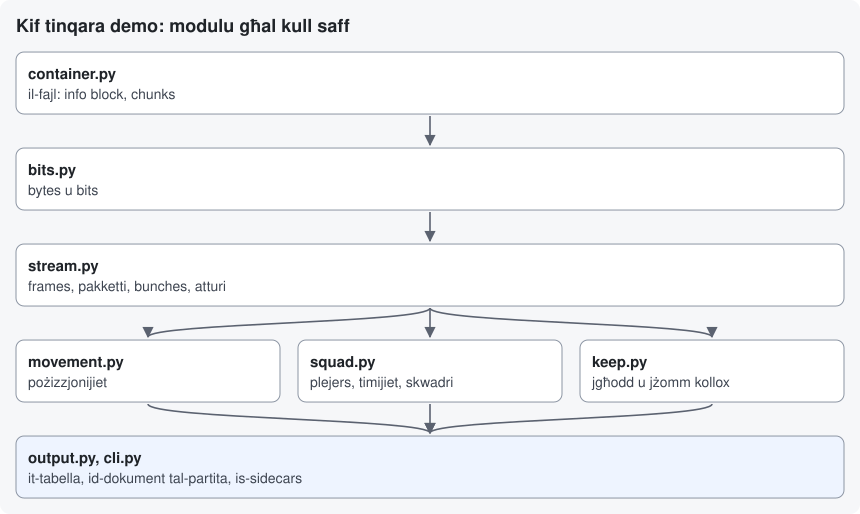

# Kif tinqara demo {#how-a-demo-is-read}

Bil-kliem sempliċi: server ta' Squad jibgħat il-pożizzjoni ta' kull plejer lil kull plejer ieħor. Il-fajl tad-demo huwa reġistrazzjoni ta' dak it-traffiku. Din l-għodda terġa' ddoqqu u tniżżel min kien fejn.



Replay tan-network ta' Unreal huwa t-traffiku tar-replikazzjoni proprju tas-server, miktub mid-demo driver tiegħu. Li taqra waħda tfisser li taqra dak it-traffiku kif jagħmel klijent.

| Modulu | Saff |
|---|---|
| `container.py` | Il-fajl tal-local file streamer: info block (magic `0x1CA2E27F`), imbagħad chunks. It-tipi ta' chunk huma l-header (`FNetworkDemoHeader`, magic `0x2CF5A13D`), id-dejta tar-replay, checkpoints u avvenimenti. |
| `bits.py` | Arkivji tal-bytes għall-frames u arkivji tal-bits għall-pakketti. Il-pakketti jinqraw bl-iżgħar bit l-ewwel. |
| `stream.py` | Frames, pakketti, bunches (bunches parzjali magħquda), actor channels, actor spawns u content blocks. Kull block iżomm proprjetajiet irreplikati bħala handle, għadd ta' bits u bits, imbagħad sejħiet remoti u oqsma custom-delta bħala handles fil-grupp `_ClassNetCache` tal-klassi. L-oġġetti li l-exports ma jsemmux jingħataw il-klassi tagħhom darba li d-demo kollha tkun moqrija (ara hawn taħt). |
| `movement.py` | Il-`FRepMovement` tal-magna, u l-moviment tal-elikopters ta' Squad. |
| `keep.py` | Kull oġġett li ltaqa' miegħu, magħdud u miżmum: ir-ringieli tas-sidecars u s-self-check. |
| `squad.py` | Liema klassijiet ta' Squad iġorru x'. `SQPlayerState` iżomm l-isem, l-istat tat-tim, l-istat tal-iskwadra u l-pawn kurrenti; `SQTeamState` in-numru tat-tim u l-fazzjoni; `SQSquadState` in-numru tal-iskwadra. Is-sid ta' pawn ta' sit huwa l-vettura tiegħu. |
| `output.py`, `cli.py` | It-tabella u d-dokument tal-partita. |

Replay jisimma l-oqsma tiegħu stess. Iġorr il-paths tal-klassijiet u l-ismijiet tal-proprjetajiet għal kull handle, u l-paths tal-oġġetti li jirreferi għalihom. Għalhekk kull proprjetà tista' tinstab skont l-isem mingħajr il-kodiċi tal-logħba. Biss il-bits ta' proprjetà jeħtieġu t-tip tagħha. Għal moviment dak huwa t-tip proprju tal-magna; għall-proprjetajiet ta' Squad it-tipi huma sempliċi: strings, integers, referenzi għal oġġetti u ismijiet.

Xi oġġetti huma msemmija minnhom infushom biss: l-atturi ta' livell bl-isem tal-istanza tagħhom (`Team1SpawnPoint3`), il-komponenti bi tagħhom (`MovementComponent`, `wheel_L1`). Il-klassi tagħhom tinstab mit-tabelli tal-export, wara l-istream: id-demo driver jesporta l-qasam ta' klassi fil-frame fejn tintbagħat għall-ewwel darba (veru f'kull ewwel bagħta ta' oġġett bl-isem fid-demos tat-test), għalhekk il-klassi hija l-grupp wieħed li esporta eżatt dawk il-handles fil-frames fejn l-oġġett bagħathom l-ewwel; inkella kull grupp li kellu l-handles kollha tiegħu sa dak iż-żmien, meta kollha jagħtuhom l-istess ismijiet; inkella l-klassi ta' oġġett bl-istess isem, mingħajr in-numri, jew l-uniku grupp li ismu jinkludi dak tal-oġġett. Mill-handles ta' oġġetti msemmija hekk li l-klassi tagħhom tibgħathom b'għadd fiss ta' bits, kollha ġew b'dak l-għadd (ebda wieħed b'ieħor). Dak li ebda wieħed minn dawn ma jiddeċiedi jibqa' fis-sidecar tal-entities, sħiħ.

## Id-dekodifikar tal-proprjetajiet {#decoding-properties}

Kull proprjetà rreplikata hija ddekodifikata safejn jgħidu l-bits tagħha x'inhi: bit wieħed flag, referenza għal oġġett (in-net GUID tiegħu) fejn l-isem jispiċċa bħal dak ta' referenza (`...State`, `...Seat`, `...Pawn`, `...Class`...), tul u dak l-għadd ta' bytes string, isem, 8/16/32/64 bits numru (float fejn l-isem tal-proprjetà jgħid hekk: saħħa, ħin, rata, input...), kull ħaġa oħra l-bits tagħha f'hex bl-istrings misjuba ġewwa. Is-sejħiet remoti jinqraw bl-istess mod, skont l-ismijiet tal-parametri li d-demo tesporta għal kull funzjoni.

## Kif jinqraw l-avvenimenti {#how-the-events-are-read}

`Health` u `bWounded` ta' suldat jiġu mis-server: midrub meta `bWounded` jixgħel, irrevivat meta jintefa b'saħħa 'l fuq minn 0, mejjet meta s-saħħa tinżel taħt -100 (plejer li jċedi jew jitlef id-demm jitqiegħed fuq -300); bot, qatt midrub, imut f'0. Vettura jew deployable hija `damaged` f'kull waqgħa ta' `Health` tagħha, `destroyed` f'0 jew taħt. L-ispawns u t-tneħħijiet huma l-ftuħ u l-għeluq tal-actor channel; sit huwa `CurrentSeat` tal-player state (referenza għall-komponent tas-sit, li tintbagħat fuq il-vettura tiegħu). Il-pitch tal-vista huwa `RemoteViewPitch` tas-suldat, byte minn dritt 'l isfel (0) sa dritt 'il fuq (255). Sparatura hija `MulticastFireProjectile` ta' arma (oriġini u direzzjoni), jew `MulticastFireMultipleProjectileEffects` tagħha fejn ma kienet ġiet ebda sejħa bħal din bl-istess direzzjoni; daqqa hija `MulticastPlayDamageEffects` ta' vettura (post tal-impatt, tip ta' dannu).

## X'ġie vverifikat, u kif {#what-was-verified-and-how}

Dawn ġew ikkontrollati kontra żewġ demos pubbliċi ta' servers ta' Squad v10.3.1 (Unreal Engine 5.5.4, engine network version 36), mill-fixtures tat-test tal-proġett squad-replay:

- **Għadd.** L-għadd ta' frames, pakketti, actor opens, export groups u paths ta' oġġetti esportati jaqbel eżatt mal-parser indipendenti ta' dak il-proġett. Hekk ukoll l-għadd tal-kampjuni tal-moviment tas-suldati.
- **Moviment kontra veloċità.** Il-pass ta' kull kampjun ta' suldat mill-preċedenti, diviż bil-ħin bejniethom, jaqbel mal-veloċità li jġorr il-kampjun. Ir-razzjo medjan huwa bejn 0.8 u 1.2 fuq plejers li jiċċaqalqu.
- **Timijiet kontra blueprints.** It-tim ta' kull ringiela huwa t-tim li l-fazzjoni tiegħu fiha l-blueprint tas-suldat. Dan żamm għal plejer li biddel naħa matul il-partita.
- **Żbalji.** Żball wieħed tal-istream għal kull demo jibqa': bit żejjed fl-aħħar tal-bunch tal-ftuħ tal-attur spettatur proprju tar-recorder, li ma jġorr xejn użat hawn.
- **Vittmi kontra l-qtil ta' dak il-proġett.** Kull qtil li jelenka huwa ferita jew mewt moqrija hawn, fl-istess ħin u tal-istess plejer; il-qtil tiegħu ta' vetturi huma vetturi moqrija hawn li jilħqu saħħa 0 jew taħt.
- **Deployables.** L-atturi moqrija hawn b'build state jew rekwiżit FOB jaqblu mad-deployables ta' dak il-proġett, sa wieħed.
- **Pitch.** Il-byte tal-pitch tal-vista jinsab madwar 120 fil-mistrieħ u jilħaq 255 (dritt 'il fuq): moqri bħala byte fuq -90..+90. Moqri bħala l-byte tas-soltu tal-magna ta' dawra sħiħa, ipoġġi suldati sa 128 grad taħt l-orizzont, li ma jistgħux iħarsu.
- **Bots.** Fuq demo ta' seeding kull bot (`SQSquidBot`) għandu t-track tiegħu, u l-bots li jmutu jinqraw bħala mwiet.
- **Moviment tal-elikopters** (`SQHelicopterMovementComponent.ReplicatedMovement`, layout proprju ta' Squad: ebda flags, il-lokazzjoni f'mijiet, il-veloċità u l-veloċità angolari, tliet angoli 16-bit fakultattivi, l-arloġġ tas-server bħala float). Kull kampjun ta' elikopter jimla l-bits tiegħu eżatt. Il-lokazzjoni u l-yaw ta' elikopter parkjat huma dawk tal-ispawn tiegħu, sa ċentimetru u unità ta' angolu. Fit-titjira, il-pass bejn kampjuni fuq il-pass tal-arloġġ huwa l-veloċità (razzjo medjan 0.997), u l-arloġġ jimxi mal-ħin tad-demo (medjan 0.4 ms bogħod). Il-veloċità angolari ssegwi r-rata tal-yaw (korrelazzjoni 0.91), imma l-unità tagħha mhix stabbilita: tinżamm, mhux użata.
- **Sits.** `CurrentSeat` ta' player state huwa referenza (net GUID ippakkjat), mhux numru kif kien moqri qabel: moqri hekk, f'kull bidla huwa s-sit li `MulticastUpdateCurrentSeat` tas-suldat innifsu jsemmi mument qabel, u l-bidliet huma ta' squad-replay.
- **Sparaturi u daqqiet.** Kull `ShootDir` huwa vettur unitarju (tul 1 sa 0.00003); kull oriġini ta' `MulticastFireMultipleProjectileEffects`, diviża b'10, hija l-`OriginZeroBased` ta' `MulticastFireProjectile` li taqbel sa 1 mm; fejn il-pożizzjoni tal-shooter jew tal-vettura li ħadet id-daqqa hi magħrufa, l-oriġini tal-isparatura jew l-impatt huma medjan ta' 0.45 m minnha.
- **Inputs tal-vetturi.** Moqrija bħala floats, ix-throttle, il-brake u l-handbrake tal-vetturi tracked jinsabu f'0..1 u l-isteering f'-1..1, f'kull aġġornament.
- **Raġunijiet tal-għeluq.** Kull attur li l-channel tiegħu nfetaħ mill-ġdid kien ingħalaq b'`Dormancy`; ebda wieħed magħluq b'`Destroyed` ma nfetaħ mill-ġdid.

Testijiet fuq demos mibnija mit-testijiet infushom ikopru l-container, l-arkivji, l-istream u t-triq kollha sat-tabella, u li demo li żżomm wieħed minn kull tip ta' oġġett ma titlef ebda wieħed ([`tests/test_completeness.py`](https://github.com/Holdi601/3DHeat-Ext-Squad/blob/main/tests/test_completeness.py)):

```bash
python -m pip install -e .[test]
pytest                                   # synthetic demos
HEAT3D_SQUAD_DEMOS=<folder> pytest       # plus real demos in that folder
```
