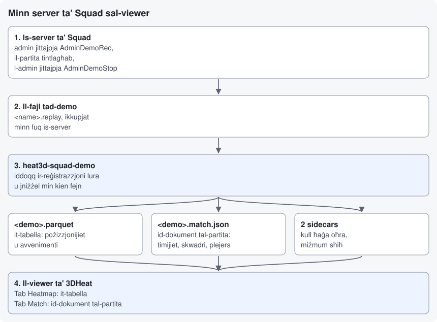

# 3DHeat Squad {#dheat-squad}

**X'inhi?** Programm żgħir li jibdel reġistrazzjoni ta' partita ta' Squad f'fajls li
l-viewer ta' [3DHeat](https://github.com/Holdi601/3DHeat)
([dokumentazzjoni](https://holdi601.github.io/3DHeat/)) jista' jpinġi: fejn kien
kull plejer, sekonda b'sekonda, u x'ġara fejn.

**Għaliex nużah?** Biex tara partita minn fuq: fejn seħħet il-ġlieda,
liema rotot ħadu l-iskwadri, fejn mietu l-vetturi.

**Eżempju:** `match.replay` (demo, irrekordjata fuq server ta' Squad) ->
`match.parquet` (ringiela waħda għal kull pożizzjoni jew avveniment) + `match.match.json` (id-dokument
tal-partita: timijiet, skwadri, plejers). L-outputs huma fajls Parquet u JSON ordinarji,
għalhekk kull ħaġa oħra tista' taqrahom ukoll.

Għal xiex huwa utli:

- **Fejn intlagħbet partita.** Il-pożizzjoni ta' kull plejer u bot, a piedi, fi
  vetturi tal-art u f'elikopters, madwar tmien darbiet fis-sekonda, bit-tim,
  il-fazzjoni, l-iskwadra, is-saħħa u l-pitch tal-vista.
- **X'ġara fejn.** Midruba, irrevivati u mwiet; kull sparatura u kull
  daqqa fuq vettura; kull vettura, deployable u emplacement li ħarġu,
  indarbu, inqerdu u tneħħew.
- **Il-partita kollha f'dokument wieħed.** Timijiet, skwadri, l-istat tal-logħba, kull
  attur, linja għal kull plejer u għal kull bot, u self-check li xejn minn dak li fiha
  d-demo ma intilef.



## Tluq malajr {#quick-start}

Ġdid mal-linja tal-kmandi? Aqra [Qabel ma tibda](before-you-start.md) l-ewwel.

```bash
python -m pip install -e .              # installs the heat3d-squad-demo command
heat3d-squad-demo match.replay -o out   # or a folder of .replay files
```

Għandek tara linja waħda għal kull demo. Imbagħad ittrasferixxi `out/<map>/<demo>.parquet` fit-tab Heatmap tal-viewer
([Kif iddaħħal id-dejta](https://holdi601.github.io/3DHeat/getting-data-in.html)).

## Paġni {#pages}

| Paġna | X'tkopri |
|---|---|
| [Qabel ma tibda](before-you-start.md) | Python, terminal, ewwel użu |
| [Tirrekordja demo](recording.md) | kif tagħmel server jikteb demo, u kif issibha |
| [Tikkonverti demos](converting.md) | il-kmand, kull għażla, output ta' eżempju |
| [It-tabella](output-table.md) | kull kolonna u kull `event` |
| [Id-dokument tal-partita u s-sidecars](output-match.md) | il-`.match.json`, iż-żewġ sidecars, is-self-check |
| [Kif tinqara demo](how-it-works.md) | is-saffi tal-qarrej, u x'ġie vverifikat |
| [Limiti, aġġornamenti u termini](limits.md) | x'ma jinqarax, x'jista' jkisser aġġornament ta' Squad, dejta personali, liċenzja |
| [Referenza tal-kmandi](../cli-reference.md) | kull għażla u kolonna, iġġenerata mill-kodiċi |
| [Iżżomm dawn id-dokumenti](maintaining.md) | il-lista ta' kontroll tar-rilaxx |

## Relatat {#related}

- Il-viewer ta' 3DHeat: [github.com/Holdi601/3DHeat](https://github.com/Holdi601/3DHeat),
  dokumentazzjoni fuq [holdi601.github.io/3DHeat](https://holdi601.github.io/3DHeat/).
- Il-formati tal-fajls li jaqra l-viewer, inkluż il-container ta'
  fajl wieħed għal kull partita: [Fajl wieħed għal kull partita (.3dheat)](https://holdi601.github.io/3DHeat/container.html).
  Dan il-konvertitur jikteb il-fajls separati: it-tabella, id-dokument tal-partita u
  s-sidecars tiegħu ħdejn xulxin.
- Il-Watcher ta' 3DHeat iħaddem dan il-konvertitur fuq demos ġodda meta jkun installat
  (adapter `squad-demos`): [3DHeat Watcher](https://holdi601.github.io/3DHeat-Watcher/).

## L-għodod ta' 3DHeat {#the-3dheat-tools}

| Għodda | X'tagħmel | Kodiċi | Dokumenti |
|---|---|---|---|
| 3DHeat viewer | juri d-dejta: heatmaps, analiżi tat-tlielaq, reviżjoni tal-partiti | [3DHeat](https://github.com/Holdi601/3DHeat) | [docs](https://holdi601.github.io/3DHeat/) |
| GameFiles | livelli u korsijiet mill-fajls proprji tal-logħba | [3DHeat-GameFiles](https://github.com/Holdi601/3DHeat-GameFiles) | [docs](https://holdi601.github.io/3DHeat-GameFiles/) |
| GameCapture | telemetrija tal-lapes, u livelli mibnija mill-ġdid minn vidjow tal-logħba | [3DHeat-GameCapture](https://github.com/Holdi601/3DHeat-GameCapture) | [docs](https://holdi601.github.io/3DHeat-GameCapture/) |
| Unreal Exporter | plugin ta' Unreal Editor: livell bħala `.glb` wieħed | [3DHeat-UnrealExporter](https://github.com/Holdi601/3DHeat-UnrealExporter) | [docs](https://holdi601.github.io/3DHeat-UnrealExporter/) |
| CS2 | demos u mapep ta' Counter-Strike 2 | [3DHeat-CS2](https://github.com/Holdi601/3DHeat-CS2) | [docs](https://holdi601.github.io/3DHeat-CS2/) |
| Watcher | jirrekordja dak li l-logħob jippubblika waqt li tilgħab | [3DHeat-Watcher](https://github.com/Holdi601/3DHeat-Watcher) | [docs](https://holdi601.github.io/3DHeat-Watcher/) |
| Ext-WarThunder | replays ta' War Thunder | [3DHeat-Ext-WarThunder](https://github.com/Holdi601/3DHeat-Ext-WarThunder) | [docs](https://holdi601.github.io/3DHeat-Ext-WarThunder/) |
| Ext-WoT | replays ta' World of Tanks | [3DHeat-Ext-WoT](https://github.com/Holdi601/3DHeat-Ext-WoT) | [docs](https://holdi601.github.io/3DHeat-Ext-WoT/) |
| Ext-WoWs | replays ta' World of Warships | [3DHeat-Ext-WoWs](https://github.com/Holdi601/3DHeat-Ext-WoWs) | [docs](https://holdi601.github.io/3DHeat-Ext-WoWs/) |
| Ext-Squad | demos tas-server ta' Squad | [3DHeat-Ext-Squad](https://github.com/Holdi601/3DHeat-Ext-Squad) | [docs](https://holdi601.github.io/3DHeat-Ext-Squad/) |
| Ext-DCS | mapep ta' DCS World bħala livelli 3D | [3DHeat-Ext-DCS](https://github.com/Holdi601/3DHeat-Ext-DCS) | [docs](https://holdi601.github.io/3DHeat-Ext-DCS/) |
| Ext-IL2 | mapep ta' IL-2 Sturmovik bħala livelli 3D | [3DHeat-Ext-IL2](https://github.com/Holdi601/3DHeat-Ext-IL2) | [docs](https://holdi601.github.io/3DHeat-Ext-IL2/) |
