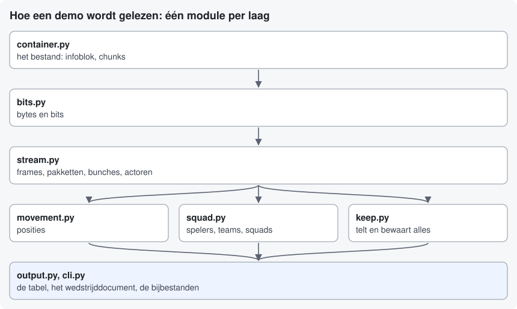

# Hoe een demo wordt gelezen {#how-a-demo-is-read}

In gewone woorden: een Squad-server stuurt de positie van elke speler naar elke andere speler. Het demobestand is een opname van dat verkeer. Deze tool speelt het terug en schrijft op wie waar was.



Een Unreal-netwerkreplay is het eigen replicatieverkeer van de server, opgeschreven door zijn demo-driver. Het lezen ervan is dat verkeer lezen zoals een client het zou doen.

| Module | Laag |
|---|---|
| `container.py` | Het bestand van de lokale bestandsstreamer: een infoblok (magic `0x1CA2E27F`), daarna chunks. De chunksoorten zijn de header (`FNetworkDemoHeader`, magic `0x2CF5A13D`), replaygegevens, checkpoints en gebeurtenissen. |
| `bits.py` | Bytearchieven voor frames en bitarchieven voor pakketten. Pakketten worden van het laagste bit af gelezen. |
| `stream.py` | Frames, pakketten, bunches (gedeeltelijke bunches samengevoegd), actorkanalen, actor-spawns en contentblokken. Elk blok bevat gerepliceerde eigenschappen als handle, aantal bits en bits, daarna remote calls en custom-delta-velden als handles in de `_ClassNetCache`-groep van de klasse. Objecten die de exports niet benoemen, krijgen hun klasse zodra de hele demo is gelezen (zie hieronder). |
| `movement.py` | `FRepMovement` van de engine, en de helikoptermovement van Squad. |
| `keep.py` | Elk tegengekomen item, geteld en bewaard: de rijen van de bijbestanden en de zelfcontrole. |
| `squad.py` | Welke Squad-klassen wat dragen. `SQPlayerState` heeft de naam, de teamstatus, de squadstatus en de huidige pawn; `SQTeamState` het teamnummer en de factie; `SQSquadState` het squadnummer. De eigenaar van een stoelpawn is zijn voertuig. |
| `output.py`, `cli.py` | De tabel en het wedstrijddocument. |

Een replay noemt zijn eigen velden. Hij bevat de klassepaden en eigenschapsnamen voor elke handle, en de paden van de objecten waarnaar hij verwijst. Zo kan elke eigenschap bij naam worden gevonden zonder de code van het spel. Alleen de bits van een eigenschap hebben het type nodig. Voor beweging is dat het eigen type van de engine; voor de eigenschappen van Squad zijn de types eenvoudig: tekst, gehele getallen, objectverwijzingen en namen.

Sommige objecten worden alleen door zichzelf benoemd: de actoren van een level door hun instantienaam (`Team1SpawnPoint3`), componenten door de hunne (`MovementComponent`, `wheel_L1`). Hun klasse wordt na de stream gevonden, uit de exporttabellen: de demo-driver exporteert het veld van een klasse in het frame waarin het voor het eerst wordt verstuurd (dat geldt voor elke eerste verzending van een benoemd object in de testdemo's), dus de klasse is de ene groep die precies die handles exporteerde in de frames waarin het object ze voor het eerst verstuurde; anders elke groep die toen al al zijn handles had, wanneer ze allemaal dezelfde namen geven; anders de klasse van een object met dezelfde naam, zonder de cijfers, of de ene groep wiens naam die van het object bevat. Van de handles van objecten die op deze manier benoemd zijn en waarvan de klasse ze met één vast aantal bits verstuurt, kwamen alle met dat aantal (geen met een ander). Wat geen van deze oplossingen bepaalt, blijft volledig in het bijbestand entities staan.

## Eigenschappen decoderen {#decoding-properties}

Elke gerepliceerde eigenschap wordt gedecodeerd zover de bits zeggen wat ze zijn: één bit een vlag, een verwijzing naar een object (zijn net-GUID) waar de naam eindigt zoals die van een verwijzing (`...State`, `...Seat`, `...Pawn`, `...Class`...), een lengte en zoveel bytes een tekst, een naam, 8/16/32/64 bits een getal (een float waar de naam van de eigenschap dat zegt: gezondheid, tijd, snelheid, invoer...), al het andere zijn bits in hex met de tekst die erin gevonden is. Remote calls worden op dezelfde manier gelezen, aan de hand van de parameternamen die de demo voor elke functie exporteert.

## Hoe de gebeurtenissen worden gelezen {#how-the-events-are-read}

De `Health` en `bWounded` van een soldaat komen van de server: gewond wanneer `bWounded` aangaat, hersteld wanneer hij uitgaat met gezondheid boven 0, dood wanneer de gezondheid onder -100 zakt (een speler die opgeeft of leegbloedt, wordt op -300 gezet); een bot, die nooit gewond raakt, sterft bij 0. Een voertuig of opstelling is `damaged` bij elke daling van zijn `Health`, `destroyed` bij 0 of lager. Spawns en verwijderingen zijn het openen en sluiten van het actorkanaal; een stoel is de `CurrentSeat` van de spelerstatus (een verwijzing naar de stoelcomponent, die op zijn voertuig wordt verstuurd). De kijkhelling is de `RemoteViewPitch` van de soldaat, een byte van recht naar beneden (0) tot recht omhoog (255). Een schot is de `MulticastFireProjectile` van een wapen (oorsprong en richting), of zijn `MulticastFireMultipleProjectileEffects` wanneer geen zo'n call met dezelfde richting kwam; een treffer is de `MulticastPlayDamageEffects` van een voertuig (inslagpositie, schadetype).

## Wat is gecontroleerd, en hoe {#what-was-verified-and-how}

Dit is gecontroleerd met twee openbare Squad v10.3.1-serverdemo's (Unreal Engine 5.5.4, engine-netwerkversie 36), uit de testfixtures van het squad-replay-project:

- **Aantallen.** De aantallen frames, pakketten, actoropeningen, exportgroepen en geëxporteerde objectpaden komen exact overeen met de onafhankelijke parser van dat project. Dat geldt ook voor het aantal bewegingsmonsters van soldaten.
- **Beweging tegen snelheid.** De stap van elk bewegingsmonster van een soldaat ten opzichte van het vorige, gedeeld door de tijd ertussen, komt overeen met de snelheid die het monster draagt. De mediane verhouding ligt tussen 0,8 en 1,2 bij bewegende spelers.
- **Teams tegen blueprints.** Het team van elke rij is het team waarvan de factie bij de blueprint van de soldaat hoort. Dit klopte ook voor een speler die van kant wisselde tijdens de wedstrijd.
- **Fouten.** Er blijft één streamfout per demo: een zwerfbit aan het eind van de openingsbunch van de eigen spectatoractor van de opnemer, die niets draagt dat hier gebruikt wordt.
- **Slachtoffers tegen de doden van dat project.** Elke daar genoemde dode is hier een gelezen verwonding of dood, op hetzelfde moment en van dezelfde speler; zijn voertuigdoden zijn hier gelezen voertuigen die gezondheid 0 of lager bereikten.
- **Opstellingen.** De actors die hier gelezen zijn met een bouwstatus of een FOB-eis, komen overeen met de opstellingen van dat project, tot op één na.
- **Kijkhelling.** De kijkhelling-byte ligt in rust rond 120 en bereikt 255 (recht omhoog): gelezen als byte over -90..+90. Gelezen als de gebruikelijke byte van een volledige draai van de engine, zou ze soldaten tot 128 graden onder de horizon zetten, waar ze niet naar kunnen kijken.
- **Bots.** Op een opwarmdemo heeft elke bot (`SQSquidBot`) zijn eigen spoor, en de bots die sterven, worden gelezen als doden.
- **Helikoptermovement** (`SQHelicopterMovementComponent.ReplicatedMovement`, de eigen indeling van Squad: geen vlaggen, de locatie in honderdsten, de snelheid en de hoeksnelheid, drie optionele hoeken van 16 bit, de klok van de server als float). Elk helikoptermonster vult zijn bits exact. De locatie en de gier van een geparkeerde helikopter zijn die van zijn spawn, tot op de centimeter en de hoekeenheid. In de vlucht is de stap tussen monsters gedeeld door de stap van de klok de snelheid (mediane verhouding 0,997), en de klok loopt mee met de tijd van de demo (mediaan 0,4 ms tussen de stappen). De hoeksnelheid volgt de gier-snelheid (correlatie 0,91), maar de eenheid ervan is niet vastgesteld: ze wordt bewaard, niet gebruikt.
- **Stoelen.** De `CurrentSeat` van een spelerstatus is een verwijzing (een gepakte net-GUID), geen getal zoals eerder gelezen: zo gelezen, bij elke wijziging is het de stoel die de eigen `MulticastUpdateCurrentSeat` van de soldaat even eerder noemt, en de wijzigingen zijn die van squad-replay.
- **Schoten en treffers.** Elke `ShootDir` is een eenheidsvector (lengte 1 binnen 0,00003); elke `MulticastFireMultipleProjectileEffects`-oorsprong, gedeeld door 10, is de `OriginZeroBased` van de bijbehorende `MulticastFireProjectile` binnen 1 mm; waar de positie van de schutter of het getroffen voertuig bekend is, ligt de oorsprong van het schot of de inslag gemiddeld 0,45 m daarvandaan.
- **Voertuiginvoer.** Gelezen als floats liggen de gas, rem en handrem van de rupsvoertuigen tussen 0 en 1 en hun sturing tussen -1 en 1, in elke update.
- **Sluitredenen.** Elke actor waarvan het kanaal opnieuw werd geopend, was gesloten met `Dormancy`; geen enkele die met `Destroyed` was gesloten, werd opnieuw geopend.

Tests op demo's die de tests zelf bouwen, dekken de container, de archieven, de stream en het hele pad naar de tabel, en controleren dat een demo met één van elke soort item geen enkel item verliest ([`tests/test_completeness.py`](https://github.com/Holdi601/3DHeat-Ext-Squad/blob/main/tests/test_completeness.py)):

```bash
python -m pip install -e .[test]
pytest                                   # synthetische demo's
HEAT3D_SQUAD_DEMOS=<folder> pytest       # plus echte demo's in die map
```
