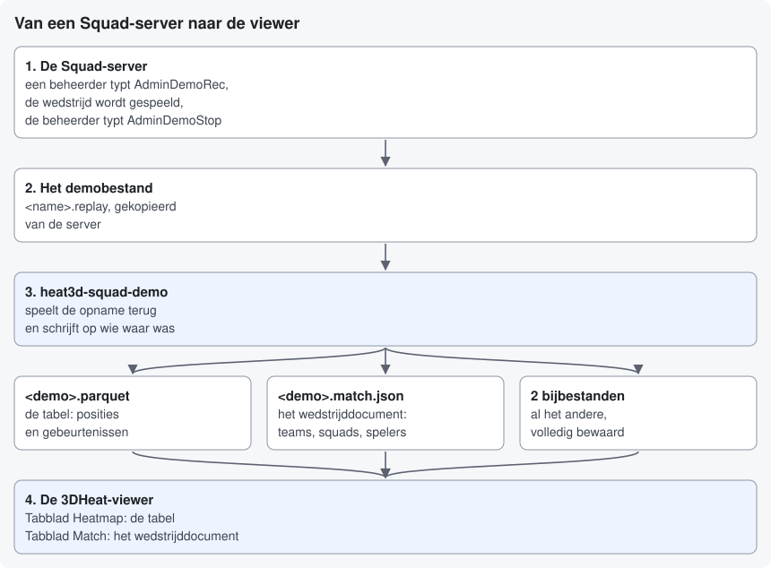

# 3DHeat Squad {#dheat-squad}

**Wat is het?** Een klein programma dat een opname van een Squad-wedstrijd omzet in
bestanden die de [3DHeat](https://github.com/Holdi601/3DHeat)-viewer
([documentatie](https://holdi601.github.io/3DHeat/)) kan tekenen: waar elke speler was, seconde
voor seconde, en wat er waar gebeurde.

**Waarom zou ik het gebruiken?** Om een wedstrijd van bovenaf te bekijken: waar de gevechten waren,
welke routes squads namen, waar voertuigen sneuvelden.

**Voorbeeld:** `match.replay` (een demo, opgenomen op een Squad-server) ->
`match.parquet` (één rij per positie of gebeurtenis) + `match.match.json` (het
wedstrijddocument: teams, squads, spelers). De uitvoer zijn gewone Parquet- en JSON-bestanden,
dus andere programma's kunnen ze ook lezen.

Waarvoor het nuttig is:

- **Waar een wedstrijd gevochten werd.** De positie van elke speler en bot, te voet, in grondvoertuigen
  en in helikopters, ongeveer acht keer per seconde, met team, factie, squad, gezondheid en kijkhoek.
- **Wat er waar gebeurde.** Verwondingen, herstellingen en doden; elk schot en elke treffer op een
  voertuig; elk voertuig, elke opstelling en elke stelling die verscheen, werd beschadigd, vernietigd of verwijderd.
- **De hele wedstrijd in één document.** Teams, squads, de spelstatus, elke actor, een regel per
  speler en per bot, en een zelfcontrole dat niets wat de demo bevat verloren is gegaan.



## Snelstart {#quick-start}

Nog nooit met de opdrachtregel gewerkt? Lees eerst [Voordat je begint](before-you-start.md).

```bash
python -m pip install -e .              # installeert het commando heat3d-squad-demo
heat3d-squad-demo match.replay -o out   # of een map met .replay-bestanden
```

Je ziet één regel per demo. Laad daarna `out/<map>/<demo>.parquet` in het tabblad Heatmap van de viewer
([Gegevens binnenhalen](https://holdi601.github.io/3DHeat/getting-data-in.html)).

## Pagina's {#pages}

| Pagina | Wat die behandelt |
|---|---|
| [Voordat je begint](before-you-start.md) | Python, een terminal, een eerste keer draaien |
| [Een demo opnemen](recording.md) | een server een demo laten schrijven, en die terugvinden |
| [Demo's omzetten](converting.md) | het commando, elke optie, voorbeelduitvoer |
| [De tabel](output-table.md) | elke kolom en elke `event` |
| [Het wedstrijddocument en de bijbestanden](output-match.md) | het `.match.json`, de twee bijbestanden, de zelfcontrole |
| [Hoe een demo wordt gelezen](how-it-works.md) | de lagen van de lezer, en wat er is gecontroleerd |
| [Beperkingen, updates en voorwaarden](limits.md) | wat niet gelezen wordt, wat een Squad-update kan breken, persoonsgegevens, licentie |
| [Commandoreferentie](../cli-reference.md) | elke optie en kolom, gegenereerd uit de code |
| [Deze documentatie onderhouden](maintaining.md) | de checklist per release |

## Verwant {#related}

- De 3DHeat-viewer: [github.com/Holdi601/3DHeat](https://github.com/Holdi601/3DHeat),
  documentatie op [holdi601.github.io/3DHeat](https://holdi601.github.io/3DHeat/).
- De bestandsformaten die de viewer leest, waaronder de container met één bestand per wedstrijd:
  [Eén bestand per wedstrijd (.3dheat)](https://holdi601.github.io/3DHeat/container.html).
  Deze converter schrijft de losse bestanden: de tabel, het wedstrijddocument en
  de bijbestanden naast elkaar.
- De 3DHeat Watcher draait deze converter op nieuwe demo's als hij is geïnstalleerd
  (adapter `squad-demos`): [3DHeat Watcher](https://holdi601.github.io/3DHeat-Watcher/).
- Elke spellezer is een eigen klein project met een eigen licentiebestand, eigen releases en een eigen issuetracker, zodat hij los geïnstalleerd, bijgewerkt, onderhouden - of op verzoek van een rechthebbende teruggetrokken - kan worden, zonder dat de viewer of de andere tools daar iets van merken.

## De 3DHeat-tools {#the-3dheat-tools}

| Tool | Wat die doet | Code | Documentatie |
|---|---|---|---|
| 3DHeat-viewer | toont de gegevens: heatmaps, Race-analyse, wedstrijdanalyse | [3DHeat](https://github.com/Holdi601/3DHeat) | [documentatie](https://holdi601.github.io/3DHeat/) |
| GameFiles | levels en banen uit de eigen bestanden van een spel | [3DHeat-GameFiles](https://github.com/Holdi601/3DHeat-GameFiles) | [documentatie](https://holdi601.github.io/3DHeat-GameFiles/) |
| GameCapture | telemetrie van rondes, en levels opnieuw opgebouwd uit gameplayvideo | [3DHeat-GameCapture](https://github.com/Holdi601/3DHeat-GameCapture) | [documentatie](https://holdi601.github.io/3DHeat-GameCapture/) |
| Unreal Exporter | een plug-in voor de Unreal Editor: een level als één `.glb` | [3DHeat-UnrealExporter](https://github.com/Holdi601/3DHeat-UnrealExporter) | [documentatie](https://holdi601.github.io/3DHeat-UnrealExporter/) |
| CS2 | Counter-Strike 2-demo's en -kaarten | [3DHeat-CS2](https://github.com/Holdi601/3DHeat-CS2) | [documentatie](https://holdi601.github.io/3DHeat-CS2/) |
| Watcher | legt vast wat games publiceren terwijl je speelt | [3DHeat-Watcher](https://github.com/Holdi601/3DHeat-Watcher) | [documentatie](https://holdi601.github.io/3DHeat-Watcher/) |
| Ext-WarThunder | War Thunder-replays | [3DHeat-Ext-WarThunder](https://github.com/Holdi601/3DHeat-Ext-WarThunder) | [documentatie](https://holdi601.github.io/3DHeat-Ext-WarThunder/) |
| Ext-WoT | World of Tanks-replays | [3DHeat-Ext-WoT](https://github.com/Holdi601/3DHeat-Ext-WoT) | [documentatie](https://holdi601.github.io/3DHeat-Ext-WoT/) |
| Ext-WoWs | World of Warships-replays | [3DHeat-Ext-WoWs](https://github.com/Holdi601/3DHeat-Ext-WoWs) | [documentatie](https://holdi601.github.io/3DHeat-Ext-WoWs/) |
| Ext-Squad | Squad-serverdemo's | [3DHeat-Ext-Squad](https://github.com/Holdi601/3DHeat-Ext-Squad) | [documentatie](https://holdi601.github.io/3DHeat-Ext-Squad/) |
| Ext-DCS | DCS World-kaarten als 3D-levels | [3DHeat-Ext-DCS](https://github.com/Holdi601/3DHeat-Ext-DCS) | [documentatie](https://holdi601.github.io/3DHeat-Ext-DCS/) |
| Ext-IL2 | IL-2 Sturmovik-kaarten als 3D-levels | [3DHeat-Ext-IL2](https://github.com/Holdi601/3DHeat-Ext-IL2) | [documentatie](https://holdi601.github.io/3DHeat-Ext-IL2/) |
