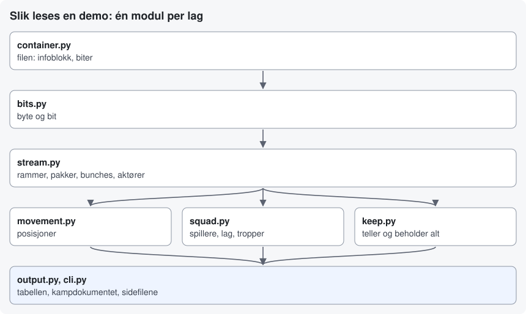

# Slik leses en demo {#how-a-demo-is-read}

Med enkle ord: en Squad-server sender hver spillers posisjon til alle andre spillere. Demo-filen er et opptak av den trafikken. Dette verktøyet spiller den av igjen og skriver ned hvem som var hvor.



Et Unreal-nettverksreplay er serverens egen replikeringstrafikk, skrevet ned av demo-driveren. Å lese det er å lese den trafikken slik en klient gjør.

| Modul | Lag |
|---|---|
| `container.py` | Den lokale filstrømmerens fil: en infoblokk (magisk `0x1CA2E27F`), deretter biter. Bittyper er headeren (`FNetworkDemoHeader`, magisk `0x2CF5A13D`), replaydata, sjekkpunkter og hendelser. |
| `bits.py` | Byte-arkiver for rammer og bit-arkiver for pakker. Pakker leses lavest bit først. |
| `stream.py` | Rammer, pakker, bunches (delvise bunches satt sammen), aktørkanaler, aktør-spawns og innholdsblokker. Hver blokk holder replikerte egenskaper som håndtak, antall bit og bitene, deretter fjernkall og egendefinerte delta-felt som håndtak inn i klassens `_ClassNetCache`-gruppe. Objekter som eksportene ikke navngir får sin klasse når hele demoen er lest (se nedenfor). |
| `movement.py` | Motorens `FRepMovement`, og Squads helikoptermovement. |
| `keep.py` | Alt som møtes, telles og beholdes: sidefilenes rader og selvkontrollen. |
| `squad.py` | Hvilke Squad-klasser som bærer hva. `SQPlayerState` holder navnet, lagstatus, tropp-status og nåværende pawn; `SQTeamState` lagnummeret og fraksjonen; `SQSquadState` troppnummeret. Et sete-pawns eier er sitt kjøretøy. |
| `output.py`, `cli.py` | Tabellen og kampdokumentet. |

Et replay navngir sine egne felt. Det bærer klassestiene og egenskapsnavnene for hvert håndtak, og stiene til objektene det refererer til. Så hver egenskap kan finnes ved navn uten spillets kode. Bare bitene i en egenskap trenger en type. For bevegelse er det motorens egen type; for Squads egenskaper er typene enkle: strenger, heltall, objektreferanser og navn.

Noen objekter er bare navngitt med seg selv: en bane sine aktører med instansnavnet (`Team1SpawnPoint3`), komponenter med sitt eget (`MovementComponent`, `wheel_L1`). Klassen deres finnes fra eksporttabellene, etter strømmen: demo-driveren eksporterer en klasses felt i rammen der det først sendes (sant for hver første sending av et navngitt objekt i testdemoene), så klassen er den ene gruppen som eksporterte nettopp de håndtakene i rammene der objektet først sendte dem; ellers en hvilken som helst gruppe som hadde alle sine håndtak da, når alle gir dem de samme navnene; ellers klassen til et objekt med samme navn, tall utelatt, eller den ene gruppen der objektets navn inngår. Av håndtakene til objekter som er navngitt slik, og hvis klasse sender dem med et fast antall bit, kom alle med det antallet (ingen med et annet). Det ingen av disse avgjør, blir i sidefilen for entiteter, helt.

## Dekoding av egenskaper {#decoding-properties}

Hver replikert egenskap dekodes så langt bitene sier hva den er: én bit er et flagg, en referanse til et objekt (dets nett-GUID) der navnet ender slik en referanse gjør (`...State`, `...Seat`, `...Pawn`, `...Class`...), en lengde og så mange byte er en streng, et navn, 8/16/32/64 bit er et tall (et flyttall der egenskapens navn sier det: helse, tid, rate, input...), alt annet sine bit i hex med strengene som finnes inni. Fjernkall leses på samme måte, etter parameternavnene demoen eksporterer for hver funksjon.

## Slik leses hendelsene {#how-the-events-are-read}

En soldats `Health` og `bWounded` kommer fra serveren: såret når `bWounded` slås på, gjenopplivet når den slås av med helse over 0, død når helsen faller under -100 (en spiller som gir opp eller blør ut settes til -300); en bot, som aldri er såret, dør ved 0. Et kjøretøy eller et utplasserbart objekt er `damaged` ved hvert fall i `Health`, `destroyed` ved 0 eller under. Spawns og fjerninger er at aktørkanalen åpnes og lukkes; et sete er spillertilstandens `CurrentSeat` (en referanse til setekomponenten, som sendes på kjøretøyet sitt). Synsvinkelen er soldatens `RemoteViewPitch`, en byte fra rett ned (0) til rett opp (255). Et skudd er et våpens `MulticastFireProjectile` (utgangspunkt og retning), eller dets `MulticastFireMultipleProjectileEffects` der ingen slik kom med samme retning; et treff er et kjøretøys `MulticastPlayDamageEffects` (nedslagssted, skadetype).

## Hva som ble kontrollert, og hvordan {#what-was-verified-and-how}

Dette ble sjekket mot to offentlige Squad v10.3.1-serverdemoer (Unreal Engine 5.5.4, nettverksversjon 36 i motoren), fra squad-replay-prosjektets testfiksturer:

- **Antall.** Antallet rammer, pakker, aktøråpninger, eksportgrupper og eksporterte objektstier stemmer nøyaktig med det prosjektets uavhengige parser. Det samme gjelder antallet soldatbevegelsesprøver.
- **Bevegelse mot hastighet.** Hver soldatprøves steg fra den forrige, delt på tiden mellom dem, stemmer med hastigheten prøven bærer. Medianforholdet ligger mellom 0,8 og 1,2 for spillere som beveger seg.
- **Lag mot blåkopier.** Hver rads lag er laget som soldatens blåkopi tilhører fraksjonen til. Dette holdt også for en spiller som byttet side under kampen.
- **Feil.** Én strømfeil per demo gjenstår: en løs bit på slutten av åpningsbunchen til opptakerens egen tilskuer-aktør, som ikke bærer noe som brukes her.
- **Drap mot det prosjektets drap.** Hvert drap det lister er et sår eller en død lest her, til samme tid og for samme spiller; dets kjøretøydrap er kjøretøy lest her som når helse 0 eller under.
- **Utplasserbare objekter.** Aktørene lest her med en byggestatus eller et FOB-krav stemmer med det prosjektets utplasserbare objekter, innenfor én.
- **Synsvinkel.** Synsvinkel-byten ligger rundt 120 i hvile og når 255 (rett opp): lest som en byte over -90..+90. Lest som motorens vanlige byte for en hel omdreining ville den satt soldater opptil 128 grader under horisonten, noe de ikke kan se.
- **Boter.** På en seeding-demo har hver bot (`SQSquidBot`) sin egen bane, og botene som dør leses som dødsfall.
- **Helikoptermovement** (`SQHelicopterMovementComponent.ReplicatedMovement`, Squads eget oppsett: ingen flagg, posisjonen i hundredeler, hastigheten og vinkelhastigheten, tre valgfrie 16-bit vinkler, serverens klokke som et flyttall). Hver helikopterprøve fyller bitene sine nøyaktig. Et parkert helikopters posisjon og gir er spawnens, til centimeteren og vinkelenheten. Under flyging er steget mellom prøvene delt på klokkens steg lik hastigheten (medianforhold 0,997), og klokken går med demoens tid (median 0,4 ms fra hverandre). Vinkelhastigheten følger gir-raten (korrelasjon 0,91), men enheten er ikke fastslått: den beholdes, brukes ikke.
- **Seter.** En spillertilstands `CurrentSeat` er en referanse (en pakket nett-GUID), ikke et tall slik den ble lest før: lest slik, ved hver endring er det setet soldatens egen `MulticastUpdateCurrentSeat` nevner et øyeblikk tidligere, og endringene er squad-replays.
- **Skudd og treff.** Hver `ShootDir` er en enhetsvektor (lengde 1 innen 0,00003); hver `MulticastFireMultipleProjectileEffects`-utgangspunkt, delt på 10, er den matchende `MulticastFireProjectile`s `OriginZeroBased` innen 1 mm; der skytterens eller det trefte kjøretøyets posisjon er kjent, ligger skuddets utgangspunkt eller nedslaget i median 0,45 m fra den.
- **Kjøretøyinndata.** Lest som flyttall ligger de beltebaserte kjøretøyenes gass, brems og håndbrems i 0..1 og styringen i -1..1, i hver oppdatering.
- **Årsaker til lukking.** Hver aktør hvis kanal åpnet seg igjen var lukket med `Dormancy`; ingen lukket med `Destroyed` åpnet seg igjen.

Tester på demoer som testene selv bygger, dekker beholderen, bitarkivene, strømmen og hele veien til tabellen, og at en demo som holder ett av hver type element ikke mister noe ([`tests/test_completeness.py`](https://github.com/Holdi601/3DHeat-Ext-Squad/blob/main/tests/test_completeness.py)):

```bash
python -m pip install -e .[test]
pytest                                   # synthetic demos
HEAT3D_SQUAD_DEMOS=<folder> pytest       # plus real demos in that folder
```
