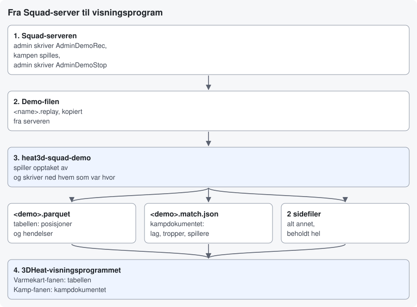

# 3DHeat Squad {#dheat-squad}

**Hva er det?** Et lite program som gjør et opptak av en Squad-kamp om til
filer [3DHeat](https://github.com/Holdi601/3DHeat)-visningsprogrammet
([dokumentasjon](https://holdi601.github.io/3DHeat/)) kan tegne: hvor hver
spiller var, sekund for sekund, og hva som skjedde hvor.

**Hvorfor skulle jeg bruke det?** For å se en kamp ovenfra: hvor kampene var,
hvilke ruter troppene tok, hvor kjøretøyene ble ødelagt.

**Eksempel:** `match.replay` (en demo, tatt opp på en Squad-server) ->
`match.parquet` (én rad per posisjon eller hendelse) + `match.match.json` (kampdokumentet:
lag, tropper, spillere). Utdataene er vanlige Parquet- og JSON-filer, så alt annet kan også lese dem.

Til hva det er nyttig:

- **Hvor en kamp ble utkjempet.** Hver spillers og bots posisjon, til fots, i bakkekjøretøy
  og i helikoptre, omtrent åtte ganger i sekundet, med lag, fraksjon, tropp, helse og synsvinkel.
- **Hva som skjedde hvor.** Sår, gjenopplivinger og dødsfall; hvert skudd og hvert
  treff på et kjøretøy; hvert kjøretøy, utplasserbart objekt og stilling som ble spawnet,
  skadet, ødelagt og fjernet.
- **Hele kampen i ett dokument.** Lag, tropper, spillsituasjonen, hver aktør, en linje per
  spiller og per bot, og en selvkontroll som viser at ingenting demoen holder gikk tapt.



## Hurtigstart {#quick-start}

Ny til kommandolinjen? Les [Før du starter](before-you-start.md) først.

```bash
python -m pip install -e .              # installerer kommandoen heat3d-squad-demo
heat3d-squad-demo match.replay -o out   # eller en mappe med .replay-filer
```

Du bør se én linje per demo. Last deretter inn `out/<map>/<demo>.parquet` i visningsprogrammets Varmekart-fane
([Få data inn](https://holdi601.github.io/3DHeat/getting-data-in.html)).

## Sider {#pages}

| Side | Hva den dekker |
|---|---|
| [Før du starter](before-you-start.md) | Python, en terminal, en første kjøring |
| [Ta opp en demo](recording.md) | få en server til å skrive en demo, og finne den |
| [Konverter demoer](converting.md) | kommandoen, hvert alternativ, eksempelutdata |
| [Tabellen](output-table.md) | hver kolonne og hver `event` |
| [Kampdokumentet og sidefilene](output-match.md) | `.match.json`, de to sidefilene, selvkontrollen |
| [Slik leses en demo](how-it-works.md) | lagene i leseren, og hva som ble kontrollert |
| [Begrensninger, oppdateringer og vilkår](limits.md) | hva som ikke leses, hva en Squad-oppdatering kan ødelegge, personopplysninger, lisens |
| [Kommandoreferanse](../cli-reference.md) | hvert alternativ og hver kolonne, generert fra koden |
| [Vedlikeholde dokumentasjonen](maintaining.md) | sjekklisten for utgivelse |

## Relatert {#related}

- 3DHeat-visningsprogrammet: [github.com/Holdi601/3DHeat](https://github.com/Holdi601/3DHeat),
  dokumentasjon på [holdi601.github.io/3DHeat](https://holdi601.github.io/3DHeat/).
- Filformatene visningsprogrammet leser, inkludert beholderen med én fil per kamp:
  [Én fil per kamp (.3dheat)](https://holdi601.github.io/3DHeat/container.html).
  Dette konverteringsverktøyet skriver de løse filene: tabellen, kampdokumentet og
  sidefilene side om side.
- 3DHeat Watcher kjører dette konverteringsverktøyet på nye demoer når det er installert
  (adapter `squad-demos`): [3DHeat Watcher](https://holdi601.github.io/3DHeat-Watcher/).
- Hver spilleser er sitt eget lille prosjekt med egen lisensfil, egne utgivelser og egen issue-tracker, slik at den kan installeres, oppdateres, vedlikeholdes - eller trekkes tilbake etter ønske fra en rettighetshaver - for seg selv, uten at det påvirker visningsprogrammet eller de andre verktøyene.

## 3DHeat-verktøyene {#the-3dheat-tools}

| Verktøy | Hva det gjør | Kode | Dokumentasjon |
|---|---|---|---|
| 3DHeat-visningsprogram | viser dataene: varmekart, løpsanalyse, kampgjennomgang | [3DHeat](https://github.com/Holdi601/3DHeat) | [dokumentasjon](https://holdi601.github.io/3DHeat/) |
| GameFiles | nivåer og løyper fra et spills egne filer | [3DHeat-GameFiles](https://github.com/Holdi601/3DHeat-GameFiles) | [dokumentasjon](https://holdi601.github.io/3DHeat-GameFiles/) |
| GameCapture | telemetri fra runder, og nivåer bygget opp fra spillopptak | [3DHeat-GameCapture](https://github.com/Holdi601/3DHeat-GameCapture) | [dokumentasjon](https://holdi601.github.io/3DHeat-GameCapture/) |
| Unreal Exporter | en Unreal Editor-plugin: et nivå som én `.glb` | [3DHeat-UnrealExporter](https://github.com/Holdi601/3DHeat-UnrealExporter) | [dokumentasjon](https://holdi601.github.io/3DHeat-UnrealExporter/) |
| CS2 | Counter-Strike 2-demoer og kart | [3DHeat-CS2](https://github.com/Holdi601/3DHeat-CS2) | [dokumentasjon](https://holdi601.github.io/3DHeat-CS2/) |
| Watcher | tar opp det spill publiserer mens du spiller | [3DHeat-Watcher](https://github.com/Holdi601/3DHeat-Watcher) | [dokumentasjon](https://holdi601.github.io/3DHeat-Watcher/) |
| Ext-WarThunder | War Thunder-replayer | [3DHeat-Ext-WarThunder](https://github.com/Holdi601/3DHeat-Ext-WarThunder) | [dokumentasjon](https://holdi601.github.io/3DHeat-Ext-WarThunder/) |
| Ext-WoT | World of Tanks-replayer | [3DHeat-Ext-WoT](https://github.com/Holdi601/3DHeat-Ext-WoT) | [dokumentasjon](https://holdi601.github.io/3DHeat-Ext-WoT/) |
| Ext-WoWs | World of Warships-replayer | [3DHeat-Ext-WoWs](https://github.com/Holdi601/3DHeat-Ext-WoWs) | [dokumentasjon](https://holdi601.github.io/3DHeat-Ext-WoWs/) |
| Ext-Squad | Squad-serverdemoer | [3DHeat-Ext-Squad](https://github.com/Holdi601/3DHeat-Ext-Squad) | [dokumentasjon](https://holdi601.github.io/3DHeat-Ext-Squad/) |
| Ext-DCS | DCS World-kart som 3D-nivåer | [3DHeat-Ext-DCS](https://github.com/Holdi601/3DHeat-Ext-DCS) | [dokumentasjon](https://holdi601.github.io/3DHeat-Ext-DCS/) |
| Ext-IL2 | IL-2 Great Battles-kart som 3D-nivåer | [3DHeat-Ext-IL2](https://github.com/Holdi601/3DHeat-Ext-IL2) | [dokumentasjon](https://holdi601.github.io/3DHeat-Ext-IL2/) |
