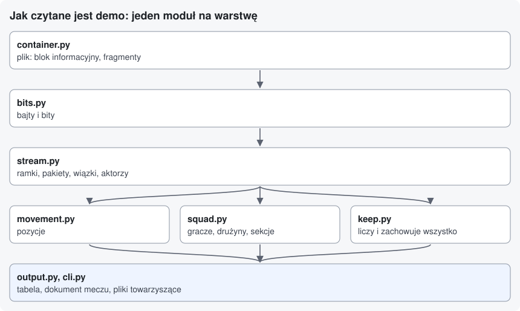

# Jak czytane jest demo {#how-a-demo-is-read}

Prostymi słowami: serwer Squad wysyła pozycję każdego gracza każdemu innemu graczowi. Plik dema to nagranie tego ruchu. To narzędzie odtwarza nagranie i zapisuje, kto gdzie był.



Replay sieciowy Unreal to własny ruch replikacji serwera, zapisany przez jego sterownik dema. Odczytanie go oznacza odczytanie tego ruchu tak, jak zrobiłby to klient.

| Moduł | Warstwa |
|---|---|
| `container.py` | plik strumieniowy lokalnego pliku: blok informacyjny (magia `0x1CA2E27F`), a potem fragmenty. Typy fragmentów to nagłówek (`FNetworkDemoHeader`, magia `0x2CF5A13D`), dane replay, punkty kontrolne i zdarzenia. |
| `bits.py` | archiwa bajtowe dla ramek i archiwa bitowe dla pakietów. Pakiety odczytuje się od najmniej znaczącego bitu. |
| `stream.py` | ramki, pakiety, wiązki (części wiązek złączone razem), kanały aktorów, pojawienia się aktorów i bloki treści. Każdy blok niesie replikowane właściwości jako uchwyt, liczbę bitów i bity, a potem zdalne wywołania i pola niestandardowej delty jako uchwyty do grupy `_ClassNetCache` klasy. Obiektom, których eksporty nie nazywają, nadaje się klasę dopiero po odczytaniu całego dema (zob. niżej). |
| `movement.py` | `FRepMovement` silnika i ruch helikopterów Squad. |
| `keep.py` | każdy napotkany element, policzony i zachowany: wiersze plików towarzyszących i samosprawdzenie. |
| `squad.py` | które klasy Squad przenoszą jakie dane. `SQPlayerState` niesie nazwę, stan drużyny, stan sekcji i aktualny pawn; `SQTeamState` numer drużyny i frakcję; `SQSquadState` numer sekcji. Właścicielem pawna miejsca jest jego pojazd. |
| `output.py`, `cli.py` | tabela i dokument meczu. |

Replay sam nazywa swoje pola. Zawiera ścieżki klas i nazwy właściwości dla każdego uchwytu oraz ścieżki obiektów, do których się odwołuje. Dzięki temu każdą właściwość można znaleźć po nazwie bez kodu gry. Do odczytania bitów właściwości potrzebny jest tylko jej typ; dla ruchu to typ silnika, a właściwości Squad mają proste typy: ciągi znaków, liczby całkowite, referencje do obiektów i nazwy.

Niektóre obiekty są nazwane tylko przez siebie: aktory poziomu po nazwie instancji (`Team1SpawnPoint3`), komponenty po własnej nazwie (`MovementComponent`, `wheel_L1`). Ich klasę znajduje się w tabelach eksportu, po strumieniu: sterownik dema eksportuje pole klasy w ramce, w której obiekt wysyła je po raz pierwszy (tak jest przy każdym pierwszym wysłaniu nazwanego obiektu w demach testowych), więc klasą jest jedyna grupa, która wyeksportowała dokładnie te uchwyty w ramkach, w których obiekt je po raz pierwszy wysłał; w przeciwnym razie dowolna grupa, która do tego czasu miała wszystkie swoje uchwyty, gdy wszystkie nadają im te same nazwy; w przeciwnym razie klasa obiektu o tej samej nazwie, bez numerów; albo jedyna grupa, której nazwa zawiera nazwę obiektu. Spośród uchwytów obiektów nazwanych w ten sposób, których klasa wysyła je z jedną stałą liczbą bitów, wszystkie przyszły z tą liczbą (żadna z inną). To, czego żadna z tych metod nie rozstrzyga, zostaje w całości w pliku towarzyszącym entities.

## Dekodowanie właściwości {#decoding-properties}

Każda replikowana właściwość jest dekodowana tak daleko, jak jej bity mówią, czym jest: jeden bit to flaga; referencja do obiektu (jego net GUID) tam, gdzie nazwa kończy się tak jak nazwa referencji (`...State`, `...Seat`, `...Pawn`, `...Class`...); długość i tyle bajtów to ciąg znaków; nazwa; 8/16/32/64 bity to liczba (zmiennoprzecinkowa tam, gdzie tak mówi nazwa właściwości: zdrowie, czas, tempo, wejście...); wszystko inne to jego bity w hex, z ciągami znaków znalezionymi wewnątrz. Zdalne wywołania są czytane tak samo, po nazwach parametrów, które demo eksportuje dla każdej funkcji.

## Jak odczytywane są zdarzenia {#how-the-events-are-read}

`Health` i `bWounded` żołnierza pochodzą z serwera: ranny, gdy `bWounded` się włącza; ożywiony, gdy się wyłącza, a zdrowie jest powyżej 0; martwy, gdy zdrowie spada poniżej -100 (gracz, który się poddaje albo wykrwawia, dostaje -300); bot, który nigdy nie jest ranny, ginie przy 0. Pojazd albo element rozstawiany dostaje `damaged` przy każdym spadku jego `Health`, a `destroyed` przy 0 lub mniej. Pojawienia się i usunięcia to otwarcie i zamknięcie kanału aktora; miejsce to `CurrentSeat` stanu gracza (referencja do komponentu miejsca, który jest wysyłany na jego pojeździe). Pochylenie widoku to `RemoteViewPitch` żołnierza, bajt od patrzenia prosto w dół (0) do patrzenia prosto w górę (255). Strzał to `MulticastFireProjectile` broni (początek i kierunek) albo jej `MulticastFireMultipleProjectileEffects`, gdy nie przyszło takie samo wywołanie z tym samym kierunkiem; trafienie to `MulticastPlayDamageEffects` pojazdu (miejsce uderzenia, rodzaj obrażeń).

## Co zostało sprawdzone i jak {#what-was-verified-and-how}

Sprawdzono to na dwóch publicznych demach serwera Squad v10.3.1 (Unreal Engine 5.5.4, wersja sieciowa silnika 36), z danych testowych projektu squad-replay:

- **Liczby.** Liczby ramek, pakietów, otwarć aktorów, grup eksportu i ścieżek eksportowanych obiektów zgadzają się dokładnie z niezależnym parserem tego projektu. Zgadza się też liczba próbek ruchu żołnierzy.
- **Ruch względem prędkości.** Krok każdej próbki żołnierza od poprzedniej, podzielony przez czas między nimi, zgadza się z prędkością, którą niesie próbka. Mediana stosunku mieści się w przedziale od 0,8 do 1,2 dla poruszających się graczy.
- **Drużyny względem planów.** Drużyna każdego wiersza to drużyna, do której należy frakcja planu żołnierza. Tak było także dla gracza, który w trakcie meczu zmienił strony.
- **Błędy.** Pozostaje jeden błąd strumienia na demo: zabłąkany bit na końcu otwierającej wiązki aktora spectatora nagrywającego, który nie niesie niczego używanego tutaj.
- **Zgony względem zabójstw tamtego projektu.** Każde zabójstwo, które on wymienia, to rana albo zgon odczytany tutaj, w tym samym czasie i u tego samego gracza; jego zabójstwa pojazdów to pojazdy odczytane tutaj, których zdrowie spadło do 0 lub poniżej.
- **Elementy rozstawiane.** Aktory odczytane tutaj ze stanem budowy albo wymaganiem FOB zgadzają się z elementami rozstawianymi tamtego projektu, z dokładnością do jednego.
- **Pochylenie.** Bajt pochylenia widoku wynosi około 120 w spoczynku i sięga 255 (prosto w górę): odczytany jako bajt w zakresie -90..+90. Odczytany jako zwykły bajt silnika dla pełnego obrotu, postawiłby żołnierzy aż 128 stopni pod horyzontem, a tak nie mogą patrzeć.
- **Boty.** Na demie z fazy rozgrzewki każdy bot (`SQSquidBot`) ma własną trasę, a boty, które giną, są odczytane jako zgony.
- **Ruch helikopterów** (`SQHelicopterMovementComponent.ReplicatedMovement`, własny układ Squad: bez flag, położenie w setnych części metra, prędkość i prędkość kątowa, trzy opcjonalne 16-bitowe kąty, zegar serwera jako liczba zmiennoprzecinkowa). Każda próbka helikoptera wypełnia swoje bity dokładnie. Zaparkowany helikopter ma położenie i yaw takie jak jego miejsce pojawienia się, co do centymetra i jednostki kąta. W locie krok między próbkami podzielony przez krok zegara to prędkość (mediana stosunku 0,997), a zegar przesuwa się razem z czasem dema (mediana 0,4 ms różnicy). Prędkość kątowa idzie za prędkością obrotu yaw (korelacja 0,91), ale jej jednostka nie jest ustalona: jest zachowana, nie używana.
- **Miejsca.** `CurrentSeat` stanu gracza jest referencją (spakowanym net GUID), a nie liczbą, jak odczytywano wcześniej: odczytane tak, przy każdej zmianie jest miejscem, które chwilę wcześniej wskazuje własne `MulticastUpdateCurrentSeat` żołnierza, a zmiany są zgodne z squad-replay.
- **Strzały i trafienia.** Każdy `ShootDir` to wektor jednostkowy (długość 1 z dokładnością do 0,00003); każdy początek `MulticastFireMultipleProjectileEffects`, podzielony przez 10, jest `OriginZeroBased` pasującego `MulticastFireProjectile` z dokładnością do 1 mm; tam, gdzie znana jest pozycja strzelca albo trafionego pojazdu, początek strzału lub miejsce uderzenia są oddalone medianowo o 0,45 m od niej.
- **Wejścia pojazdów.** Odczytane jako liczby zmiennoprzecinkowe, przepustnica, hamulec i hamulec ręczny gąsienicowych pojazdów mieszczą się w 0..1, a ich skręt w -1..1, w każdej aktualizacji.
- **Powody zamknięcia.** Każdy aktor, którego kanał otworzył się ponownie, został wcześniej zamknięty z `Dormancy`; żaden zamknięty z `Destroyed` nie otworzył się ponownie.

Testy na demach, które same testy budują, obejmują kontener, archiwa, strumień i całą drogę do tabeli, oraz sprawdzają, że demo zawierające po jednym elemencie każdego rodzaju nie gubi żadnego ([`tests/test_completeness.py`](https://github.com/Holdi601/3DHeat-Ext-Squad/blob/main/tests/test_completeness.py)):

```bash
python -m pip install -e .[test]
pytest                                   # syntetyczne demo
HEAT3D_SQUAD_DEMOS=<folder> pytest       # oraz prawdziwe dema w tym folderze
```
