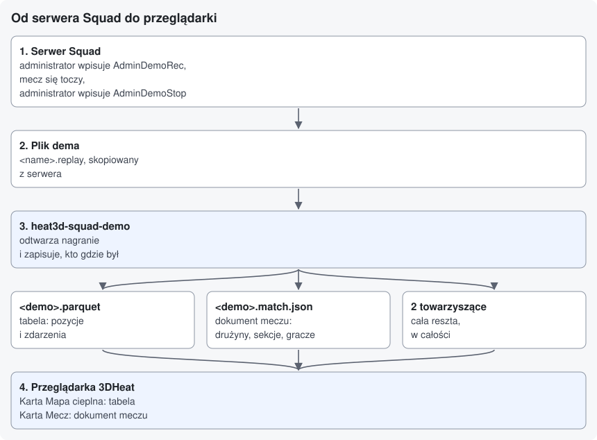

# 3DHeat Squad {#dheat-squad}

**Czym jest?** To mały program, który zamienia nagranie meczu Squad na pliki,
które przeglądarka [3DHeat](https://github.com/Holdi601/3DHeat)
([dokumentacja](https://holdi601.github.io/3DHeat/)) potrafi narysować: gdzie był każdy gracz,
sekunda po sekundzie, i co wydarzyło się w każdym miejscu.

**Po co go używać?** Żeby zobaczyć mecz z góry: gdzie były walki,
jakimi trasami szły sekcje i gdzie ginęły pojazdy.

**Przykład:** `match.replay` (demo nagrane na serwerze Squad) ->
`match.parquet` (jeden wiersz na każdą pozycję lub zdarzenie) + `match.match.json` (dokument
meczu: drużyny, sekcje, gracze). Wyniki to zwykłe pliki Parquet i JSON, więc każde inne narzędzie też je odczyta.

Do czego się przydaje:

- **Gdzie toczyła się walka.** Pozycja każdego gracza i każdego bota, pieszo, w pojazdach lądowych
  i w helikopterach, około osiem razy na sekundę, z drużyną, frakcją, sekcją, zdrowiem
  i kątem patrzenia.
- **Co wydarzyło się gdzie.** Rany, ożywienia i zgony; każdy strzał i każde trafienie w pojazd;
  każdy pojazd, element rozstawiany, stanowisko i skrzynia, które się pojawiły, zostały uszkodzone,
  zniszczone albo usunięte.
- **Cały mecz w jednym dokumencie.** Drużyny, sekcje, stan gry, każdy aktor, wiersz dla każdego
  gracza i bota oraz samosprawdzenie, że nic z zawartości demo nie zginęło.



## Szybki start {#quick-start}

Nigdy nie używałeś wiersza poleceń? Najpierw przeczytaj [Zanim zaczniesz](before-you-start.md).

```bash
python -m pip install -e .              # instaluje polecenie heat3d-squad-demo
heat3d-squad-demo match.replay -o out   # albo folder z plikami .replay
```

Zobaczysz jedną linię na każde demo. Potem wczytaj `out/<map>/<demo>.parquet` w karcie
Mapa cieplna przeglądarki ([Wczytywanie danych](https://holdi601.github.io/3DHeat/getting-data-in.html)).

## Strony {#pages}

| Strona | Czego dotyczy |
|---|---|
| [Zanim zaczniesz](before-you-start.md) | Python, terminal, pierwsze uruchomienie |
| [Nagrywanie dema](recording.md) | jak sprawić, by serwer zapisał demo, i jak je znaleźć |
| [Konwersja dem](converting.md) | polecenie, każda opcja, przykładowy wynik |
| [Tabela](output-table.md) | każda kolumna i każde `event` |
| [Dokument meczu i pliki towarzyszące](output-match.md) | `.match.json`, dwa pliki towarzyszące, samosprawdzenie |
| [Jak czytane jest demo](how-it-works.md) | warstwy czytnika i to, co zostało sprawdzone |
| [Ograniczenia, aktualizacje i warunki](limits.md) | czego nie czytamy, co może zepsuć aktualizacja Squad, dane osobowe, licencja |
| [Opis poleceń](../cli-reference.md) | każda opcja i kolumna, generowane z kodu |
| [Utrzymanie tych stron](maintaining.md) | lista kontrolna wydania |

## Powiązane {#related}

- Przeglądarka 3DHeat: [github.com/Holdi601/3DHeat](https://github.com/Holdi601/3DHeat),
  dokumentacja na [holdi601.github.io/3DHeat](https://holdi601.github.io/3DHeat/).
- Formaty plików, które czyta przeglądarka, w tym kontener jednego pliku na mecz:
  [Jeden plik na mecz (.3dheat)](https://holdi601.github.io/3DHeat/container.html).
  Ten konwerter zapisuje pliki luźno: tabelę, dokument meczu i jego pliki towarzyszące obok siebie.
- Program 3DHeat Watcher uruchamia ten konwerter na nowych demach, gdy jest zainstalowany
  (adapter `squad-demos`): [3DHeat Watcher](https://holdi601.github.io/3DHeat-Watcher/).

## Narzędzia 3DHeat {#the-3dheat-tools}

| Narzędzie | Co robi | Kod | Dokumentacja |
|---|---|---|---|
| przeglądarka 3DHeat | pokazuje dane: mapy cieplne, analizę wyścigów, przegląd meczu | [3DHeat](https://github.com/Holdi601/3DHeat) | [dokumentacja](https://holdi601.github.io/3DHeat/) |
| GameFiles | poziomy i trasy z plików samej gry | [3DHeat-GameFiles](https://github.com/Holdi601/3DHeat-GameFiles) | [dokumentacja](https://holdi601.github.io/3DHeat-GameFiles/) |
| GameCapture | telemetria okrążeń i poziomy odtworzone z nagrań rozgrywki | [3DHeat-GameCapture](https://github.com/Holdi601/3DHeat-GameCapture) | [dokumentacja](https://holdi601.github.io/3DHeat-GameCapture/) |
| Unreal Exporter | wtyczka do edytora Unreal: poziom jako jeden plik `.glb` | [3DHeat-UnrealExporter](https://github.com/Holdi601/3DHeat-UnrealExporter) | [dokumentacja](https://holdi601.github.io/3DHeat-UnrealExporter/) |
| CS2 | dema i mapy Counter-Strike 2 | [3DHeat-CS2](https://github.com/Holdi601/3DHeat-CS2) | [dokumentacja](https://holdi601.github.io/3DHeat-CS2/) |
| Watcher | zapisuje to, co gry publikują podczas grania | [3DHeat-Watcher](https://github.com/Holdi601/3DHeat-Watcher) | [dokumentacja](https://holdi601.github.io/3DHeat-Watcher/) |
| Ext-WarThunder | replaye War Thunder | [3DHeat-Ext-WarThunder](https://github.com/Holdi601/3DHeat-Ext-WarThunder) | [dokumentacja](https://holdi601.github.io/3DHeat-Ext-WarThunder/) |
| Ext-WoT | replaye World of Tanks | [3DHeat-Ext-WoT](https://github.com/Holdi601/3DHeat-Ext-WoT) | [dokumentacja](https://holdi601.github.io/3DHeat-Ext-WoT/) |
| Ext-WoWs | replaye World of Warships | [3DHeat-Ext-WoWs](https://github.com/Holdi601/3DHeat-Ext-WoWs) | [dokumentacja](https://holdi601.github.io/3DHeat-Ext-WoWs/) |
| Ext-Squad | dema z serwerów Squad | [3DHeat-Ext-Squad](https://github.com/Holdi601/3DHeat-Ext-Squad) | [dokumentacja](https://holdi601.github.io/3DHeat-Ext-Squad/) |
| Ext-DCS | mapy DCS World jako poziomy 3D | [3DHeat-Ext-DCS](https://github.com/Holdi601/3DHeat-Ext-DCS) | [dokumentacja](https://holdi601.github.io/3DHeat-Ext-DCS/) |
| Ext-IL2 | mapy IL-2 Sturmovik jako poziomy 3D | [3DHeat-Ext-IL2](https://github.com/Holdi601/3DHeat-Ext-IL2) | [dokumentacja](https://holdi601.github.io/3DHeat-Ext-IL2/) |
