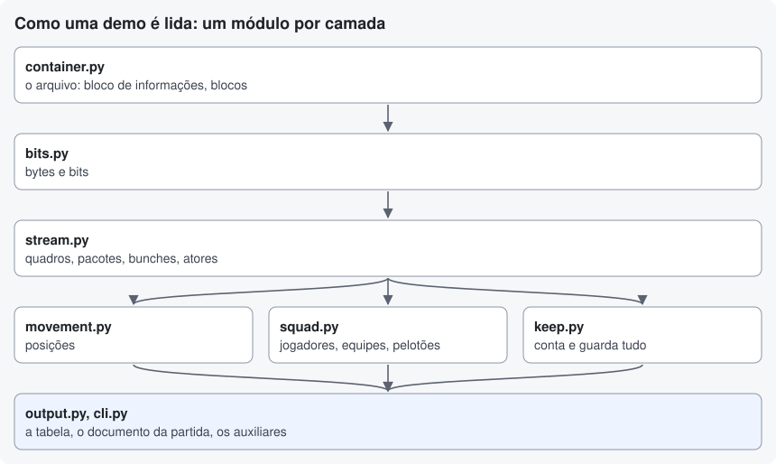

# Como uma demo é lida {#how-a-demo-is-read}

Em palavras simples: um servidor do Squad envia a posição de cada jogador a todos os outros jogadores. O arquivo da demo é uma gravação desse tráfego. Esta ferramenta reproduz essa gravação e anota quem estava onde.



Uma repetição de rede do Unreal é o próprio tráfego de replicação do servidor, anotado pelo seu driver de demo. Lê-la é ler esse tráfego como um cliente o leria.

| Módulo | Camada |
|---|---|
| `container.py` | O arquivo do transmissor de arquivo local: um bloco de informações (magia `0x1CA2E27F`), depois blocos. Os tipos de bloco são o cabeçalho (`FNetworkDemoHeader`, magia `0x2CF5A13D`), os dados de repetição, os pontos de verificação e os eventos. |
| `bits.py` | Arquivos de bytes para quadros e arquivos de bits para pacotes. Os pacotes são lidos do bit menos significativo para o mais significativo. |
| `stream.py` | Quadros, pacotes, bunches (bunches parciais unidos), canais de atores, criação de atores e blocos de conteúdo. Cada bloco traz as propriedades replicadas como identificador, quantidade de bits e bits, depois chamadas remotas e campos de delta personalizados como identificadores no grupo `_ClassNetCache` da classe. Objetos que as exportações não nomeiam recebem a classe depois que a demo inteira é lida (veja abaixo). |
| `movement.py` | O `FRepMovement` do motor, e o movimento do helicóptero do Squad. |
| `keep.py` | Cada item encontrado, contado e guardado: as linhas dos auxiliares e a autoverificação. |
| `squad.py` | Quais classes do Squad carregam o quê. `SQPlayerState` traz o nome, o estado da equipe, o estado do pelotão e o pawn atual; `SQTeamState` o número e a facção da equipe; `SQSquadState` o número do pelotão. O dono de um pawn de assento é o seu veículo. |
| `output.py`, `cli.py` | A tabela e o documento da partida. |

Uma repetição dá nome aos seus próprios campos. Ela traz os caminhos de classe e os nomes de propriedade de cada identificador, e os caminhos dos objetos que referencia. Assim, cada propriedade pode ser encontrada pelo nome, sem o código do jogo. Só os bits de uma propriedade precisam do seu tipo. Para o movimento, esse é o tipo do próprio motor; para as propriedades do Squad, os tipos são simples: textos, inteiros, referências a objetos e nomes.

Alguns objetos são nomeados apenas por si mesmos: os atores de um nível pelo nome da instância (`Team1SpawnPoint3`), os componentes pelo seu próprio (`MovementComponent`, `wheel_L1`). A classe deles é encontrada a partir das tabelas de exportação, depois do fluxo: o driver de demo exporta o campo de uma classe no quadro em que ele é enviado pela primeira vez (verdadeiro em todo primeiro envio de um objeto nomeado nas demos de teste), então a classe é o único grupo que exportou exatamente esses identificadores nos quadros em que o objeto os enviou pela primeira vez; senão, qualquer grupo que já tivesse todos os seus identificadores até então, quando todos dão os mesmos nomes; senão, a classe de um objeto com o mesmo nome, sem os números, ou o único grupo cujo nome contém o do objeto. Dos identificadores de objetos nomeados assim cuja classe os envia com uma quantidade fixa de bits, todos chegaram com essa quantidade (nenhum com outra). O que nada disso resolve fica no auxiliar de entidades, inteiro.

## Decodificar propriedades {#decoding-properties}

Cada propriedade replicada é decodificada até onde os seus bits indicam o que ela é: um bit é um sinalizador, uma referência a um objeto (seu GUID de rede) quando o nome termina como o de uma referência (`...State`, `...Seat`, `...Pawn`, `...Class`...), um comprimento seguido desse número de bytes é um texto, um nome, 8/16/32/64 bits são um número (um número de ponto flutuante quando o nome da propriedade indica isso: vida, tempo, taxa, entrada...), e qualquer outra coisa são os seus bits em hexadecimal com os textos encontrados dentro. As chamadas remotas são lidas do mesmo jeito, pelos nomes de parâmetro que a demo exporta para cada função.

## Como os eventos são lidos {#how-the-events-are-read}

A `Health` e o `bWounded` de um soldado vêm do servidor: ferido quando `bWounded` liga, reanimado quando desliga com vida acima de 0, morto quando a vida cai abaixo de -100 (um jogador que desiste ou sangra até morrer é colocado em -300); um bot, que nunca fica ferido, morre em 0. Um veículo ou implantável é `damaged` a cada queda da sua `Health`, `destroyed` em 0 ou abaixo. Criações e remoções são o canal do ator abrindo e fechando; um assento é o `CurrentSeat` do estado do jogador (uma referência ao componente do assento, que é enviado no seu veículo). A inclinação da visão é o `RemoteViewPitch` do soldado, um byte de totalmente para baixo (0) a totalmente para cima (255). Um tiro é um `MulticastFireProjectile` de uma arma (origem e direção), ou o seu `MulticastFireMultipleProjectileEffects` quando não veio nenhuma chamada dessas com a mesma direção; um acerto é um `MulticastPlayDamageEffects` de um veículo (local do impacto, tipo de dano).

## O que foi verificado, e como {#what-was-verified-and-how}

Isto foi conferido com duas demos públicas de servidor do Squad v10.3.1 (Unreal Engine 5.5.4, versão de rede do motor 36), dos acessórios de teste do projeto squad-replay:

- **Contagens.** As contagens de quadros, pacotes, aberturas de atores, grupos de exportação e caminhos de objetos exportados coincidem exatamente com as do analisador independente desse projeto. O mesmo vale para o número de amostras de movimento dos soldados.
- **Movimento contra velocidade.** O deslocamento de cada amostra de soldado em relação à anterior, dividido pelo tempo entre elas, coincide com a velocidade que a amostra traz. A razão mediana fica entre 0,8 e 1,2 nos jogadores em movimento.
- **Equipes contra blueprints.** A equipe de cada linha é a equipe a que pertence a facção do blueprint do soldado. Isso valeu inclusive para um jogador que mudou de lado durante a partida.
- **Erros.** Resta um erro de fluxo por demo: um bit perdido no fim do bunch de abertura do ator espectador do próprio gravador, que não traz nada usado aqui.
- **Baixas contra os abates desse projeto.** Cada abate que ele lista é um ferimento ou uma morte lidos aqui, no mesmo instante e do mesmo jogador; seus abates de veículos são veículos lidos aqui chegando a vida 0 ou abaixo.
- **Implantáveis.** Os atores lidos aqui com um estado de construção ou um requisito de FOB coincidem com os implantáveis desse projeto, com diferença de até um.
- **Inclinação.** O byte de inclinação da visão fica em torno de 120 em repouso e chega a 255 (totalmente para cima): lido como byte sobre -90..+90. Lido como o byte usual do motor, uma volta inteira, colocaria os soldados até 128 graus abaixo do horizonte, para onde eles não conseguem olhar.
- **Bots.** Em uma demo de aquecimento, cada bot (`SQSquidBot`) tem a sua própria trilha, e os bots que morrem são lidos como mortes.
- **Movimento de helicóptero** (`SQHelicopterMovementComponent.ReplicatedMovement`, o layout próprio do Squad: sem sinalizadores, a posição em centésimos, a velocidade e a velocidade angular, três ângulos opcionais de 16 bits, o relógio do servidor como ponto flutuante). Cada amostra de helicóptero preenche os seus bits exatamente. A posição e o yaw de um helicóptero estacionado são os do seu ponto de surgimento, até o centímetro e a unidade de ângulo. Em voo, o deslocamento entre amostras dividido pelo passo do relógio é a velocidade (razão mediana 0,997), e o relógio avança junto com o tempo da demo (passo mediano de 0,4 ms). A velocidade angular acompanha a taxa de yaw (correlação 0,91), mas a sua unidade não está fixada: ela é guardada, não usada.
- **Assentos.** O `CurrentSeat` de um estado de jogador é uma referência (um GUID de rede compactado), não um número como se lia antes: lido assim, a cada mudança é o assento que o próprio `MulticastUpdateCurrentSeat` do soldado indica um momento antes, e as mudanças são as do squad-replay.
- **Tiros e acertos.** Cada `ShootDir` é um vetor unitário (comprimento 1 com precisão de 0,00003); cada origem de `MulticastFireMultipleProjectileEffects`, dividida por 10, é o `OriginZeroBased` do `MulticastFireProjectile` correspondente com precisão de 1 mm; onde a posição do atirador ou do veículo atingido é conhecida, a origem do tiro ou o impacto fica, em mediana, a 0,45 m dela.
- **Entradas de veículo.** Lidos como números de ponto flutuante, o acelerador, o freio e o freio de mão dos veículos de esteira ficam entre 0 e 1, e a direção entre -1 e 1, em cada atualização.
- **Motivos de fechamento.** Cada ator cujo canal foi aberto de novo tinha sido fechado com `Dormancy`; nenhum fechado com `Destroyed` foi aberto de novo.

Os testes, em demos criadas pelos próprios testes, cobrem o contêiner, os arquivos de bits, o fluxo e o caminho completo até a tabela, e verificam que uma demo com um exemplar de cada tipo de item não perde nenhum ([`tests/test_completeness.py`](https://github.com/Holdi601/3DHeat-Ext-Squad/blob/main/tests/test_completeness.py)):

```bash
python -m pip install -e .[test]
pytest                                   # demos sintéticas
HEAT3D_SQUAD_DEMOS=<pasta> pytest        # mais as demos reais dessa pasta
```
