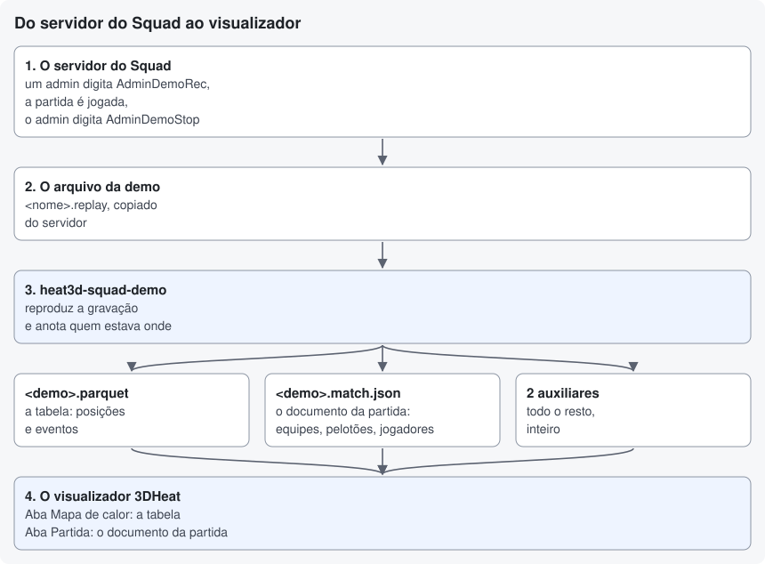

# 3DHeat Squad {#dheat-squad}

**O que é?** Um pequeno programa que transforma a gravação de uma partida do Squad em
arquivos que o visualizador [3DHeat](https://github.com/Holdi601/3DHeat)
([documentação](https://holdi601.github.io/3DHeat/)) consegue desenhar: onde estava
cada jogador, segundo a segundo, e o que aconteceu em cada lugar.

**Para que eu usaria?** Para ver uma partida de cima: onde foram os combates, por onde
os pelotões passaram, onde os veículos foram destruídos.

**Exemplo:** `match.replay` (uma demo gravada em um servidor do Squad) ->
`match.parquet` (uma linha por posição ou evento) + `match.match.json` (o
documento da partida: equipes, pelotões, jogadores). As saídas são arquivos Parquet
e JSON comuns, então qualquer outro programa também consegue lê-los.

Para que serve:

- **Onde a partida foi disputada.** A posição de cada jogador e bot, a pé, em veículos
  terrestres e em helicópteros, cerca de oito vezes por segundo, com equipe, facção, pelotão,
  vida e ângulo de visão.
- **O que aconteceu em cada lugar.** Feridos, reanimados e mortes; cada tiro e cada
  acerto em um veículo; cada veículo, implantável e posto de tiro que surgiu, foi danificado,
  destruído ou removido.
- **A partida inteira em um só documento.** Equipes, pelotões, o estado do jogo, cada
  ator, uma linha por jogador e por bot, e uma autoverificação de que nada do que a demo
  guarda se perdeu.



## Início rápido {#quick-start}

Nunca usou a linha de comando? Leia primeiro [Antes de começar](before-you-start.md).

```bash
python -m pip install -e .              # instala o comando heat3d-squad-demo
heat3d-squad-demo match.replay -o out   # ou uma pasta com arquivos .replay
```

Você deve ver uma linha por demo. Depois carregue `out/<mapa>/<demo>.parquet` na aba
Mapa de calor do visualizador ([Obter dados](https://holdi601.github.io/3DHeat/getting-data-in.html)).

## Páginas {#pages}

| Página | O que cobre |
|---|---|
| [Antes de começar](before-you-start.md) | Python, um terminal, uma primeira execução |
| [Gravar uma demo](recording.md) | fazer o servidor gravar uma demo, e encontrá-la |
| [Converter demos](converting.md) | o comando, cada opção, exemplo de saída |
| [A tabela](output-table.md) | cada coluna e cada `event` |
| [O documento da partida e os auxiliares](output-match.md) | o `.match.json`, os dois auxiliares, a autoverificação |
| [Como uma demo é lida](how-it-works.md) | as camadas do leitor, e o que foi verificado |
| [Limites, atualizações e termos](limits.md) | o que não é lido, o que uma atualização do Squad pode quebrar, dados pessoais, licença |
| [Referência de comandos](../cli-reference.md) | cada opção e coluna, gerada a partir do código |
| [Manutenção destas páginas](maintaining.md) | a lista de verificação de cada versão |

## Relacionados {#related}

- O visualizador 3DHeat: [github.com/Holdi601/3DHeat](https://github.com/Holdi601/3DHeat),
  documentação em [holdi601.github.io/3DHeat](https://holdi601.github.io/3DHeat/).
- Os formatos de arquivo que o visualizador lê, incluindo o contêiner de uma partida em
  um só arquivo: [Um arquivo por partida (.3dheat)](https://holdi601.github.io/3DHeat/container.html).
  Este conversor grava os arquivos soltos: a tabela, o documento da partida e os
  auxiliares lado a lado.
- O 3DHeat Watcher executa este conversor nas novas demos quando estiver instalado
  (adaptador `squad-demos`): [3DHeat Watcher](https://holdi601.github.io/3DHeat-Watcher/).

## As ferramentas 3DHeat {#the-3dheat-tools}

| Ferramenta | O que faz | Código | Documentação |
|---|---|---|---|
| Visualizador 3DHeat | mostra os dados: mapas de calor, análise de corrida, revisão de partidas | [3DHeat](https://github.com/Holdi601/3DHeat) | [docs](https://holdi601.github.io/3DHeat/) |
| GameFiles | níveis e percursos a partir dos arquivos do próprio jogo | [3DHeat-GameFiles](https://github.com/Holdi601/3DHeat-GameFiles) | [docs](https://holdi601.github.io/3DHeat-GameFiles/) |
| GameCapture | telemetria de voltas, e níveis reconstruídos a partir de vídeo de jogo | [3DHeat-GameCapture](https://github.com/Holdi601/3DHeat-GameCapture) | [docs](https://holdi601.github.io/3DHeat-GameCapture/) |
| Unreal Exporter | um plugin do Unreal Editor: um nível como um único `.glb` | [3DHeat-UnrealExporter](https://github.com/Holdi601/3DHeat-UnrealExporter) | [docs](https://holdi601.github.io/3DHeat-UnrealExporter/) |
| CS2 | demos e mapas do Counter-Strike 2 | [3DHeat-CS2](https://github.com/Holdi601/3DHeat-CS2) | [docs](https://holdi601.github.io/3DHeat-CS2/) |
| Watcher | registra o que os jogos publicam enquanto você joga | [3DHeat-Watcher](https://github.com/Holdi601/3DHeat-Watcher) | [docs](https://holdi601.github.io/3DHeat-Watcher/) |
| Ext-WarThunder | repetições do War Thunder | [3DHeat-Ext-WarThunder](https://github.com/Holdi601/3DHeat-Ext-WarThunder) | [docs](https://holdi601.github.io/3DHeat-Ext-WarThunder/) |
| Ext-WoT | repetições do World of Tanks | [3DHeat-Ext-WoT](https://github.com/Holdi601/3DHeat-Ext-WoT) | [docs](https://holdi601.github.io/3DHeat-Ext-WoT/) |
| Ext-WoWs | repetições do World of Warships | [3DHeat-Ext-WoWs](https://github.com/Holdi601/3DHeat-Ext-WoWs) | [docs](https://holdi601.github.io/3DHeat-Ext-WoWs/) |
| Ext-Squad | demos de servidores do Squad | [3DHeat-Ext-Squad](https://github.com/Holdi601/3DHeat-Ext-Squad) | [docs](https://holdi601.github.io/3DHeat-Ext-Squad/) |
| Ext-DCS | mapas do DCS World como níveis 3D | [3DHeat-Ext-DCS](https://github.com/Holdi601/3DHeat-Ext-DCS) | [docs](https://holdi601.github.io/3DHeat-Ext-DCS/) |
| Ext-IL2 | mapas do IL-2 Sturmovik como níveis 3D | [3DHeat-Ext-IL2](https://github.com/Holdi601/3DHeat-Ext-IL2) | [docs](https://holdi601.github.io/3DHeat-Ext-IL2/) |
