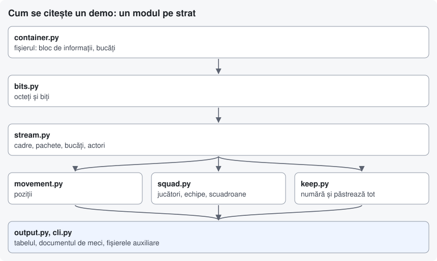

# Cum se citește un demo {#how-a-demo-is-read}

Pe scurt: un server Squad trimite poziția fiecărui jucător către toți ceilalți jucători. Fișierul demo este o înregistrare a acelui trafic. Acest instrument îl redă și notează cine unde se afla.



Un replay de rețea Unreal este traficul de replicare al serverului însuși, notat de driverul său de demo. A-l citi înseamnă a citi acel trafic așa cum l-ar citi un client.

| Modul | Strat |
|---|---|
| `container.py` | Fișierul fluxului local: un bloc de informații (magic `0x1CA2E27F`), apoi bucăți. Tipurile de bucăți sunt antetul (`FNetworkDemoHeader`, magic `0x2CF5A13D`), datele de replay, punctele de control și evenimentele. |
| `bits.py` | Arhive de octeți pentru cadre și arhive de biți pentru pachete. Pachetele se citesc începând cu bitul cel mai puțin semnificativ. |
| `stream.py` | Cadre, pachete, pachete parțiale (bunches; cele parțiale sunt unite), canale de actori, apariții de actori și blocuri de conținut. Fiecare bloc conține proprietățile replicate ca handle, număr de biți și biți, apoi apelurile de la distanță și câmpurile delta personalizate ca handle-uri în grupul `_ClassNetCache` al clasei. Obiectele pe care exporturile nu le numesc primesc clasa lor după ce s-a citit tot demo-ul (vedeți mai jos). |
| `movement.py` | `FRepMovement` al motorului și componenta de mișcare a elicopterelor din Squad. |
| `keep.py` | Fiecare element întâlnit, numărat și păstrat: rândurile fișierelor auxiliare și autoverificarea. |
| `squad.py` | Ce clase Squad poartă ce. `SQPlayerState` conține numele, starea echipei, starea scuadronului și pionul curent; `SQTeamState` numărul și fracțiunea echipei; `SQSquadState` numărul scuadronului. Pionul unui loc este proprietarul său, adică vehiculul. |
| `output.py`, `cli.py` | Tabelul și documentul de meci. |

Un replay își numește singur câmpurile. Conține numele claselor și ale proprietăților pentru fiecare handle, precum și căile obiectelor la care face referire. Așadar, orice proprietate poate fi găsită după nume, fără codul jocului. Doar biții unei proprietăți au nevoie de tipul ei. Pentru mișcare, acesta este tipul propriu al motorului; pentru proprietățile Squad, tipurile sunt simple: șiruri, numere întregi, referințe la obiecte și nume.

Unele obiecte sunt numite doar prin ele însele: actorii unui nivel prin numele lor de instanță (`Team1SpawnPoint3`), componentele prin ale lor (`MovementComponent`, `wheel_L1`). Clasa lor se găsește din tabelele de export, după flux: driverul de demo exportă câmpul unei clase în cadrul în care este trimis prima dată (adevărat pentru fiecare primă trimitere a unui obiect numit din demo-urile de test), deci clasa este grupul unic care a exportat exact acele handle-uri în cadrele în care obiectul le-a trimis prima dată; altfel, orice grup care avea până atunci toate handle-urile sale, când toate îi dau aceleași nume; altfel clasa unui obiect cu același nume, fără numere, sau grupul unic al cărui nume îl conține pe al obiectului. Dintre handle-urile obiectelor numite astfel, al căror clasă le trimite cu un număr fix de biți, toate au venit cu acel număr (niciunul cu altul). Ce nu rezolvă nimic din toate acestea rămâne întreg în fișierul auxiliar cu entități.

## Decodarea proprietăților {#decoding-properties}

Fiecare proprietate replicată este decodată pe cât o spun biții ei: un bit un indicator, o referință la un obiect (identificatorul său net GUID) acolo unde numele se termină ca al unei referințe (`...State`, `...Seat`, `...Pawn`, `...Class`...), o lungime și atâția octeți un șir, un nume, 8/16/32/64 de biți un număr (un număr real acolo unde numele proprietății o spune: sănătate, timp, rată, intrare...), orice altceva biții ei în hexazecimal, cu șirurile găsite în interior. Apelurile de la distanță se citesc în același fel, după numele parametrilor pe care demo-ul le exportă pentru fiecare funcție.

## Cum se citesc evenimentele {#how-the-events-are-read}

`Health` și `bWounded` ale unui soldat vin de la server: rănit când `bWounded` se activează, revenit când se dezactivează cu sănătatea peste 0, mort când sănătatea scade sub -100 (un jucător care renunță sau sângerează până la moarte este setat la -300); un bot, care nu este niciodată rănit, moare la 0. Un vehicul sau un dispozitiv desfășurabil este `damaged` la fiecare scădere a `Health`, `destroyed` la 0 sau sub. Apariția și eliminarea sunt deschiderea și închiderea canalului de actori; un loc este `CurrentSeat` al stării jucătorului (o referință la componenta locului, care este trimisă pe vehiculul său). Unghiul de vizualizare vertical este `RemoteViewPitch` al soldatului, un octet de la drept în jos (0) până drept în sus (255). Un foc este `MulticastFireProjectile` al unei arme (origine și direcție), sau `MulticastFireMultipleProjectileEffects` acolo unde nu a venit niciun astfel de apel cu aceeași direcție; o lovitură este `MulticastPlayDamageEffects` al unui vehicul (locul impactului, tipul de daună).

## Ce s-a verificat și cum {#what-was-verified-and-how}

Acestea au fost verificate pe două demo-uri publice de server Squad v10.3.1 (Unreal Engine 5.5.4, versiune de rețea a motorului 36), din fixture-urile de test ale proiectului squad-replay:

- **Numărători.** Numărul de cadre, pachete, deschideri de actori, grupuri de export și căi de obiecte exportate se potrivesc exact cu cel al parserului independent al acelui proiect. La fel și numărul de mostre de mișcare ale soldaților.
- **Mișcarea față de viteză.** Pasul fiecărei mostre de soldat față de cea anterioară, împărțit la timpul dintre ele, se potrivește cu viteza pe care o poartă mostra. Raportul median este între 0,8 și 1,2 la jucătorii în mișcare.
- **Echipele față de planurile de bază (blueprints).** Echipa fiecărui rând este echipa a cărei fracțiune aparține planului de bază al soldatului. Acest lucru s-a confirmat și pentru un jucător care a schimbat tabăra în timpul meciului.
- **Erori.** Rămâne câte o eroare de flux pe demo: un bit rătăcit la sfârșitul primului pachet al actorului de spectator al înregistratorului, care nu conține nimic folosit aici.
- **Victimele față de uciderile acelui proiect.** Fiecare ucidere pe care o listează este o rană sau un deces citit aici, în același moment și al aceluiași jucător; uciderile de vehicule sunt vehicule citite aici ajungând la sănătate 0 sau sub.
- **Dispozitive desfășurabile.** Actorii citiți aici cu o stare de construcție sau o cerință FOB se potrivesc cu dispozitivele desfășurabile ale acelui proiect, cu o diferență de cel mult unu.
- **Unghiul vertical.** Octetul unghiului de vizualizare se află în jur de 120 în repaus și ajunge la 255 (drept în sus): citit ca octet în intervalul -90..+90. Citit ca octetul obișnuit al motorului, pentru un întreg tur, ar pune soldații până la 128 de grade sub orizont, unde nu se pot uita.
- **Boții.** Pe un demo de adunare, fiecare bot (`SQSquidBot`) are propria traiectorie, iar boții care mor sunt citiți ca decese.
- **Mișcarea elicopterelor** (`SQHelicopterMovementComponent.ReplicatedMovement`, aspectul propriu al Squad: fără indicatori, locația în sutimi, viteza și viteza unghiulară, trei unghiuri opționale de 16 biți, ceasul serverului ca număr real). Fiecare mostră de elicopter își umple exact biții. Locația și unghiul de girație ale unui elicopter parcat sunt cele ale punctului său de apariție, până la centimetru și la unitatea de unghi. În zbor, pasul dintre mostre împărțit la pasul ceasului este viteza (raport median 0,997), iar ceasul avansează odată cu timpul demo-ului (la o medie de 0,4 ms distanță). Viteza unghiulară urmează rata de girație (corelație 0,91), dar unitatea ei nu este stabilită: se păstrează, nu se folosiți.
- **Locuri.** `CurrentSeat` al stării jucătorului este o referință (un net GUID împachetat), nu un număr, cum se citea înainte: citit astfel, la fiecare schimbare este locul pe care îl numește mai devreme `MulticastUpdateCurrentSeat` al soldatului, iar schimbările sunt cele ale squad-replay.
- **Focuri și lovituri.** Fiecare `ShootDir` este un vector unitar (lungime 1, cu o toleranță de 0,00003); fiecare origine `MulticastFireMultipleProjectileEffects`, împărțită la 10, este `OriginZeroBased` al `MulticastFireProjectile` corespunzător, cu o toleranță de 1 mm; acolo unde se cunoaște poziția trăgătorului sau a vehiculului lovit, originea focului sau impactul este la o medie de 0,45 m de ea.
- **Intrările vehiculelor.** Citite ca numere reale, accelerația, frâna și frâna de mână ale vehiculelor cu șenile se află între 0 și 1, iar direcția între -1 și 1, în fiecare actualizare.
- **Motivele închiderii.** Fiecare actor al cărui canal s-a deschis din nou fusese închis cu `Dormancy`; niciunul închis cu `Destroyed` nu s-a deschis din nou.

Testele pe demo-uri construite de ele însele acoperă containerul, arhivele, fluxul și întregul drum până la tabel, și verifică faptul că un demo care conține câte un element din fiecare fel nu pierde niciunul ([`tests/test_completeness.py`](https://github.com/Holdi601/3DHeat-Ext-Squad/blob/main/tests/test_completeness.py)):

```bash
python -m pip install -e .[test]
pytest                                   # synthetic demos
HEAT3D_SQUAD_DEMOS=<folder> pytest       # plus real demos in that folder
```
