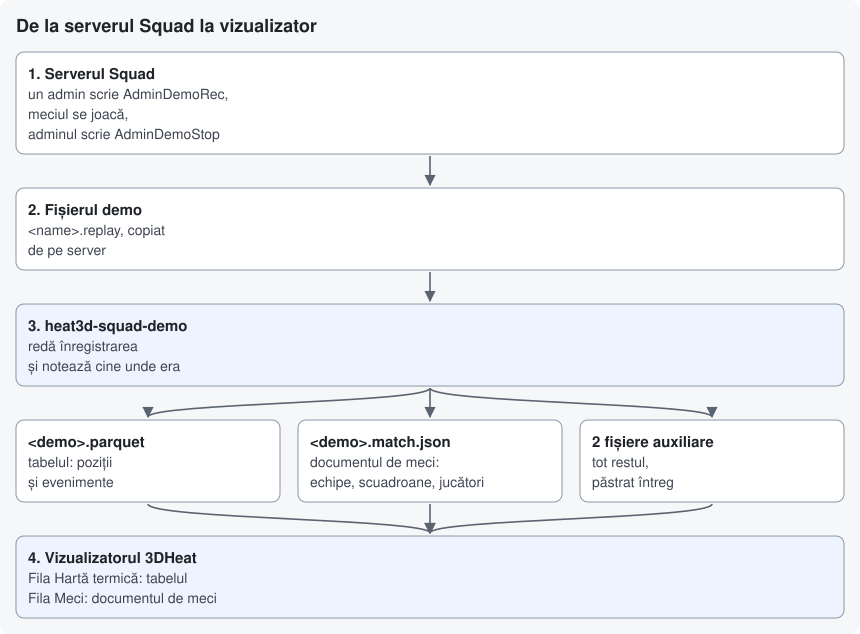

# 3DHeat Squad {#dheat-squad}

**Ce este?** Un program mic care transformă o înregistrare a unui meci Squad în fișiere pe care
vizualizatorul [3DHeat](https://github.com/Holdi601/3DHeat)
([documentație](https://holdi601.github.io/3DHeat/)) le poate desena: unde se afla fiecare
jucător, secundă cu secundă, și ce s-a întâmplat unde.

**De ce l-aș folosi?** Ca să vedeți un meci de sus: unde au avut loc luptele, pe ce rute au mers
scuadroanele, unde au fost distruse vehiculele.

**Exemplu:** `match.replay` (un demo, înregistrat pe un server Squad) ->
`match.parquet` (câte un rând pentru fiecare poziție sau eveniment) + `match.match.json` (documentul
de meci: echipe, scuadroane, jucători). Rezultatele sunt fișiere Parquet și JSON obișnuite, deci
le poate citi orice alt program.

La ce este util:

- **Unde s-a dat lupta.** Poziția fiecărui jucător și a fiecărui bot, pe jos, în vehicule terestre
  și în elicoptere, de aproximativ opt ori pe secundă, cu echipa, fracțiunea, scuadronul, sănătatea
  și unghiul de vizualizare.
- **Ce s-a întâmplat unde.** Răniri, reanimări și morți; fiecare foc și fiecare lovitură asupra
  unui vehicul; fiecare vehicul, dispozitiv desfășurabil și punct de tragere apărut, avariat,
  distrus și eliminat.
- **Tot meciul într-un singur document.** Echipe, scuadroane, starea jocului, fiecare actor, o linie
  pentru fiecare jucător și fiecare bot și o autoverificare care arată că nimic din ce conține
  demo-ul nu s-a pierdut.



## Pornire rapidă {#quick-start}

Nu ați mai lucrat în linia de comandă? Citiți mai întâi [Înainte de a începe](before-you-start.md).

```bash
python -m pip install -e .              # installs the heat3d-squad-demo command
heat3d-squad-demo match.replay -o out   # or a folder of .replay files
```

Ar trebui să vedeți câte o linie pentru fiecare demo. Apoi încărcați `out/<map>/<demo>.parquet` în
fila Hartă termică a vizualizatorului ([Introducerea datelor](https://holdi601.github.io/3DHeat/getting-data-in.html)).

## Pagini {#pages}

| Pagina | Ce acoperă |
|---|---|
| [Înainte de a începe](before-you-start.md) | Python, un terminal, o primă rulare |
| [Înregistrarea unui demo](recording.md) | cum faceți ca un server să scrie un demo, și cum îl găsiți |
| [Convertirea demo-urilor](converting.md) | comanda, fiecare opțiune, exemplu de ieșire |
| [Tabelul](output-table.md) | fiecare coloană și fiecare `event` |
| [Documentul de meci și fișierele auxiliare](output-match.md) | `.match.json`, cele două fișiere auxiliare, autoverificarea |
| [Cum se citește un demo](how-it-works.md) | straturile cititorului și ce s-a verificat |
| [Limite, actualizări și condiții](limits.md) | ce nu se citește, ce poate strica o actualizare Squad, datele personale, licența |
| [Referința comenzilor](../cli-reference.md) | fiecare opțiune și coloană, generate din cod |
| [Întreținerea acestor documente](maintaining.md) | lista de verificare pentru lansare |

## Legături {#related}

- Vizualizatorul 3DHeat: [github.com/Holdi601/3DHeat](https://github.com/Holdi601/3DHeat),
  documentația la [holdi601.github.io/3DHeat](https://holdi601.github.io/3DHeat/).
- Formatele de fișiere pe care le citește vizualizatorul, inclusiv containerul cu un fișier pe meci:
  [Un fișier pe meci (.3dheat)](https://holdi601.github.io/3DHeat/container.html).
  Acest convertor scrie fișierele separate: tabelul, documentul de meci și fișierele sale auxiliare, unul lângă altul.
- Vizualizatorul 3DHeat Watcher rulează acest convertor pe demo-urile noi, când este instalat
  (adaptorul `squad-demos`): [3DHeat Watcher](https://holdi601.github.io/3DHeat-Watcher/).
- Fiecare cititor de joc este un mic proiect de sine stătător, cu propriul fișier de licență, propriile versiuni și propriul sistem de raportare a problemelor, astfel încât poate fi instalat, actualizat, întreținut - sau retras la cererea unui deținător de drepturi - separat, fără a afecta vizualizatorul sau celelalte instrumente.

## Instrumentele 3DHeat {#the-3dheat-tools}

| Instrument | Ce face | Cod | Documentație |
|---|---|---|---|
| Vizualizatorul 3DHeat | arată datele: hărți termice, analiza cursei, revizuirea meciului | [3DHeat](https://github.com/Holdi601/3DHeat) | [documentație](https://holdi601.github.io/3DHeat/) |
| GameFiles | niveluri și trasee din fișierele proprii ale unui joc | [3DHeat-GameFiles](https://github.com/Holdi601/3DHeat-GameFiles) | [documentație](https://holdi601.github.io/3DHeat-GameFiles/) |
| GameCapture | telemetria turelor și niveluri reconstruite din videoclipuri de joc | [3DHeat-GameCapture](https://github.com/Holdi601/3DHeat-GameCapture) | [documentație](https://holdi601.github.io/3DHeat-GameCapture/) |
| Unreal Exporter | un plugin pentru Unreal Editor: un nivel ca un singur `.glb` | [3DHeat-UnrealExporter](https://github.com/Holdi601/3DHeat-UnrealExporter) | [documentație](https://holdi601.github.io/3DHeat-UnrealExporter/) |
| CS2 | demo-uri și hărți Counter-Strike 2 | [3DHeat-CS2](https://github.com/Holdi601/3DHeat-CS2) | [documentație](https://holdi601.github.io/3DHeat-CS2/) |
| Watcher | înregistrează ce publică jocurile cât jucați | [3DHeat-Watcher](https://github.com/Holdi601/3DHeat-Watcher) | [documentație](https://holdi601.github.io/3DHeat-Watcher/) |
| Ext-WarThunder | replay-uri War Thunder | [3DHeat-Ext-WarThunder](https://github.com/Holdi601/3DHeat-Ext-WarThunder) | [documentație](https://holdi601.github.io/3DHeat-Ext-WarThunder/) |
| Ext-WoT | replay-uri World of Tanks | [3DHeat-Ext-WoT](https://github.com/Holdi601/3DHeat-Ext-WoT) | [documentație](https://holdi601.github.io/3DHeat-Ext-WoT/) |
| Ext-WoWs | replay-uri World of Warships | [3DHeat-Ext-WoWs](https://github.com/Holdi601/3DHeat-Ext-WoWs) | [documentație](https://holdi601.github.io/3DHeat-Ext-WoWs/) |
| Ext-Squad | demo-uri de server Squad | [3DHeat-Ext-Squad](https://github.com/Holdi601/3DHeat-Ext-Squad) | [documentație](https://holdi601.github.io/3DHeat-Ext-Squad/) |
| Ext-DCS | hărțile DCS World ca niveluri 3D | [3DHeat-Ext-DCS](https://github.com/Holdi601/3DHeat-Ext-DCS) | [documentație](https://holdi601.github.io/3DHeat-Ext-DCS/) |
| Ext-IL2 | hărțile IL-2 Sturmovik ca niveluri 3D | [3DHeat-Ext-IL2](https://github.com/Holdi601/3DHeat-Ext-IL2) | [documentație](https://holdi601.github.io/3DHeat-Ext-IL2/) |
