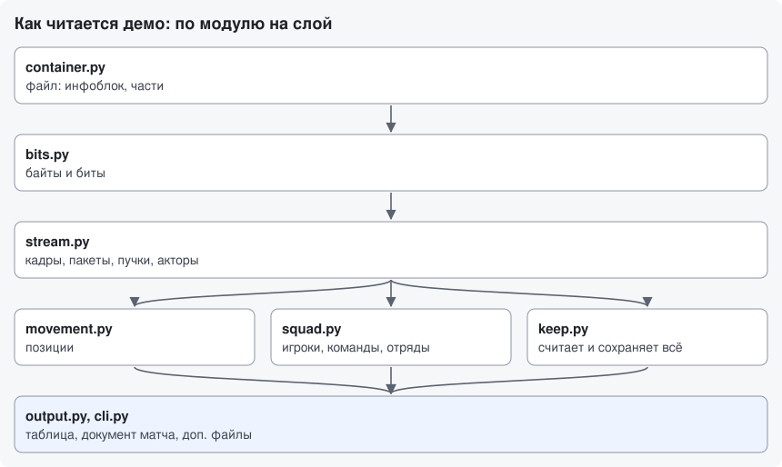

# Как читается демо {#how-a-demo-is-read}

Простыми словами: сервер Squad отправляет позицию каждого игрока всем остальным игрокам.
Файл демо — это запись этого трафика. Этот инструмент проигрывает запись и записывает,
кто где был.



Сетевое демо Unreal — это собственный трафик репликации сервера, записанный его драйвером
демо. Чтение такого демо — это чтение трафика так, как его читал бы клиент.

| Модуль | Слой |
|---|---|
| `container.py` | файл локального потокового записывателя: информационный блок (магия `0x1CA2E27F`), затем части. Типы частей: заголовок (`FNetworkDemoHeader`, магия `0x2CF5A13D`), данные повтора, контрольные точки и события. |
| `bits.py` | байтовые архивы для кадров и битовые архивы для пакетов. Пакеты читаются от младшего бита к старшему. |
| `stream.py` | кадры, пакеты, пучки (частичные пучки склеиваются), каналы акторов, появления акторов и блоки содержимого. Каждый блок содержит реплицируемые свойства как дескриптор, число битов и сами биты, затем удалённые вызовы и пользовательские дельта-поля как дескрипторы в группе `_ClassNetCache` класса. Объекты, которых не называют экспорты, получают свой класс после чтения всего демо (см. ниже). |
| `movement.py` | `FRepMovement` движка и вертолётная физика движения Squad. |
| `keep.py` | каждый встреченный элемент, подсчитанный и сохранённый: строки вспомогательных файлов и самопроверка. |
| `squad.py` | какие классы Squad что несут. `SQPlayerState` хранит имя, состояние команды, состояние отряда и текущего пешку; `SQTeamState` — номер команды и фракцию; `SQSquadState` — номер отряда. Владелец пешки на сиденье — его транспорт. |
| `output.py`, `cli.py` | таблица и документ матча. |

Повтор сам называет свои поля. В нём есть имена классов и свойств для каждого дескриптора
и пути к объектам, на которые он ссылается. Поэтому любое свойство можно найти по имени без
кода игры. Для чтения битов свойства нужен только его тип. Для движения это собственный тип
движка; для свойств Squad типы простые: строки, целые числа, ссылки на объекты и имена.

Некоторые объекты называются только сами по себе: акторы уровня — по имени экземпляра
(`Team1SpawnPoint3`), компоненты — по собственному имени (`MovementComponent`, `wheel_L1`).
Их класс находят по таблицам экспорта, после потока: драйвер демо экспортирует поле класса
в том кадре, где оно впервые отправлено (так бывает при каждой первой отправке именованного
объекта в тестовых демо). Поэтому класс — это та единственная группа, которая экспортировала
именно эти дескрипторы в кадрах, где объект впервые их отправил; иначе — любая группа, у которой
к тому моменту были все её дескрипторы, если все они дают одинаковые имена; иначе — класс
объекта с тем же именем, без учёта цифр, или единственная группа, чьё имя содержит имя объекта.
Из дескрипторов объектов, названных таким образом, у которых класс отправляет их с одним
фиксированным числом битов, все пришли с этим числом (ни один — с другим). То, что ни одно из
этих правил не решает, остаётся целиком во вспомогательном файле сущностей.

## Декодирование свойств {#decoding-properties}

Каждое реплицируемое свойство декодируется настолько, насколько говорят его биты: один бит —
флаг; ссылка на объект (его сетевой GUID), если имя свойства заканчивается как у ссылки
(`...State`, `...Seat`, `...Pawn`, `...Class`...); длина и столько байтов — строка; имя; 8, 16,
32 или 64 бита — число (с плавающей точкой, если это следует из имени свойства: здоровье,
время, скорость, ввод...); всё остальное — его биты в шестнадцатеричном виде, с найденными
внутри строками. Удалённые вызовы читаются так же, по именам параметров, которые демо
экспортирует для каждой функции.

## Как читаются события {#how-the-events-are-read}

`Health` и `bWounded` солдата приходят с сервера: ранен, когда `bWounded` включается; поднят,
когда выключается при здоровье выше 0; погиб, когда здоровье падает ниже -100 (игрок, который
сдался или истёк кровью, получает -300); бот, который никогда не ранен, погибает при 0.
Транспорт или развёртываемый объект получает `damaged` при каждом падении своего `Health`,
`destroyed` — при 0 или ниже. Появления и удаления — это открытие и закрытие канала актора;
сиденье — это `CurrentSeat` состояния игрока (ссылка на компонент сиденья, который отправляется
вместе со своим транспортом). Угол взгляда по вертикали — это `RemoteViewPitch` солдата, байт
от прямо вниз (0) до прямо вверх (255). Выстрел — это `MulticastFireProjectile` оружия (точка
вылета и направление) или его `MulticastFireMultipleProjectileEffects`, если с тем же
направлением не пришёл такой вызов; попадание — это `MulticastPlayDamageEffects` транспорта
(место удара, тип урона).

## Что проверено и как {#what-was-verified-and-how}

Проверка выполнена на двух публичных серверных демо Squad v10.3.1 (Unreal Engine 5.5.4,
сетевая версия движка 36) из тестовых материалов проекта squad-replay:

- **Счётчики.** Число кадров, пакетов, открытий акторов, групп экспорта и путей экспортируемых
  объектов точно совпадает с независимым парсером этого проекта. Так же совпадает число
  отсчётов движения солдат.
- **Движение против скорости.** Шаг каждого отсчёта солдата от предыдущего, делённый на время
  между ними, совпадает со скоростью, которую несёт отсчёт. Медианное отношение лежит в пределах
  от 0,8 до 1,2 у движущихся игроков.
- **Команды против блюпринтов.** Команда каждой строки — та, к фракции которой относится
  блюпринт солдата. Это выполнялось и для игрока, который переходил на другую сторону во время матча.
- **Ошибки.** Одна ошибка потока на демо остаётся: лишний бит в конце открывающего пучка
  собственного актора-наблюдателя записывающего, который здесь ничего не несёт.
- **Потери против убийств того проекта.** Каждое убийство, которое он перечисляет, — это ранение
  или смерть, прочитанные здесь, в то же время и у того же игрока; его убийства транспорта — это
  транспорт, прочитанный здесь с здоровьем 0 или ниже.
- **Развёртываемые объекты.** Акторы, прочитанные здесь с состоянием постройки или требованием
  FOB, совпадают с развёртываемыми объектами того проекта с точностью до одного.
- **Угол взгляда.** Байт угла взгляда лежит около 120 в покое и достигает 255 (прямо вверх):
  его читаем как байт в диапазоне от -90 до +90. Прочитанный как обычный байт движка полного
  оборота, он поставил бы солдат до 128 градусов под горизонтом, куда они не могут смотреть.
- **Боты.** На демо разминки у каждого бота (`SQSquidBot`) есть свой след, а боты, которые
  погибают, читаются как смерти.
- **Движение вертолёта** (`SQHelicopterMovementComponent.ReplicatedMovement`, собственная
  раскладка Squad: без флагов, положение в сотых, скорость и угловая скорость, три необязательных
  16-битных угла, серверные часы как число с плавающей точкой). Каждый отсчёт вертолёта точно
  заполняет свои биты. Положение и курс стоящего вертолёта совпадают с его точкой появления, до
  сантиметра и единицы угла. В полёте шаг между отсчётами, делённый на шаг часов, — это скорость
  (медианное отношение 0,997), а часы идут вместе со временем демо (медианный шаг 0,4 мс).
  Угловая скорость следует за скоростью поворота (корреляция 0,91), но её единица не установлена:
  её сохраняют, но не используют.
- **Сиденья.** `CurrentSeat` состояния игрока — это ссылка (упакованный сетевой GUID), а не число,
  как читалось раньше: так прочитано, что при каждой смене это сиденье, которое собственный
  `MulticastUpdateCurrentSeat` солдата называет мгновением раньше, а смены — те же, что у squad-replay.
- **Выстрелы и попадания.** Каждый `ShootDir` — единичный вектор (длина 1 с точностью до 0,00003);
  каждая точка `MulticastFireMultipleProjectileEffects`, делённая на 10, совпадает с
  `OriginZeroBased` соответствующего `MulticastFireProjectile` с точностью до 1 мм; там, где
  известна позиция стрелка или поражённого транспорта, точка выстрела или удара в медиане
  отстоит от неё на 0,45 м.
- **Входы транспорта.** Прочитанные как числа с плавающей точкой, газ, тормоз и ручной тормоз
  гусеничных машин лежат в пределах 0..1, а поворот — в пределах -1..1 в каждом обновлении.
- **Причины закрытия.** Каждый актор, чей канал открылся снова, был закрыт с `Dormancy`; ни один
  не закрытый с `Destroyed` не открылся снова.

Тесты на демо, которые сами тесты строят, охватывают контейнер, архивы, поток и весь путь до
таблицы, а также проверяют, что демо с одним элементом каждого вида ничего не теряет
([`tests/test_completeness.py`](https://github.com/Holdi601/3DHeat-Ext-Squad/blob/main/tests/test_completeness.py)):

```bash
python -m pip install -e .[test]
pytest                                   # синтетические демо
HEAT3D_SQUAD_DEMOS=<folder> pytest       # плюс настоящие демо из этой папки
```
