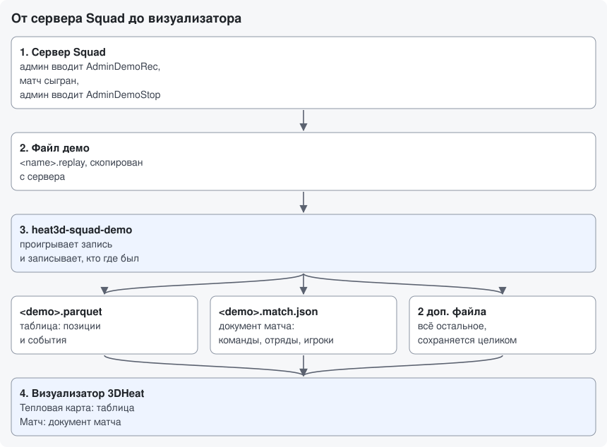

# 3DHeat Squad {#dheat-squad}

**Что это?** Небольшая программа, которая превращает запись матча Squad в файлы, которые
визуализатор [3DHeat](https://github.com/Holdi601/3DHeat)
([документация](https://holdi601.github.io/3DHeat/)) умеет рисовать: где был каждый
игрок, секунда за секундой, и что где произошло.

**Зачем это нужно?** Чтобы увидеть матч сверху: где шёл бой, по каким маршрутам двигались
отряды, где гибли техника.

**Пример:** `match.replay` (демо, записанное на сервере Squad) ->
`match.parquet` (одна строка на каждую позицию или событие) + `match.match.json` (документ
матча: команды, отряды, игроки). Результаты — обычные файлы Parquet и JSON, поэтому их может
прочитать и что-то другое.

Для чего это полезно:

- **Где шёл бой.** Позиция каждого игрока и бота — пешком, на наземной технике и на вертолётах,
  примерно восемь раз в секунду, с командой, фракцией, отрядом, здоровьем и углом взгляда.
- **Что где произошло.** Ранения, подъёмы и смерти; каждый выстрел и каждое попадание в технику;
  каждая техника, развёртываемый объект и огневая точка, появившиеся, повреждённые, уничтоженные
  и убранные.
- **Весь матч в одном документе.** Команды, отряды, состояние игры, каждый актор, строка на
  каждого игрока и каждого бота, и самопроверка, что ничего из того, что содержит демо,
  не потеряно.



## Быстрый старт {#quick-start}

Впервые в командной строке? Сначала прочитайте [С чего начать](before-you-start.md).

```bash
python -m pip install -e .              # устанавливает команду heat3d-squad-demo
heat3d-squad-demo match.replay -o out   # или папка с файлами .replay
```

Вы увидите по одной строке на демо. Затем загрузите `out/<map>/<demo>.parquet` на вкладку
«Тепловая карта» визуализатора ([Загрузка данных](https://holdi601.github.io/3DHeat/getting-data-in.html)).

## Страницы {#pages}

| Страница | Что в ней |
|---|---|
| [С чего начать](before-you-start.md) | Python, терминал, первый запуск |
| [Запись демо](recording.md) | как заставить сервер записать демо и где его найти |
| [Конвертация демо](converting.md) | команда, все параметры, пример вывода |
| [Таблица](output-table.md) | каждый столбец и каждое `event` |
| [Документ матча и вспомогательные файлы](output-match.md) | `.match.json`, два вспомогательных файла, самопроверка |
| [Как читается демо](how-it-works.md) | слои читателя и то, что проверено |
| [Ограничения, обновления и условия](limits.md) | что не читается, что может сломать обновление Squad, личные данные, лицензия |
| [Справка по командам](../cli-reference.md) | каждый параметр и столбец, создано из кода |
| [Сопровождение документации](maintaining.md) | контрольный список выпуска |

## Связанное {#related}

- Визуализатор 3DHeat: [github.com/Holdi601/3DHeat](https://github.com/Holdi601/3DHeat),
  документация на [holdi601.github.io/3DHeat](https://holdi601.github.io/3DHeat/).
- Форматы файлов, которые читает визуализатор, включая контейнер «один файл на матч»:
  [Один файл на матч (.3dheat)](https://holdi601.github.io/3DHeat/container.html).
  Этот конвертер записывает отдельные файлы: таблицу, документ матча и его вспомогательные
  файлы рядом.
- Watcher 3DHeat запускает этот конвертер для новых демо, когда установлен
  (адаптер `squad-demos`): [3DHeat Watcher](https://holdi601.github.io/3DHeat-Watcher/).

## Инструменты 3DHeat {#the-3dheat-tools}

| Инструмент | Что делает | Код | Документация |
|---|---|---|---|
| Визуализатор 3DHeat | показывает данные: тепловые карты, анализ заездов, разбор матчей | [3DHeat](https://github.com/Holdi601/3DHeat) | [docs](https://holdi601.github.io/3DHeat/) |
| GameFiles | уровни и трассы из собственных файлов игры | [3DHeat-GameFiles](https://github.com/Holdi601/3DHeat-GameFiles) | [docs](https://holdi601.github.io/3DHeat-GameFiles/) |
| GameCapture | телеметрия кругов и уровни, восстановленные по видео игры | [3DHeat-GameCapture](https://github.com/Holdi601/3DHeat-GameCapture) | [docs](https://holdi601.github.io/3DHeat-GameCapture/) |
| Unreal Exporter | плагин редактора Unreal: уровень одним `.glb` | [3DHeat-UnrealExporter](https://github.com/Holdi601/3DHeat-UnrealExporter) | [docs](https://holdi601.github.io/3DHeat-UnrealExporter/) |
| CS2 | демо и карты Counter-Strike 2 | [3DHeat-CS2](https://github.com/Holdi601/3DHeat-CS2) | [docs](https://holdi601.github.io/3DHeat-CS2/) |
| Watcher | записывает то, что игры публикуют во время игры | [3DHeat-Watcher](https://github.com/Holdi601/3DHeat-Watcher) | [docs](https://holdi601.github.io/3DHeat-Watcher/) |
| Ext-WarThunder | повторы War Thunder | [3DHeat-Ext-WarThunder](https://github.com/Holdi601/3DHeat-Ext-WarThunder) | [docs](https://holdi601.github.io/3DHeat-Ext-WarThunder/) |
| Ext-WoT | повторы World of Tanks | [3DHeat-Ext-WoT](https://github.com/Holdi601/3DHeat-Ext-WoT) | [docs](https://holdi601.github.io/3DHeat-Ext-WoT/) |
| Ext-WoWs | повторы World of Warships | [3DHeat-Ext-WoWs](https://github.com/Holdi601/3DHeat-Ext-WoWs) | [docs](https://holdi601.github.io/3DHeat-Ext-WoWs/) |
| Ext-Squad | демо серверов Squad | [3DHeat-Ext-Squad](https://github.com/Holdi601/3DHeat-Ext-Squad) | [docs](https://holdi601.github.io/3DHeat-Ext-Squad/) |
| Ext-DCS | карты DCS World как 3D-уровни | [3DHeat-Ext-DCS](https://github.com/Holdi601/3DHeat-Ext-DCS) | [docs](https://holdi601.github.io/3DHeat-Ext-DCS/) |
| Ext-IL2 | карты IL-2 Sturmovik как 3D-уровни | [3DHeat-Ext-IL2](https://github.com/Holdi601/3DHeat-Ext-IL2) | [docs](https://holdi601.github.io/3DHeat-Ext-IL2/) |
