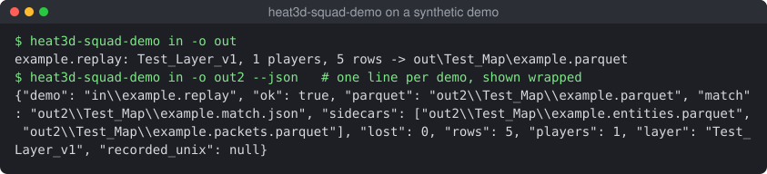

# Prevod dem {#converting-demos}

```text
heat3d-squad-demo <demos or folders> -o <folder> [--flat] [--json]
python -m heat3d_ext_squad ...          to isté, bez inštalácie
```

## Krok za krokom {#step-by-step}

Nikdy ste nepracovali s príkazovým riadkom? Najprv si prečítajte [Ako začať](before-you-start.md).

1. Nainštalujte raz: `git clone https://github.com/Holdi601/3DHeat-Ext-Squad`,
   otvorte terminál v tom priečinku a spustite `python -m pip install -e .`
   (Python 3.10 alebo novší; nainštaluje pyarrow a numpy).
2. Dajte súbory `.replay` do priečinka alebo ich pomenujte jeden po druhom.
3. Spustite `heat3d-squad-demo <folder> -o out`.
4. Uvidíte jeden riadok na každé demo: jeho vrstvu, hráčov a riadky a kam sa tabuľka uložila.
   Každé demo sa zmení na štyri voľné súbory v `out/<map>/` (nie na
   kontajner `.3dheat`); načítajte `.parquet` do prehliadača 3DHeat.



Obrázok ukazuje spustenie na deme, ktoré vytvárajú testy (`tests/test_stream.py`),
nie na skutočnom zápase.

## Možnosti {#options}

| Možnosť | Predvolené | Čo robí |
|---|---|---|
| `demos` (jeden alebo viac) | - | súbory `.replay`, alebo priečinky, ktoré ich obsahujú |
| `-o`, `--out` | povinné | priečinok, do ktorého sa zapisuje; každé demo ide do `<out>/<map>/` |
| `--flat` | vypnuté | zapíše priamo do priečinka, bez podpriečinka `<map>/` |
| `--json` | vypnuté | vypíše jeden riadok JSON na každé demo na štandardný výstup (pre programy, ktoré volajú tento príkaz): `demo`, `ok`, `parquet`, `match`, `sidecars`, `lost`, `rows`, `players`, `layer`, `recorded_unix`; demo, ktoré zlyhalo, vypíše `demo`, `ok: false` a `error` |
| `--version` | - | vypíše verziu a skončí |

Každá možnosť tak, ako ju program vypisuje: [Referencia príkazov](../cli-reference.md).

Názov priečinka mapy je názov mapy prevzatý z cesty k úrovni, ktorú demo uvádza
(`/Game/Maps/<Map>/Gameplay_Layers/<Layer>` dáva `<Map>`).

Stavový kód: 0, keď sa previedlo každé demo; 1, keď zlyhalo ktorékoľvek demo (ostatné
sa aj tak zapíšu), alebo keď sa nenašiel žiadny súbor `.replay`.

## Čo vznikne {#what-comes-out}

| Súbor | Čo obsahuje |
|---|---|
| `<demo>.parquet` | tabuľka: pozície a udalosti, po jednom riadku ([Tabuľka](output-table.md)) |
| `<demo>.match.json` | dokument zápasu ([Dokument zápasu](output-match.md)) |
| `<demo>.entities.parquet` | sprievodný súbor: každá aktualizácia vlastností a každé vzdialené volanie, celé |
| `<demo>.packets.parquet` | sprievodný súbor: časti súboru a všetko, čo sa nedalo prečítať, celé |

Tabuľka a dokument zápasu sú rovnaký pár, aký zapisuje nástroj 3DHeat CS2.
Prehliadač otvorí tabuľku priamo a sprievodné súbory vynechá, keď sa načíta celý priečinok.

## Príklady {#examples}

```bash
heat3d-squad-demo D:\SquadDemos -o out                 # každé demo v priečinku
heat3d-squad-demo one.replay two.replay -o out --flat  # rovno do out/
heat3d-squad-demo D:\SquadDemos -o out --json          # jeden riadok JSON na každé demo
```

`D:\SquadDemos` je príklad priečinka na jednotke D: použite svoj vlastný.
