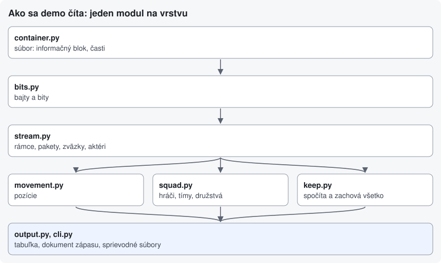

# Ako sa demo číta {#how-a-demo-is-read}

Jednoducho povedané: server Squad posiela pozíciu každého hráča každému inému hráčovi. Súbor dema je záznam tejto komunikácie. Tento nástroj ju prehrá a zapíše, kto kde bol.



Sieťové demo Unreal je vlastná sieťová komunikácia servera, zapísaná jeho ovládačom dema. Čítať ho znamená čítať túto komunikáciu tak, ako ju číta klient.

| Modul | Vrstva |
|---|---|
| `container.py` | súbor lokálneho streamera: informačný blok (magické číslo `0x1CA2E27F`), potom časti. Typy častí sú hlavička (`FNetworkDemoHeader`, magické číslo `0x2CF5A13D`), sieťové dáta, kontrolné body a udalosti. |
| `bits.py` | bajtové archívy pre rámce a bitové archívy pre pakety. Pakety sa čítajú od najnižšieho bitu. |
| `stream.py` | rámce, pakety, zväzky (čiastočné zväzky sa spájajú), kanály aktérov, vznik aktérov a bloky obsahu. Každý blok obsahuje replikované vlastnosti ako handle, počet bitov a bity, potom vzdialené volania a vlastné delta polia ako handle do skupiny `_ClassNetCache` triedy. Objektom, ktorým exporty nedávajú meno, sa trieda priradí až po prečítaní celého dema (pozri nižšie). |
| `movement.py` | `FRepMovement` motora a pohyb helikoptéry Squad. |
| `keep.py` | Každá stretnutá položka, spočítaná a uložená: riadky sprievodných súborov a sebakontrola. |
| `squad.py` | Ktoré triedy Squad čo nesú. `SQPlayerState` nesie meno, stav tímu, stav družstva a aktuálne pešiaka; `SQTeamState` číslo tímu a frakciu; `SQSquadState` číslo družstva. Vlastníkom pešiaka na sedadle je jeho vozidlo. |
| `output.py`, `cli.py` | tabuľka a dokument zápasu. |

Replay pomenúva svoje polia sám. Obsahuje názvy tried a vlastností pre každý handle a cesty k objektom, na ktoré odkazuje. Preto sa každá vlastnosť dá nájsť podľa mena bez kódu hry. Na určenie bitov vlastnosti je potrebný len jej typ. Pri pohybe je to vlastný typ motora; pri vlastnostiach Squad sú typy jednoduché: reťazce, celé čísla, odkazy na objekty a názvy.

Niektoré objekty majú len vlastné meno: aktéri úrovne podľa názvu inštancie (`Team1SpawnPoint3`), komponenty podľa svojho názvu (`MovementComponent`, `wheel_L1`). Ich trieda sa zistí z tabuliek exportu až po streame: ovládač dema exportuje pole triedy v rámci, v ktorom sa prvýkrát pošle (platí pri každom prvom odoslaní pomenovaného objektu v testovacích demách), takže trieda je tá jediná skupina, ktorá exportovala presne tie handle v rámcoch, v ktorých ich objekt prvýkrát poslal; inak ľubovoľná skupina, ktorá mala do tej doby všetky svoje handle, ak všetky dávajú rovnaké mená; inak trieda objektu s rovnakým menom bez čísel, alebo jediná skupina, ktorej názov obsahuje názov objektu. Z handle objektov pomenovaných týmto spôsobom, ktorých trieda ich posiela s jedným pevným počtom bitov, prišli všetky s týmto počtom (žiadny s iným). Čo ani jedno z toho nevyrieši, zostáva v sprievodnom súbore entít, celé.

## Dekódovanie vlastností {#decoding-properties}

Každá replikovaná vlastnosť sa dekóduje až tak ďaleko, ako hovoria jej bity: jeden bit ako príznak, odkaz na objekt (jeho sieťové GUID), ak názov končí ako odkaz (`...State`, `...Seat`, `...Pawn`, `...Class`...), dĺžka a toľko bajtov ako reťazec, názov, 8/16/32/64-bitové čísla (desatinné číslo tam, kde to názov vlastnosti hovorí: zdravie, čas, rýchlosť, vstup...), čokoľvek iné ako bity v hexadecimálnej sústave s reťazcami nájdenými vo vnútri. Vzdialené volania sa čítajú rovnako, podľa názvov parametrov, ktoré demo exportuje pre každú funkciu.

## Ako sa čítajú udalosti {#how-the-events-are-read}

`Health` a `bWounded` vojaka prichádzajú zo servera: ranený, keď sa `bWounded` zapne, oživený, keď sa vypne a zdravie je nad 0, mŕtvy, keď zdravie klesne pod -100 (hráč, ktorý sa vzdá alebo vykrváca, dostane -300); bot, ktorý nikdy nebol zranený, zomiera pri 0. Vozidlo alebo rozmiestnený prvok je `damaged` pri každom poklese jeho `Health` a `destroyed` pri 0 alebo menej. Vznik a odstránenie je otvorenie a zatvorenie kanála aktéra; sedadlo je `CurrentSeat` stavu hráča (odkaz na komponent sedadla, ktorý sa posiela na jeho vozidle). Uhol pohľadu je `RemoteViewPitch` vojaka, bajt od priamo dole (0) po priamo hore (255). Výstrel je `MulticastFireProjectile` zbrane (začiatok a smer), alebo jej `MulticastFireMultipleProjectileEffects`, ak sa s rovnakým smerom neobjavilo také volanie; zásah je `MulticastPlayDamageEffects` vozidla (miesto nárazu, typ poškodenia).

## Čo bolo overené a ako {#what-was-verified-and-how}

Overené na dvoch verejných serverových demách Squad v10.3.1 (Unreal Engine 5.5.4, sieťová verzia motora 36), z testovacích súborov projektu squad-replay:

- **Počty.** Počty rámcov, paketov, otvorení aktérov, skupín exportu a exportovaných ciest objektov sa presne zhodujú s nezávislým čítačom toho projektu. Rovnako počet vzoriek pohybu vojakov.
- **Pohyb voči rýchlosti.** Krok každej vzorky vojaka od predchádzajúcej, delený časom medzi nimi, sa zhoduje s rýchlosťou, ktorú vzorka nesie. Stredný pomer je v rozsahu 0,8 až 1,2 pri pohybujúcich sa hráčoch.
- **Tímy voči plánom.** Tím každého riadka je tím, ktorého frakcia patrí plánu vojaka. Platilo to aj pre hráča, ktorý v zápase zmenil strany.
- **Chyby.** Zostáva jedna chyba streamu na demo: cudzí bit na konci úvodného zväzku aktéra diváka nahrávajúceho server, ktorý tu nič nepoužitého neobsahuje.
- **Padlí voči zabitiam toho projektu.** Každé zabitie, ktoré tamten projekt uvádza, je tu prečítané ako zranenie alebo smrť, v tom istom čase a u toho istého hráča; jeho zabitia vozidiel sú tu vozidlá, ktoré dosiahnu zdravie 0 alebo menej.
- **Rozmiestnené prvky.** Aktéri prečítaní tu so stavom stavby alebo požiadavkou FOB sa zhodujú s rozmiestnenými prvkami toho projektu, s odchýlkou do jedného.
- **Uhol pohľadu.** Bajt uhla pohľadu je v pokoji okolo 120 a dosahuje 255 (priamo hore): číta sa ako bajt v rozsahu -90..+90. Keby sa čítal ako bežný bajt motora pre celú otáčku, vojaci by sa dívali až 128 stupňov pod horizont, čo nemôžu.
- **Boti.** Na demu so zoskupovaním má každý bot (`SQSquidBot`) vlastnú dráhu a boti, ktorí zomreli, sú čítaní ako smrť.
- **Pohyb helikoptéry** (`SQHelicopterMovementComponent.ReplicatedMovement`, vlastné rozloženie Squad: žiadne príznaky, poloha v stotinách, rýchlosť a uhlová rýchlosť, tri voliteľné 16-bitové uhly, čas servera ako desatinné číslo). Každá vzorka helikoptéry presne vyplní svoje bity. Poloha a natočenie zaparkovanej helikoptéry sú polohou jej vzniku, na centimeter a jednotku uhla. Za letu je krok medzi vzorkami delený krokom času rýchlosťou (stredný pomer 0,997) a čas sa mení s časom dema (stredne 0,4 ms od seba). Uhlová rýchlosť nasleduje rýchlosť otáčania (korelácia 0,91), ale jej jednotka nie je presne určená: zachováva sa, nepoužíva sa.
- **Sedadlá.** `CurrentSeat` stavu hráča je odkaz (zabalené sieťové GUID), nie číslo, ako sa čítal predtým: takto sa číta, a pri každej zmene je to sedadlo, ktoré chvíľu predtým pomenúva vlastné `MulticastUpdateCurrentSeat` vojaka; zmeny sú zmeny squad-replay.
- **Výstrely a zásahy.** Každý `ShootDir` je jednotkový vektor (dĺžka 1 v rámci 0,00003); každý začiatok `MulticastFireMultipleProjectileEffects`, delený 10, je `OriginZeroBased` zodpovedajúceho `MulticastFireProjectile` v rámci 1 mm; kde je známa poloha strelca alebo zasiahnutého vozidla, začiatok výstrelu alebo náraz je v mediáne 0,45 m od nej.
- **Vstupy vozidiel.** Čítané ako desatinné čísla, plyn, brzda a ručná brzda pásových vozidiel ležia v rozsahu 0..1 a ich riadenie v rozsahu -1..1, pri každej aktualizácii.
- **Dôvody zatvorenia.** Každý aktér, ktorého kanál sa znova otvoril, bol zatvorený s `Dormancy`; žiadny, zatvorený s `Destroyed`, sa znova neotvoril.

Testy na demách, ktoré vytvárajú samotné testy, pokrývajú kontajner, archívy, stream a celú cestu až po tabuľku a overujú, že demo, ktoré obsahuje jeden z každého druhu položky, nestratí žiadnu ([`tests/test_completeness.py`](https://github.com/Holdi601/3DHeat-Ext-Squad/blob/main/tests/test_completeness.py)):

```bash
python -m pip install -e .[test]
pytest                                   # syntetické demá
HEAT3D_SQUAD_DEMOS=<folder> pytest       # plus skutočné demá v tom priečinku
```
