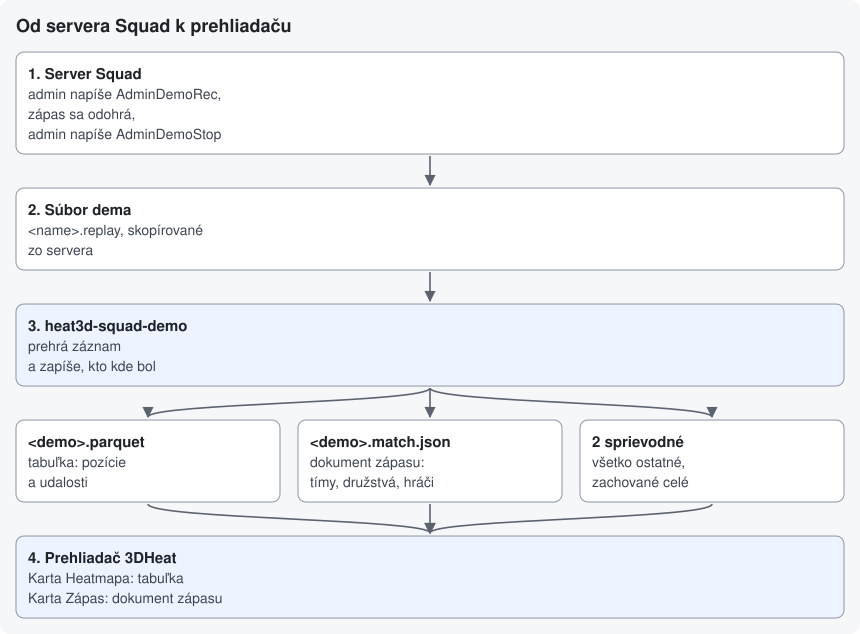

# 3DHeat Squad {#dheat-squad}

**Čo to je?** Malý program, ktorý mení záznam zápasu Squad na súbory, ktoré
prehliadač [3DHeat](https://github.com/Holdi601/3DHeat) ([dokumentácia](https://holdi601.github.io/3DHeat/))
dokáže vykresliť: kde bol každý hráč, sekundu po sekunde, a čo sa kde stalo.

**Prečo by som ho použil?** Aby ste videli zápas zhora: kde bolo boje, po akých trasách sa
pohybovali družstvá, kde ničili vozidlá.

**Príklad:** `match.replay` (demo nahrané na serveri Squad) ->
`match.parquet` (jeden riadok na každú pozíciu alebo udalosť) + `match.match.json` (dokument
zápasu: tímy, družstvá, hráči). Výstupy sú obyčajné súbory Parquet a JSON, takže ich môže čítať aj
čokoľvek iné.

Na čo je to užitočné:

- **Kde sa zápas bojoval.** Pozícia každého hráča a bota, pešo, v pozemných vozidlách a v helikoptérach,
  asi osemkrát za sekundu, s tímom, frakciou, družstvom, zdravím a uhlom pohľadu.
- **Čo sa kde stalo.** Zranenia, oživenia a smrti; každý výstrel a každý zásah do vozidla; každé
  vozidlo, rozmiestnený prvok a stanovište, ktoré vzniklo, bolo poškodené, zničené a odstránené.
- **Celý zápas v jednom dokumente.** Tímy, družstvá, stav hry, každý aktér, riadok pre každého hráča
  a pre každého bota a sebakontrolu, že sa z dema nič nestratilo.



## Rýchly štart {#quick-start}

Nikdy ste nepracovali s príkazovým riadkom? Najprv si prečítajte [Ako začať](before-you-start.md).

```bash
python -m pip install -e .              # nainštaluje príkaz heat3d-squad-demo
heat3d-squad-demo match.replay -o out   # alebo priečinok súborov .replay
```

Uvidíte jeden riadok na každé demo. Potom načítajte `out/<map>/<demo>.parquet` na karte
Heatmapa prehliadača ([Načítanie dát](https://holdi601.github.io/3DHeat/getting-data-in.html)).

## Stránky {#pages}

| Stránka | Čo obsahuje |
|---|---|
| [Ako začať](before-you-start.md) | Python, terminál, prvé spustenie |
| [Nahrávanie dema](recording.md) | ako nechať server nahrávať demo a ako ho nájsť |
| [Prevod dem](converting.md) | príkaz, každá možnosť, príklad výstupu |
| [Tabuľka](output-table.md) | každý stĺpec a každý `event` |
| [Dokument zápasu a sprievodné súbory](output-match.md) | `.match.json`, dva sprievodné súbory, sebakontrola |
| [Ako sa demo číta](how-it-works.md) | vrstvy čítačky a čo bolo overené |
| [Obmedzenia, aktualizácie a podmienky](limits.md) | čo sa nečíta, čo môže rozbiť aktualizácia Squad, osobné údaje, licencia |
| [Referencia príkazov](../cli-reference.md) | každá možnosť a stĺpec, generované z kódu |
| [Údržba týchto dokumentov](maintaining.md) | kontrolný zoznam pri vydaní |

## Súvisiace {#related}

- Prehliadač 3DHeat: [github.com/Holdi601/3DHeat](https://github.com/Holdi601/3DHeat),
  dokumentácia na [holdi601.github.io/3DHeat](https://holdi601.github.io/3DHeat/).
- Formáty súborov, ktoré prehliadač číta, vrátane kontajnera jeden súbor na zápas:
  [Jeden súbor na zápas (.3dheat)](https://holdi601.github.io/3DHeat/container.html).
  Tento prevodník zapisuje voľné súbory: tabuľku, dokument zápasu a jeho sprievodné súbory
  vedľa seba.
- Watcher 3DHeat spúšťa tento prevodník na nové demá, keď je nainštalovaný
  (adaptér `squad-demos`): [3DHeat Watcher](https://holdi601.github.io/3DHeat-Watcher/).

## Nástroje 3DHeat {#the-3dheat-tools}

| Nástroj | Čo robí | Kód | Dokumentácia |
|---|---|---|---|
| prehliadač 3DHeat | zobrazuje dáta: heatmapy, analýzu pretekov, prehľad zápasu | [3DHeat](https://github.com/Holdi601/3DHeat) | [dokumentácia](https://holdi601.github.io/3DHeat/) |
| GameFiles | úrovne a trate zo súborov samotnej hry | [3DHeat-GameFiles](https://github.com/Holdi601/3DHeat-GameFiles) | [dokumentácia](https://holdi601.github.io/3DHeat-GameFiles/) |
| GameCapture | telemetria kôl a úrovne zrekonštruované z videa hry | [3DHeat-GameCapture](https://github.com/Holdi601/3DHeat-GameCapture) | [dokumentácia](https://holdi601.github.io/3DHeat-GameCapture/) |
| Unreal Exporter | plugin pre Unreal Editor: úroveň ako jeden `.glb` | [3DHeat-UnrealExporter](https://github.com/Holdi601/3DHeat-UnrealExporter) | [dokumentácia](https://holdi601.github.io/3DHeat-UnrealExporter/) |
| CS2 | dema a mapy Counter-Strike 2 | [3DHeat-CS2](https://github.com/Holdi601/3DHeat-CS2) | [dokumentácia](https://holdi601.github.io/3DHeat-CS2/) |
| Watcher | zaznamenáva, čo hry zverejňujú, kým hráte | [3DHeat-Watcher](https://github.com/Holdi601/3DHeat-Watcher) | [dokumentácia](https://holdi601.github.io/3DHeat-Watcher/) |
| Ext-WarThunder | replaye War Thunder | [3DHeat-Ext-WarThunder](https://github.com/Holdi601/3DHeat-Ext-WarThunder) | [dokumentácia](https://holdi601.github.io/3DHeat-Ext-WarThunder/) |
| Ext-WoT | replaye World of Tanks | [3DHeat-Ext-WoT](https://github.com/Holdi601/3DHeat-Ext-WoT) | [dokumentácia](https://holdi601.github.io/3DHeat-Ext-WoT/) |
| Ext-WoWs | replaye World of Warships | [3DHeat-Ext-WoWs](https://github.com/Holdi601/3DHeat-Ext-WoWs) | [dokumentácia](https://holdi601.github.io/3DHeat-Ext-WoWs/) |
| Ext-Squad | dema zo serverov Squad | [3DHeat-Ext-Squad](https://github.com/Holdi601/3DHeat-Ext-Squad) | [dokumentácia](https://holdi601.github.io/3DHeat-Ext-Squad/) |
| Ext-DCS | mapy DCS World ako 3D úrovne | [3DHeat-Ext-DCS](https://github.com/Holdi601/3DHeat-Ext-DCS) | [dokumentácia](https://holdi601.github.io/3DHeat-Ext-DCS/) |
| Ext-IL2 | mapy IL-2 Sturmovik ako 3D úrovne | [3DHeat-Ext-IL2](https://github.com/Holdi601/3DHeat-Ext-IL2) | [dokumentácia](https://holdi601.github.io/3DHeat-Ext-IL2/) |
