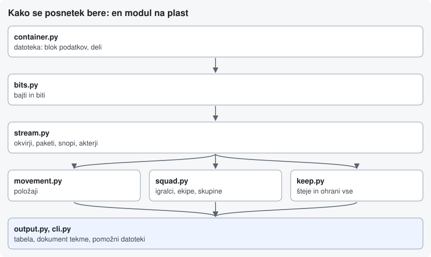

# Kako se posnetek bere {#how-a-demo-is-read}

Preprosto povedano: strežnik Squad pošilja položaj vsakega igralca vsakemu drugemu
igralcu. Datoteka posnetka je zapis tega prometa. To orodje ga predvaja nazaj in zapiše,
kdo je bil kje.



Posnetek omrežja Unreal je lastni promet replikacije strežnika, ki ga zapiše njegov
gonilnik posnetkov. Branje takega posnetka pomeni brati ta promet, kot bi ga bral odjemalec.

| Modul | Plast |
|---|---|
| `container.py` | datoteka lokalnega pretakalnika: blok podatkov (magična številka `0x1CA2E27F`), nato deli. Vrste delov so glava (`FNetworkDemoHeader`, magična številka `0x2CF5A13D`), podatki posnetka, kontrolne točke in dogodki. |
| `bits.py` | bajtni arhivi za okvire in bitni arhivi za pakete. Paketi se berejo od najnižjega bita naprej. |
| `stream.py` | okvirji, paketi, snopi (delni snopi se združijo), kanali akterjev, nastanki akterjev in vsebinski bloki. Vsak blok nosi replicirane lastnosti kot ročaj, število bitov in bite, nato oddaljene klice in polja custom-delta kot ročaje v skupini `_ClassNetCache` razreda. Objektom, ki jih izvozi ne poimenujejo, se razred določi, ko je prebran ves posnetek (glej spodaj). |
| `movement.py` | `FRepMovement` pogona in gibanje helikopterjev Squad. |
| `keep.py` | vsak srečani element, prešteti in ohranjeni: vrstice spremljevalnih datotek in samopreverba. |
| `squad.py` | kateri razredi Squad nosijo kaj. `SQPlayerState` nosi ime, stanje ekipe, stanje skupine in trenutni pawn; `SQTeamState` številko ekipe in frakcijo; `SQSquadState` številko skupine. Lastnik pawna sedeža je njegovo vozilo. |
| `output.py`, `cli.py` | tabela in dokument tekme. |

Posnetek poimenuje svoja polja sam. Za vsak ročaj nosi poti razredov in imen lastnosti ter
poti objektov, na katere se sklicuje. Tako je vsako lastnost mogoče najti po imenu brez
kode igre. Za biti lastnosti je potreben samo njen tip; za gibanje je to lasten tip
pogona, za lastnosti Squad pa so tipi preprosti: nizi, cela števila, reference na objekte
in imena.

Nekateri objekti so poimenovani samo s sabo: akterje ravni po imenu primerka
(`Team1SpawnPoint3`), komponente po lastnem (`MovementComponent`, `wheel_L1`). Njihov
razred se najde iz tabel izvoza, po toku: gonilnik posnetkov izvozi polje razreda v okvirju,
v katerem je bilo prvič poslano (velja za vsako prvo pošiljanje poimenovanega objekta v
testnih posnetkih), zato je razred tista ena skupina, ki je v okvirjih, kjer je objekt prvič
poslal svoje ročaje, izvozila točno te ročaje; sicer katerakoli skupina, ki je do tedaj imela
vse svoje ročaje, kadar vse dajejo ista imena; sicer razred objekta z istim imenom, brez številk,
ali tista ena skupina, katere ime vsebuje ime objekta. Med ročaji objektov, poimenovanih na
ta način, katerih razred jih pošilja s fiksnim številom bitov, so vsi prišli s tem številom
(nobeden z drugim). Kar nobeno od tega ne reši, ostane v spremljevalni datoteki entities,
v celoti.

## Dekodiranje lastnosti {#decoding-properties}

Vsaka replicirana lastnost se dekodira, kolikor pove njen zapis, kaj je: en bit je zastavica;
referenca na objekt (njegov mrežni GUID) je tam, kjer ime konča kot referenca (`...State`,
`...Seat`, `...Pawn`, `...Class`...); dolžina in toliko bajtov je niz; ime je ime;
8/16/32/64 bitov je število (s plavajočo vejico tam, kjer tako pove ime lastnosti: zdravje,
čas, hitrost, vnos ...); vse drugo so njeni biti v šestnajstiškem zapisu z nizi, najdenimi
znotraj. Oddaljene klice se berejo na enak način, po imenih parametrov, ki jih posnetek
izvozi za vsako funkcijo.

## Kako se dogodki preberejo {#how-the-events-are-read}

`Health` in `bWounded` vojaka prihajata od strežnika: ranjen, ko se `bWounded` vklopi; oživljen,
ko se izklopi in je zdravje nad 0; mrtev, ko zdravje pade pod -100 (igralec, ki se preda ali
izkrvavi, je nastavljen na -300); bot, ki ni nikoli ranjen, umre pri 0. Vozilo ali postavljiv
objekt je `damaged` ob vsakem padcu njegovega `Health`, `destroyed` pri 0 ali manj. Nastanki in
odstranitve so odprtje in zaprtje kanala akterja; sedež je `CurrentSeat` stanja igralca
(referenca na komponento sedeža, ki je poslana na njegovem vozilu). Nagib pogleda je
`RemoteViewPitch` vojaka, bajt od navpično navzdol (0) do navpično navzgor (255). Strel je
`MulticastFireProjectile` orožja (izvor in smer) ali njegov `MulticastFireMultipleProjectileEffects`,
kjer ni bilo takega klica z isto smerjo; zadetek je `MulticastPlayDamageEffects` vozila (mesto
udarca, vrsta poškodbe).

## Kaj je bilo preverjeno in kako {#what-was-verified-and-how}

To je bilo preverjeno na dveh javnih posnetkih strežnikov Squad v10.3.1 (Unreal Engine 5.5.4,
različica omrežja motora 36), iz testnih podatkov projekta squad-replay:

- **Števila.** Števila okvirjev, paketov, odprtij akterjev, skupin izvoza in izvoženih poti
  objektov se popolnoma ujemajo z neodvisnim bralnikom tega projekta. Enako velja za število
  vzorcev premikov vojakov.
- **Premik proti hitrosti.** Korak vsakega vzorca vojaka od prejšnjega, deljen s časom med njima,
  se ujema s hitrostjo, ki jo vzorec nosi. Mediana razmerja je med 0,8 in 1,2 pri igralcih, ki se
  premikajo.
- **Ekipe proti pawnom.** Ekipa vsake vrstice je ekipa, ki ji pripada frakcija pawna vojaka. To
  velja tudi za igralca, ki je med tekmo zamenjal stran.
- **Napake.** Ostane ena napaka toka na posnetek: odvečni bit na koncu začetnega snopa
  opazovalca, ki snema, ta pa ne nosi ničesar, kar se tukaj uporablja.
- **Ranjenci proti ubojem tega projekta.** Vsak uboj, ki ga ta navaja, je ranjenje ali smrt,
  prebrana tukaj, ob istem času in istem igralcu; njegovi uboji vozil so vozila, prebrana tukaj,
  ki dosežejo zdravje 0 ali manj.
- **Postavljivi objekti.** Akterji, prebrani tukaj z stanjem gradnje ali zahtevo FOB, se ujemajo z
  postavljivimi objekti tega projekta, do ene enote.
- **Nagib.** Bajt nagiba pogleda je okoli 120 v mirovanju in doseže 255 (navpično navzgor): prebran
  je kot bajt v razponu od -90 do +90. Prebran kot običajni bajt motorja za celoten obrat bi vojake
  postavil do 128 stopinj pod obzorje, kamor ne morejo gledati.
- **Boti.** Na posnetku s polnjenjem ima vsak bot (`SQSquidBot`) svojo pot, boti, ki umrejo, pa so
  prebrani kot smrti.
- **Gibanje helikopterja** (`SQHelicopterMovementComponent.ReplicatedMovement`, lasten zapis Squad:
  brez zastavic, položaj v stotinkah, hitrost in kotna hitrost, tri neobvezne 16-bitne kote, čas
  strežnika kot število s plavajočo vejico). Vsak vzorec helikopterja v celoti zapolni svoje bite.
  Položaj in yaw parkiranega helikopterja sta njegova nastanka, na centimeter in kotno enoto. V letu je
  korak med vzorci, deljen s korakom ure, hitrost (mediana razmerja 0,997), ura pa se premika s časom
  posnetka (mediana razmika 0,4 ms). Kotna hitrost sledi hitrosti vrtenja yaw (korelacija 0,91), vendar
  njena enota ni določena: ohranjena je, ni pa uporabljena.
- **Sedeži.** `CurrentSeat` stanja igralca je referenca (zapakiran mrežni GUID), ne število, kot je bila
  prej prebrana: tako prebrano, ob vsaki spremembi je to sedež, ki ga trenutek prej navede
  `MulticastUpdateCurrentSeat` vojaka, spremembe pa so iz squad-replay.
- **Streli in zadetki.** Vsak `ShootDir` je enotski vektor (dolžina 1 v okviru 0,00003); vsak izvor
  `MulticastFireMultipleProjectileEffects`, deljen z 10, je `OriginZeroBased` ustreznega
  `MulticastFireProjectile` v okviru 1 mm; kjer je znan položaj strelca ali zadetega vozila, je izvor
  strela ali udarec mediana 0,45 m od njega.
- **Vnosi vozil.** Prebrani kot plavajoče vrednosti so plin, zavora in ročna zavora goseničnih vozil v
  0..1, krmiljenje v -1..1, v vsaki posodobitvi.
- **Razlogi zaprtja.** Vsak akter, čigar kanal se je znova odprl, je bil zaprt z `Dormancy`; noben, zaprt z
  `Destroyed`, se ni znova odprl.

Testi na posnetkih, ki jih sami ustvarijo, pokrivajo vsebnik, arhive, tok in celotno pot do
tabele, ter preverjajo, da posnetek z enim primerkom vsake vrste elementa ne izgubi ničesar
([`tests/test_completeness.py`](https://github.com/Holdi601/3DHeat-Ext-Squad/blob/main/tests/test_completeness.py)):

```bash
python -m pip install -e .[test]
pytest                                   # sintetični posnetki
HEAT3D_SQUAD_DEMOS=<mapa> pytest         # plus pravi posnetki v tej mapi
```
