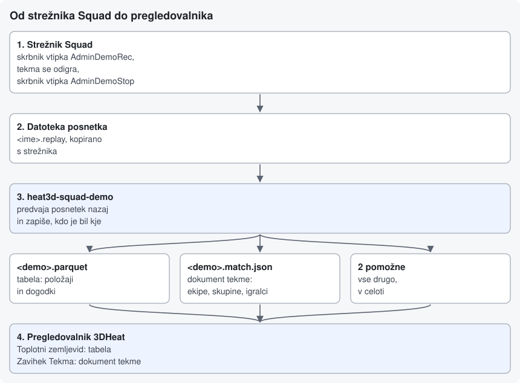

# 3DHeat Squad {#dheat-squad}

**Kaj je to?** Majhen program, ki posnetek tekme Squad spremeni v datoteke,
ki jih lahko prikaže [3DHeat](https://github.com/Holdi601/3DHeat) pregledovalnik
([dokumentacija](https://holdi601.github.io/3DHeat/)): kje je bil vsak igralec,
sekundo za sekundo, in kaj se je dogajalo na katerem mestu.

**Zakaj bi ga uporabil?** Da tekmo vidiš od zgoraj: kje so bili boji, po katerih
poteh so šle skupine, kje so uničena vozila.

**Primer:** `match.replay` (posnetek, zapisan na strežniku Squad) ->
`match.parquet` (ena vrstica na položaj ali dogodek) + `match.match.json` (dokument
tekme: ekipe, skupine, igralci). Izhodni datoteki sta navadni datoteki Parquet in
JSON, zato ju lahko prebere tudi kaj drugega.

Uporabno za:

- **Kje je potekala tekma.** Položaj vsakega igralca in bota, peš, v kopenskih
  vozilih in v helikopterjih, približno osemkrat na sekundo, z ekipo, frakcijo,
  skupino, zdravjem in nagibom pogleda.
- **Kaj se je dogajalo kje.** Ranjevanja, oživljanja in smrti; vsak strel in vsak
  zadetek v vozilo; vsako vozilo, postavljivi objekt in strelni položaj, ki je bil
  ustvarjen, poškodovan, uničen ali odstranjen.
- **Celotna tekma v enem dokumentu.** Ekipe, skupine, stanje igre, vsak akter, po
  ena vrstica za vsakega igralca in bota ter samopreverba, da nič od tega, kar
  posnetek vsebuje, ni izgubljeno.



## Hitri začetek {#quick-start}

Še nisi vajen ukazne vrstice? Najprej preberi [Preden začneš](before-you-start.md).

```bash
python -m pip install -e .              # namesti ukaz heat3d-squad-demo
heat3d-squad-demo match.replay -o out   # ali mapo datotek .replay
```

Za vsak posnetek se izpiše ena vrstica. Nato v pregledovalniku naloži
`out/<zemljevid>/<posnetek>.parquet` na zavihku Toplotni zemljevid
([Vnos podatkov](https://holdi601.github.io/3DHeat/getting-data-in.html)).

## Strani {#pages}

| Stran | Kaj obravnava |
|---|---|
| [Preden začneš](before-you-start.md) | Python, terminal, prvi zagon |
| [Snemanje posnetka](recording.md) | kako strežnik zapiše posnetek in kje ga najdeš |
| [Pretvarjanje posnetkov](converting.md) | ukaz, vse možnosti, primer izpisa |
| [Tabela](output-table.md) | vsak stolpec in vsak `event` |
| [Dokument tekme in spremljevalni datoteki](output-match.md) | `.match.json`, dve spremljevalni datoteki, samopreverba |
| [Kako se posnetek bere](how-it-works.md) | plasti bralnika in kaj je bilo preverjeno |
| [Omejitve, posodobitve in pogoji](limits.md) | kaj ni prebrano, kaj lahko posodobitev igre pokvari, osebni podatki, licenca |
| [Priročnik ukazov](../cli-reference.md) | vsaka možnost in stolpec, ustvarjen iz kode |
| [Vzdrževanje teh strani](maintaining.md) | kontrolni seznam ob izdaji |

## Povezano {#related}

- Pregledovalnik 3DHeat: [github.com/Holdi601/3DHeat](https://github.com/Holdi601/3DHeat),
  dokumentacija na [holdi601.github.io/3DHeat](https://holdi601.github.io/3DHeat/).
- Datotečne oblike, ki jih bere pregledovalnik, vključno z vsebnikom ene datoteke
  na tekmo: [Ena datoteka na tekmo (.3dheat)](https://holdi601.github.io/3DHeat/container.html).
  Ta pretvornik zapisuje ločene datoteke: tabelo, dokument tekme in njune
  spremljevalne datoteke drugo ob drugi.
- Pregledovalnik 3DHeat Watcher ob namestitvi za nove posnetke zažene ta pretvornik
  (prilagodilnik `squad-demos`): [3DHeat Watcher](https://holdi601.github.io/3DHeat-Watcher/).

## Orodja 3DHeat {#the-3dheat-tools}

| Orodje | Kaj počne | Koda | Dokumentacija |
|---|---|---|---|
| 3DHeat pregledovalnik | prikazuje podatke: toplotne zemljevide, analizo dirk, pregled tekme | [3DHeat](https://github.com/Holdi601/3DHeat) | [dokumentacija](https://holdi601.github.io/3DHeat/) |
| GameFiles | ravni in proge iz datotek same igre | [3DHeat-GameFiles](https://github.com/Holdi601/3DHeat-GameFiles) | [dokumentacija](https://holdi601.github.io/3DHeat-GameFiles/) |
| GameCapture | telemetrija krogov in ravni, obnovljene iz videoposnetka igre | [3DHeat-GameCapture](https://github.com/Holdi601/3DHeat-GameCapture) | [dokumentacija](https://holdi601.github.io/3DHeat-GameCapture/) |
| Unreal Exporter | vtičnik za urejevalnik Unreal: raven kot ena datoteka `.glb` | [3DHeat-UnrealExporter](https://github.com/Holdi601/3DHeat-UnrealExporter) | [dokumentacija](https://holdi601.github.io/3DHeat-UnrealExporter/) |
| CS2 | posnetki in zemljevidi igre Counter-Strike 2 | [3DHeat-CS2](https://github.com/Holdi601/3DHeat-CS2) | [dokumentacija](https://holdi601.github.io/3DHeat-CS2/) |
| Watcher | zapisuje, kar igre objavijo med igranjem | [3DHeat-Watcher](https://github.com/Holdi601/3DHeat-Watcher) | [dokumentacija](https://holdi601.github.io/3DHeat-Watcher/) |
| Ext-WarThunder | posnetki igre War Thunder | [3DHeat-Ext-WarThunder](https://github.com/Holdi601/3DHeat-Ext-WarThunder) | [dokumentacija](https://holdi601.github.io/3DHeat-Ext-WarThunder/) |
| Ext-WoT | posnetki igre World of Tanks | [3DHeat-Ext-WoT](https://github.com/Holdi601/3DHeat-Ext-WoT) | [dokumentacija](https://holdi601.github.io/3DHeat-Ext-WoT/) |
| Ext-WoWs | posnetki igre World of Warships | [3DHeat-Ext-WoWs](https://github.com/Holdi601/3DHeat-Ext-WoWs) | [dokumentacija](https://holdi601.github.io/3DHeat-Ext-WoWs/) |
| Ext-Squad | posnetki strežnikov Squad | [3DHeat-Ext-Squad](https://github.com/Holdi601/3DHeat-Ext-Squad) | [dokumentacija](https://holdi601.github.io/3DHeat-Ext-Squad/) |
| Ext-DCS | zemljevidi igre DCS World kot 3D ravni | [3DHeat-Ext-DCS](https://github.com/Holdi601/3DHeat-Ext-DCS) | [dokumentacija](https://holdi601.github.io/3DHeat-Ext-DCS/) |
| Ext-IL2 | zemljevidi igre IL-2 Sturmovik kot 3D ravni | [3DHeat-Ext-IL2](https://github.com/Holdi601/3DHeat-Ext-IL2) | [dokumentacija](https://holdi601.github.io/3DHeat-Ext-IL2/) |
