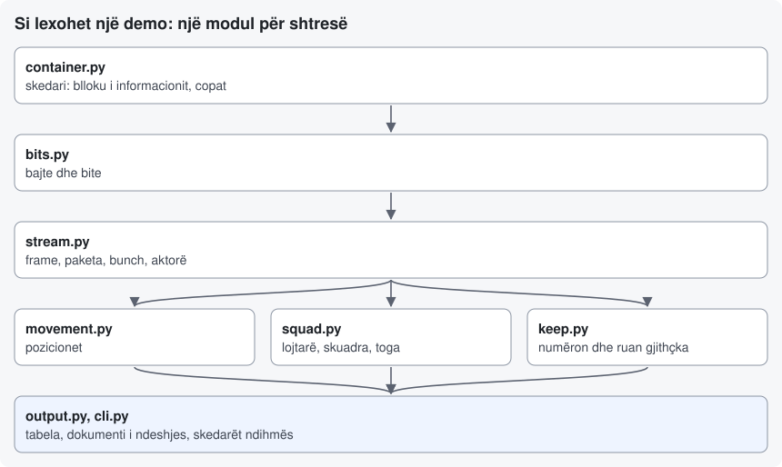

# Si lexohet një demo {#how-a-demo-is-read}

Me fjalë të thjeshta: një server Squad ia dërgon pozicionin e çdo lojtari çdo lojtari tjetër. Skedari demo është një regjistrim i këtij trafiku. Ky mjet e luan prapa dhe shënon kush ishte ku.



Një riluajtje rrjeti e Unreal është trafiku i vetë replikimit të serverit, shkruar nga drejtuesi i tij i demove. Leximi i një të tillë është leximi i atij trafiku ashtu si do ta lexonte një klient.

| Moduli | Shtresa |
|---|---|
| `container.py` | Skedari i streamer-it lokal të skedarëve: një bllok informacioni (magic `0x1CA2E27F`), pastaj copa. Llojet e copave janë koka (`FNetworkDemoHeader`, magic `0x2CF5A13D`), të dhënat e riluajtjes, checkpoint-et dhe ngjarjet. |
| `bits.py` | Arkiva bajtesh për frame-et dhe arkiva bitesh për paketat. Paketat lexohen me bitin më të vogël së pari. |
| `stream.py` | Frame-et, paketat, bunch-et (bunch-et e pjesshëm të bashkuar), kanalet e aktorëve, shfaqjet e aktorëve dhe blloqet e përmbajtjes. Çdo bllok mban veti të replikuara si handle, numër bitesh dhe bite, pastaj thirrje në distancë dhe fusha custom-delta si handle në grupin `_ClassNetCache` të klasës. Objekteve që eksportet nuk i emërtojnë u jepet klasa e tyre pasi demo të lexohet e tëra (shih më poshtë). |
| `movement.py` | `FRepMovement` i motorit, dhe lëvizja e helikopterëve të Squad. |
| `keep.py` | Çdo send i takuar, i numëruar dhe i ruajtur: rreshtat e skedarëve anësorë dhe vetëkontrolli. |
| `squad.py` | Cilat klasa të Squad çfarë mbajnë. `SQPlayerState` mban emrin, gjendjen e skuadrës, gjendjen e togës dhe pawn-in aktual; `SQTeamState` numrin e skuadrës dhe fraksionin; `SQSquadState` numrin e togës. Pronari i pawn-it të një ndenjëseje është automjeti i saj. |
| `output.py`, `cli.py` | Tabela dhe dokumenti i ndeshjes. |

Një riluajtje i emërton vetë fushat e saj. Mban shtigjet e klasave dhe emrat e vetive për çdo handle, dhe shtigjet e objekteve që referon. Kështu çdo veti mund të gjendet sipas emrit pa kodin e lojës. Vetëm bitet e një vetie kërkojnë llojin e saj. Për lëvizjen ky është lloji i vetë motorit; për vetitë e Squad llojet janë të thjeshta: vargje, numra të plotë, referenca objektesh dhe emra.

Disa objekte emërtohen vetëm nga vetvetja: aktorët e një niveli sipas emrit të instancës (`Team1SpawnPoint3`), komponentët sipas emrit të tyre (`MovementComponent`, `wheel_L1`). Klasa e tyre gjendet nga tabelat e eksportit, pas rrjedhës: drejtuesi i demove e eksporton fushën e një klase në frame-in ku dërgohet për herë të parë (e vërtetë për çdo dërgim të parë të një objekti të emërtuar në demot e provës), kështu që klasa është ajo e vetmja grup që i eksportoi saktësisht ato handle në frame-et ku objekti i dërgoi të parat; përndryshe çdo grup që i kishte të gjitha handle-t deri atëherë, kur të gjithë u japin të njëjtat emra; përndryshe klasa e një objekti me të njëjtin emër, pa numrat, ose i vetmi grup emri i të cilit përmban atë të objektit. Nga handle-t e objekteve të emërtuara kështu, klasa e të cilëve i dërgon me një numër bitesh fiks, të gjitha erdhën me atë numër (asnjë me tjetër). Ajo që asnjë nga këto nuk e zgjidh mbetet në skedarin anësor entities, e plotë.

## Dekodimi i vetive {#decoding-properties}

Çdo veti e replikuar dekodohet aq sa bitet e saj thonë çfarë është: një bit një flamur, një referencë te një objekt (net GUID-i i tij) aty ku emri mbaron si ai i një reference (`...State`, `...Seat`, `...Pawn`, `...Class`...), një gjatësi dhe aq bajte një varg, një emër, 8/16/32/64 bite një numër (një float aty ku emri i vetisë e thotë: shëndet, kohë, shpejtësi, input...), çdo gjë tjetër bitet e saj në hex me vargjet e gjetura brenda. Thirrjet në distancë lexohen njësoj, sipas emrave të parametrave që demo i eksporton për çdo funksion.

## Si lexohen ngjarjet {#how-the-events-are-read}

`Health` dhe `bWounded` të një ushtari vijnë nga serveri: i plagosur kur `bWounded` ndizet, i ringjallur kur fiket me shëndet mbi 0, i vdekur kur shëndeti bie nën -100 (një lojtar që dorëzohet ose humb gjak vendoset në -300); një bot, që s'plagoset kurrë, vdes në 0. Një automjet ose objekt i vendosur është `damaged` në çdo rënie të `Health`, `destroyed` në 0 ose më poshtë. Shfaqjet dhe heqjet janë hapja dhe mbyllja e kanalit të aktorit; një ndenjëse është `CurrentSeat` i gjendjes së lojtarit (një referencë te komponenti i ndenjëses, që dërgohet në automjetin e saj). Pjerrësia e shikimit (pitch) është `RemoteViewPitch` i ushtarit, një bajt nga drejt poshtë (0) në drejt lart (255). Një e shtënë është `MulticastFireProjectile` i një arme (origjina dhe drejtimi), ose `MulticastFireMultipleProjectileEffects` i saj aty ku asnjë thirrje e tillë nuk erdhi me të njëjtin drejtim; një goditje është `MulticastPlayDamageEffects` i një automjeti (vendi i goditjes, lloji i dëmit).

## Çfarë u verifikua, dhe si {#what-was-verified-and-how}

Këto u kontrolluan me dy demo publike serveri të Squad v10.3.1 (Unreal Engine 5.5.4, versioni i rrjetit të motorit 36), nga pajisjet e testit të projektit squad-replay:

- **Numërimet.** Numrat e frame-eve, paketave, hapjeve të aktorëve, grupeve të eksportit dhe shtigjeve të objekteve të eksportuara përputhen saktësisht me parserin e pavarur të atij projekti. Po ashtu numri i mostrave të lëvizjes së ushtarëve.
- **Lëvizja kundrejt shpejtësisë.** Hapi i çdo mostre të ushtarit nga e mëparshmja, pjesëtuar me kohën mes tyre, përputhet me shpejtësinë që mban mostra. Raporti mesatar është brenda 0.8 deri 1.2 te lojtarët që lëvizin.
- **Skuadrat kundrejt skemave.** Skuadra e çdo rreshti është skuadra fraksioni i së cilës e ka skemën e ushtarit. Kjo vlejti edhe për një lojtar që ndërroi anë gjatë ndeshjes.
- **Gabimet.** Mbetet një gabim rrjedhe për demo: një bit endacak në fund të bunch-it të hapjes së aktorit spektator të vetë regjistruesit, që nuk mbart asgjë të përdorur këtu.
- **Viktimat kundrejt vrasjeve të atij projekti.** Çdo vrasje që ai liston është një plagosje ose vdekje e lexuar këtu, në të njëjtën kohë dhe të të njëjtit lojtar; vrasjet e tij të automjeteve janë automjete të lexuara këtu që arrijnë shëndet 0 ose më poshtë.
- **Objektet e vendosura.** Aktorët e lexuar këtu me gjendje ndërtimi ose kërkesë FOB përputhen me objektet e vendosura të atij projekti, brenda një.
- **Pitch.** Bajti i pjerrësisë së shikimit rri rreth 120 në pushim dhe arrin 255 (drejt lart): lexuar si bajt mbi -90..+90. Lexuar si bajti i zakonshëm i motorit për një kthesë të plotë, do t'i vinte ushtarët deri në 128 gradë nën horizont, gjë që ata s'mund ta shohin.
- **Botët.** Në një demo seeding çdo bot (`SQSquidBot`) ka gjurmën e vet, dhe botët që vdesin lexohen si vdekje.
- **Lëvizja e helikopterit** (`SQHelicopterMovementComponent.ReplicatedMovement`, struktura e vetë Squad: pa flamuj, vendi në të qindtat, shpejtësia dhe shpejtësia këndore, tre kënde opsionale 16-bitëshe, ora e serverit si float). Çdo mostër helikopteri i mbush bitet saktësisht. Vendi dhe yaw i një helikopteri të parkuar janë ato të shfaqjes së tij, deri te centimetri dhe njësia e këndit. Në fluturim, hapi mes mostrave pjesëtuar me hapin e orës është shpejtësia (raport mesatar 0.997), dhe ora ecën me kohën e demos (mesatarisht 0.4 ms larg). Shpejtësia këndore ndjek ritmin e yaw (korrelacion 0.91), por njësia e saj nuk është përcaktuar: ruhet, nuk përdoret.
- **Ndenjëset.** `CurrentSeat` i gjendjes së lojtarit është një referencë (një net GUID i paketuar), jo një numër siç lexohej më parë: lexuar kështu, në çdo ndryshim është ndenjësja që `MulticastUpdateCurrentSeat` i vetë ushtarit emërton një çast më parë, dhe ndryshimet janë ato të squad-replay.
- **Të shtënat dhe goditjet.** Çdo `ShootDir` është vektor njësi (gjatësi 1 brenda 0.00003); çdo origjinë e `MulticastFireMultipleProjectileEffects`, pjesëtuar me 10, është `OriginZeroBased` i `MulticastFireProjectile` përkatës brenda 1 mm; aty ku pozicioni i gjuajtësit ose i automjetit të goditur njihet, origjina e të shtënës ose goditja është mesatarisht 0.45 m larg tij.
- **Inputet e automjeteve.** Lexuar si float, throttle, brake dhe handbrake i automjeteve me zinxhirë qëndrojnë në 0..1 dhe drejtimi në -1..1, në çdo përditësim.
- **Arsyet e mbylljes.** Çdo aktor kanali i të cilit u hap përsëri ishte mbyllur me `Dormancy`; asnjë i mbyllur me `Destroyed` nuk u hap përsëri.

Testet mbi demo të ndërtuara nga vetë testet mbulojnë kontejnerin, arkivat, rrjedhën dhe gjithë rrugën deri te tabela, dhe që një demo që mban një nga çdo lloj sendi nuk humb asnjë ([`tests/test_completeness.py`](https://github.com/Holdi601/3DHeat-Ext-Squad/blob/main/tests/test_completeness.py)):

```bash
python -m pip install -e .[test]
pytest                                   # synthetic demos
HEAT3D_SQUAD_DEMOS=<folder> pytest       # plus real demos in that folder
```
