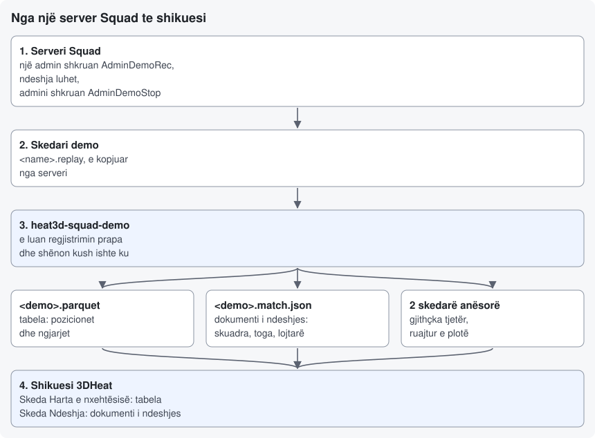

# 3DHeat Squad {#dheat-squad}

**Çfarë është?** Një program i vogël që e kthen një regjistrim të një ndeshjeje Squad në
skedarë që shikuesi [3DHeat](https://github.com/Holdi601/3DHeat)
([dokumentacioni](https://holdi601.github.io/3DHeat/)) mund t'i vizatojë: ku ishte çdo
lojtar, sekondë pas sekonde, dhe çfarë ndodhi ku.

**Pse ta përdor?** Për ta parë një ndeshje nga lart: ku u luftua, cilat rrugë ndoqën
togat, ku vdiqën automjetet.

**Shembull:** `match.replay` (një demo, regjistruar në një server Squad) ->
`match.parquet` (një rresht për çdo pozicion ose ngjarje) + `match.match.json` (dokumenti i
ndeshjes: skuadrat, togat, lojtarët). Daljet janë skedarë të zakonshëm Parquet
dhe JSON, kështu që mund t'i lexojë edhe çdo gjë tjetër.

Për çfarë është e dobishme:

- **Ku u luftua një ndeshje.** Pozicioni i çdo lojtari dhe boti, në këmbë, në
  automjete tokësore dhe në helikopterë, rreth tetë herë në sekondë, me skuadrën,
  fraksionin, togën, shëndetin dhe pjerrësinë e shikimit.
- **Çfarë ndodhi ku.** Plagosje, ringjallje dhe vdekje; çdo e shtënë dhe çdo
  goditje mbi një automjet; çdo automjet, objekt i vendosur dhe pozicion që u shfaq,
  u dëmtua, u shkatërrua dhe u hoq.
- **E gjithë ndeshja në një dokument.** Skuadrat, togat, gjendja e lojës, çdo
  aktor, një rresht për çdo lojtar dhe çdo bot, dhe një vetëkontroll që nuk u humb asgjë
  nga ç'ka demo.



## Fillimi i shpejtë {#quick-start}

Je i ri me rreshtin e komandave? Lexo së pari [Para se të fillosh](before-you-start.md).

```bash
python -m pip install -e .              # installs the heat3d-squad-demo command
heat3d-squad-demo match.replay -o out   # or a folder of .replay files
```

Duhet të shohësh një rresht për çdo demo. Pastaj ngarko `out/<map>/<demo>.parquet` te skeda Harta e nxehtësisë e shikuesit
([Getting data in](https://holdi601.github.io/3DHeat/getting-data-in.html)).

## Faqet {#pages}

| Faqja | Çfarë mbulon |
|---|---|
| [Para se të fillosh](before-you-start.md) | Python, një terminal, një ekzekutim i parë |
| [Regjistrimi i një demoje](recording.md) | si ta bëj një server të shkruajë një demo, dhe ta gjej |
| [Konvertimi i demove](converting.md) | komanda, çdo opsion, dalje shembull |
| [Tabela](output-table.md) | çdo kolonë dhe çdo `event` |
| [Dokumenti i ndeshjes dhe skedarët anësorë](output-match.md) | `.match.json`, dy skedarët anësorë, vetëkontrolli |
| [Si lexohet një demo](how-it-works.md) | shtresat e lexuesit, dhe çfarë u verifikua |
| [Kufizimet, përditësimet dhe kushtet](limits.md) | çfarë nuk lexohet, çfarë mund të prishë një përditësim i Squad, të dhënat personale, licenca |
| [Referenca e komandave](../cli-reference.md) | çdo opsion dhe kolonë, e gjeneruar nga kodi |
| [Mirëmbajtja e këtyre dokumenteve](maintaining.md) | lista e kontrollit të botimit |

## Të lidhura {#related}

- Shikuesi 3DHeat: [github.com/Holdi601/3DHeat](https://github.com/Holdi601/3DHeat),
  dokumentacioni te [holdi601.github.io/3DHeat](https://holdi601.github.io/3DHeat/).
- Formatet e skedarëve që lexon shikuesi, përfshirë kontejnerin një-skedar-për-ndeshje:
  [One file a match (.3dheat)](https://holdi601.github.io/3DHeat/container.html).
  Ky konvertues shkruan skedarët e veçantë: tabelën, dokumentin e ndeshjes dhe
  skedarët e tij anësorë përkrah njëri-tjetrit.
- 3DHeat Watcher e ekzekuton këtë konvertues mbi demot e reja kur është i instaluar
  (adapteri `squad-demos`): [3DHeat Watcher](https://holdi601.github.io/3DHeat-Watcher/).

## Mjetet 3DHeat {#the-3dheat-tools}

| Mjeti | Çfarë bën | Kodi | Dokumentet |
|---|---|---|---|
| Shikuesi 3DHeat | shfaq të dhënat: harta nxehtësie, analizë gare, rishikim ndeshjesh | [3DHeat](https://github.com/Holdi601/3DHeat) | [dokumentet](https://holdi601.github.io/3DHeat/) |
| GameFiles | nivele dhe pista nga skedarët e vetë lojës | [3DHeat-GameFiles](https://github.com/Holdi601/3DHeat-GameFiles) | [dokumentet](https://holdi601.github.io/3DHeat-GameFiles/) |
| GameCapture | telemetri xhirimesh, dhe nivele të rindërtuara nga video loje | [3DHeat-GameCapture](https://github.com/Holdi601/3DHeat-GameCapture) | [dokumentet](https://holdi601.github.io/3DHeat-GameCapture/) |
| Unreal Exporter | një shtojcë e Unreal Editor: një nivel si një `.glb` | [3DHeat-UnrealExporter](https://github.com/Holdi601/3DHeat-UnrealExporter) | [dokumentet](https://holdi601.github.io/3DHeat-UnrealExporter/) |
| CS2 | demo dhe harta të Counter-Strike 2 | [3DHeat-CS2](https://github.com/Holdi601/3DHeat-CS2) | [dokumentet](https://holdi601.github.io/3DHeat-CS2/) |
| Watcher | regjistron çfarë botojnë lojërat ndërsa luaj | [3DHeat-Watcher](https://github.com/Holdi601/3DHeat-Watcher) | [dokumentet](https://holdi601.github.io/3DHeat-Watcher/) |
| Ext-WarThunder | riluajtje të War Thunder | [3DHeat-Ext-WarThunder](https://github.com/Holdi601/3DHeat-Ext-WarThunder) | [dokumentet](https://holdi601.github.io/3DHeat-Ext-WarThunder/) |
| Ext-WoT | riluajtje të World of Tanks | [3DHeat-Ext-WoT](https://github.com/Holdi601/3DHeat-Ext-WoT) | [dokumentet](https://holdi601.github.io/3DHeat-Ext-WoT/) |
| Ext-WoWs | riluajtje të World of Warships | [3DHeat-Ext-WoWs](https://github.com/Holdi601/3DHeat-Ext-WoWs) | [dokumentet](https://holdi601.github.io/3DHeat-Ext-WoWs/) |
| Ext-Squad | demo serveri të Squad | [3DHeat-Ext-Squad](https://github.com/Holdi601/3DHeat-Ext-Squad) | [dokumentet](https://holdi601.github.io/3DHeat-Ext-Squad/) |
| Ext-DCS | harta të DCS World si nivele 3D | [3DHeat-Ext-DCS](https://github.com/Holdi601/3DHeat-Ext-DCS) | [dokumentet](https://holdi601.github.io/3DHeat-Ext-DCS/) |
| Ext-IL2 | harta të IL-2 Sturmovik si nivele 3D | [3DHeat-Ext-IL2](https://github.com/Holdi601/3DHeat-Ext-IL2) | [dokumentet](https://holdi601.github.io/3DHeat-Ext-IL2/) |
