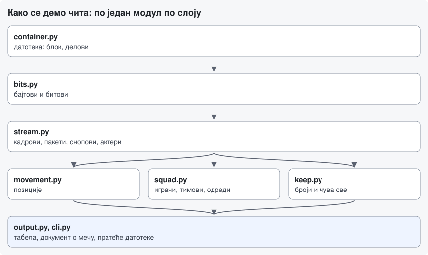

# Како се демо чита {#how-a-demo-is-read}

Речима без украса: Squad сервер шаље позицију сваког играча сваком другом играчу. Демо датотека је снимак тог саобраћаја. Овај алат га пушта уназад и записује ко је где био.



Unreal мрежна реприза је сам саобраћај репликације сервера, записан од његовог демо драјвера. Читати је значи читати тај саобраћај онако како би га читао клијент.

| Модул | Слој |
|---|---|
| `container.py` | Датотека локалног стримера: блок информација (магични број `0x1CA2E27F`), па делови. Врсте делова су заглавље (`FNetworkDemoHeader`, магични број `0x2CF5A13D`), подаци репризе, контролне тачке и догађаји. |
| `bits.py` | Бајтни архиви за кадрове и битни архиви за пакете. Пакети се читају од најнижег бита. |
| `stream.py` | Кадрови, пакети, снопови (делимични снопови спојени), канали актера, појављивања актера и блокови садржаја. Сваки блок држи реплицирана својства као ручку, број битова и саме битове, затим удаљене позиве и поља са прилагођеном разликом као ручке у групи `_ClassNetCache` класе. Објектима која извоз не именује класа се додељује тек кад се прочита цео демо (види испод). |
| `movement.py` | `FRepMovement` мотора, и кретање Squad-овог хеликоптера. |
| `keep.py` | Свака ставка која је наишла, избројана и сачувана: редови пратећих датотека и самопровера. |
| `squad.py` | Које Squad класе носе шта. `SQPlayerState` држи име, стање тима, стање одреда и тренутни пијун; `SQTeamState` број тима и фракцију; `SQSquadState` број одреда. Власник пијуна на месту у возилу је његово возило. |
| `output.py`, `cli.py` | Табела и документ о мечу. |

Реприза именује сама своја поља. Носи путање класа и имена својстава за сваку ручку, и путање објеката на које упућује. Зато се свако својство може наћи по имену без кода игре. Само битовима својства треба тип. За кретање то је сопствени тип мотора; за Squad-ова својства типови су једноставни: ниске, цели бројеви, референце на објекте и имена.

Неки објекти су именовани само самима собом: актори нивоа по имену инстанце (`Team1SpawnPoint3`), компоненте по својем (`MovementComponent`, `wheel_L1`). Њихова класа се налази из табела извоза, после тока: демо драјвер извози поље класе у кадру у којем се оно први пут шаље (тачно за свако прво слање именованог објекта у тест демоима), па је класа она једина група која је извезла баш те ручке у кадровима у којима је објекат први пут послао; иначе било која група која је до тада имала све своје ручке, кад све дају иста имена; иначе класа објекта истог имена, без бројева, или једина група чије име садржи име објекта. Од ручки објеката именованих на овај начин чија класа шаље са једним фиксним бројем битова, све су дошле са тим бројем (ниједна са другим). Оно што ниједно од ових не разреши остаје у пратећој датотеци entities, цело.

## Декодовање својстава {#decoding-properties}

Свако реплицирано својство се декодује колико његови битови говоре о томе шта је: један бит је застава, референца на објекат (његов net GUID) где име завршава као референца (`...State`, `...Seat`, `...Pawn`, `...Class`...), дужина и толико бајтова је ниска, 8/16/32/64 бита је број (реална вредност где име својства то каже: здравље, време, брзина, улаз...), све остало су његови битови у хексадецималном запису са нискама пронађеним унутра. Удаљени позиви читају се на исти начин, по именима параметара које демо извози за сваку функцију.

## Како се догађаји читају {#how-the-events-are-read}

`Health` и `bWounded` војника долазе од сервера: рањен кад се `bWounded` укључи, оживљен кад се искључи а здравље је веће од 0, мртав кад здравље падне испод -100 (играч који одустане или искрвари постави се на -300); бот, који никад није рањен, умире на 0. Возило или постављив предмет је `damaged` при сваком паду његовог `Health`, `destroyed` на 0 или испод. Појављивања и уклањања су отварање и затварање канала актера; место у возилу је `CurrentSeat` стања играча (референца на компоненту места, која се шаље уз његово возило). Нагиб погледа је `RemoteViewPitch` војника, бајт од право наниже (0) до право навише (255). Хитац је `MulticastFireProjectile` оружја (порекло и смер), или његов `MulticastFireMultipleProjectileEffects` где уз исти смер није стигао такав позив; погодак је `MulticastPlayDamageEffects` возила (место удара, врста штете).

## Шта је проверено и како {#what-was-verified-and-how}

Ово је проверено на два јавна Squad v10.3.1 сервер демоа (Unreal Engine 5.5.4, верзија мреже мотора 36), из тест грађе пројекта squad-replay:

- **Бројеви.** Бројеви кадрова, пакета, отварања актера, група извоза и путања извезених објеката тачно се слажу са независним парсером тог пројекта. Тако је и са бројем узорака кретања војника.
- **Кретање наспрам брзине.** Корак сваког узорка војника од претходног, подељен временом између њих, слаже се са брзином коју узорак носи. Средња вредност односа је између 0,8 и 1,2 за играче који се крећу.
- **Тимови наспрам плана.** Тим сваког реда је тим чијој фракцији припада план војника. Ово је важило и за играча који је током меча променио страну.
- **Грешке.** Остаје по једна грешка тока по демоу: лутајући бит на крају почетног снопа сопственог спектаторског актера снимача, који не носи ништа што се овде користи.
- **Жртве наспрам убистава тог пројекта.** Свако убиство које он наводи је рана или смрт прочитана овде, у исто време и за истог играча; његова убиства возила су возила прочитана овде која су стигла до здравља 0 или испод.
- **Постављиви предмети.** Актери прочитани овде са стањем изградње или захтевом FOB-а слажу се са постављивим предметима тог пројекта, до једне јединице.
- **Нагиб.** Бајт нагиба погледа лежи око 120 у мировању и достиже 255 (право навише): прочитан је као бајт над -90..+90. Прочитан као уобичајени бајт мотора за цео обрт, ставио би војнике до 128 степени испод хоризонта, у шта не могу да гледају.
- **Ботови.** На демоу окупљања сваки бот (`SQSquidBot`) има сопствену путању, а ботови који умру читају се као смрти.
- **Кретање хеликоптера** (`SQHelicopterMovementComponent.ReplicatedMovement`, Squad-ов сопствени распоред: без застава, место у стотинкама, брзина и угаона брзина, три необавезна 16-битна угла, сат сервера као реални број). Сваки узорак хеликоптера тачно попуњава своје битове. Место и угао паркираног хеликоптера су места и угао његовог појављивања, до центиметра и јединице угла. У лету је корак између узорака подељен кораком сата брзина (средњи однос 0,997), а сат корача са временом демоа (средње растојање корака 0,4 ms). Угаона брзина прати брзину скретања (корелација 0,91), али јединица није утврђена: чува се, не користите се.
- **Места.** `CurrentSeat` стања играча је референца (спаковани net GUID), а не број као што је раније читано: тако прочитано, при свакој промени то је место које `MulticastUpdateCurrentSeat` самог војника именује мало раније, а промене су из squad-replay-а.
- **Хици и погоци.** Сваки `ShootDir` је јединични вектор (дужина 1 у границама 0,00003); сваки порекло `MulticastFireMultipleProjectileEffects`, подељено са 10, је `OriginZeroBased` одговарајућег `MulticastFireProjectile` у границама 1 mm; где су позиција стрелца или погођеног возила позната, порекло хица или удар су на медијанском растојању од 0,45 m од ње.
- **Улази возила.** Прочитани као реални бројеви, гас, кочница и ручна кочница гусеничарских возила леже у 0..1, а управљање у -1..1, при свакој измени.
- **Разлози затварања.** Сваки актер чији је канал поново отворен био је затворен са `Dormancy`; ниједан затворен са `Destroyed` није поново отворен.

Тестови на демоима које сами тестови граде покривају контејнер, архиве, ток и цео пут до табеле, и то да демо који садржи по једну ставку сваке врсте не губи ниједну ([`tests/test_completeness.py`](https://github.com/Holdi601/3DHeat-Ext-Squad/blob/main/tests/test_completeness.py)):

```bash
python -m pip install -e .[test]
pytest                                   # синтетички демои
HEAT3D_SQUAD_DEMOS=<folder> pytest       # плус прави демои у тој фасцикли
```
