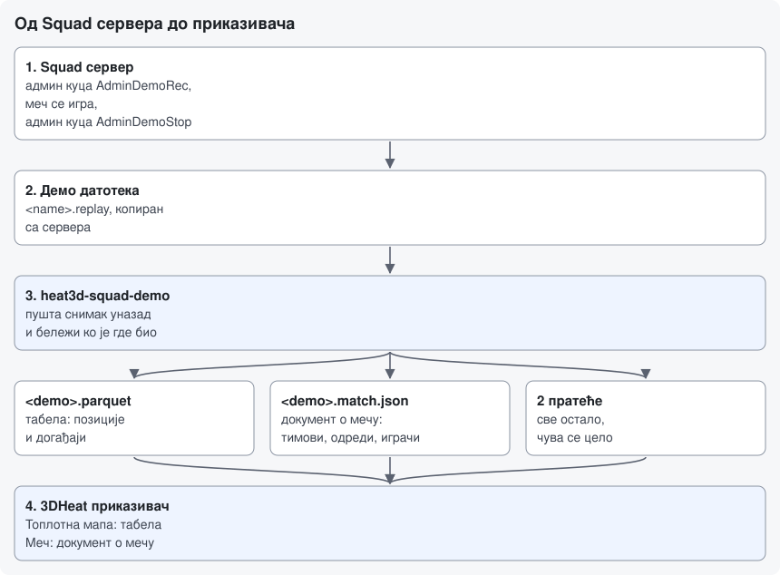

# 3DHeat Squad {#dheat-squad}

**Шта је то?** Мали програм који претвара снимак Squad меча у
датотеке које [3DHeat](https://github.com/Holdi601/3DHeat) приказивач
([документација](https://holdi601.github.io/3DHeat/)) може да црта: где је био сваки
играч, секунд по секунд, и шта се дешавало на којем месту.

**Зашто бих га користио?** Да видите меч одозго: где су се борбе водиле,
којим путевима су одреди ишли, где су возила уништена.

**Пример:** `match.replay` (демо, снимљен на Squad серверу) ->
`match.parquet` (један ред по позицији или догађају) + `match.match.json` (документ
о мечу: тимови, одреди, играчи). Излази су обичне Parquet и JSON
датотеке, па их може читати и било шта друго.

Чему служи:

- **Где се меч водио.** Позиција сваког играча и сваког бота, пешице, у
  копненим возилима и у хеликоптерима, око осам пута у секунди, са тимом,
  фракцијом, одредом, здрављем и нагибом погледа.
- **Шта се дешавало где.** Ране, оживљавања и смрти; сваки хитац и сваки
  погодак по возилу; свако возило, постављив предмет и утврђење које је
  настало, оштећено, уништено или уклоњено.
- **Цео меч у једном документу.** Тимови, одреди, стање игре, сваки актер,
  један ред по играчу и по боту, и самопровера да ништа из демоа није
  изгубљено.



## Брзи почетак {#quick-start}

Први пут у командној линији? Прво прочитајте [Пре почетка](before-you-start.md).

```bash
python -m pip install -e .              # инсталира команду heat3d-squad-demo
heat3d-squad-demo match.replay -o out   # или фасциклу са .replay датотекама
```

Требало би да видите по један ред за сваки демо. Затим учитајте `out/<map>/<demo>.parquet` на
картици Топлотна мапа приказивача
([Унос података](https://holdi601.github.io/3DHeat/getting-data-in.html)).

## Странице {#pages}

| Страница | Шта обухвата |
|---|---|
| [Пре почетка](before-you-start.md) | Python, терминал, прво покретање |
| [Снимање демоа](recording.md) | како сервер снима демо и где га наћи |
| [Претварање демоа](converting.md) | команда, свака опција, пример излаза |
| [Табела](output-table.md) | свака колона и сваки `event` |
| [Документ о мечу и пратеће датотеке](output-match.md) | `.match.json`, две пратеће датотеке, самопровера |
| [Како се демо чита](how-it-works.md) | слојеви читача и шта је проверено |
| [Ограничења, ажурирања и услови](limits.md) | шта се не чита, шта ажурирање Squad-а може покварити, лични подаци, лиценца |
| [Референца команди](../cli-reference.md) | свака опција и колона, генерисано из кода |
| [Одржавање ове документације](maintaining.md) | контролна листа за издање |

## Повезано {#related}

- 3DHeat приказивач: [github.com/Holdi601/3DHeat](https://github.com/Holdi601/3DHeat),
  документација на [holdi601.github.io/3DHeat](https://holdi601.github.io/3DHeat/).
- Формати датотека које приказивач чита, укључујући контејнер у којем је
  један меч у једној датотеци: [Једна датотека по мечу (.3dheat)](https://holdi601.github.io/3DHeat/container.html).
  Овај претварач пише засебне датотеке: табелу, документ о мечу и његове
  пратеће датотеке једну поред друге.
- 3DHeat Watcher покреће овај претварач над новим демоима кад је инсталиран
  (адаптер `squad-demos`): [3DHeat Watcher](https://holdi601.github.io/3DHeat-Watcher/).
- Сваки читач игре је засебан мали пројекат са сопственом датотеком лиценце, издањима и системом за пријаву проблема, па се може инсталирати, ажурирати, одржавати - или повући на захтев носиоца права - засебно, без утицаја на прегледач или остале алате.

## Алати 3DHeat-а {#the-3dheat-tools}

| Алат | Шта ради | Код | Документација |
|---|---|---|---|
| 3DHeat приказивач | приказује податке: топлотне мапе, анализу трке, преглед мечева | [3DHeat](https://github.com/Holdi601/3DHeat) | [документација](https://holdi601.github.io/3DHeat/) |
| GameFiles | нивои и стазе из сопствених датотека игре | [3DHeat-GameFiles](https://github.com/Holdi601/3DHeat-GameFiles) | [документација](https://holdi601.github.io/3DHeat-GameFiles/) |
| GameCapture | телеметрија кругова, и нивои реконструисани из снимка игре | [3DHeat-GameCapture](https://github.com/Holdi601/3DHeat-GameCapture) | [документација](https://holdi601.github.io/3DHeat-GameCapture/) |
| Unreal Exporter | додатак за Unreal Editor: ниво као један `.glb` | [3DHeat-UnrealExporter](https://github.com/Holdi601/3DHeat-UnrealExporter) | [документација](https://holdi601.github.io/3DHeat-UnrealExporter/) |
| CS2 | Counter-Strike 2 демои и мапе | [3DHeat-CS2](https://github.com/Holdi601/3DHeat-CS2) | [документација](https://holdi601.github.io/3DHeat-CS2/) |
| Watcher | бележи оно што игре објављују док играте | [3DHeat-Watcher](https://github.com/Holdi601/3DHeat-Watcher) | [документација](https://holdi601.github.io/3DHeat-Watcher/) |
| Ext-WarThunder | War Thunder репризе | [3DHeat-Ext-WarThunder](https://github.com/Holdi601/3DHeat-Ext-WarThunder) | [документација](https://holdi601.github.io/3DHeat-Ext-WarThunder/) |
| Ext-WoT | World of Tanks репризе | [3DHeat-Ext-WoT](https://github.com/Holdi601/3DHeat-Ext-WoT) | [документација](https://holdi601.github.io/3DHeat-Ext-WoT/) |
| Ext-WoWs | World of Warships репризе | [3DHeat-Ext-WoWs](https://github.com/Holdi601/3DHeat-Ext-WoWs) | [документација](https://holdi601.github.io/3DHeat-Ext-WoWs/) |
| Ext-Squad | Squad демои са сервера | [3DHeat-Ext-Squad](https://github.com/Holdi601/3DHeat-Ext-Squad) | [документација](https://holdi601.github.io/3DHeat-Ext-Squad/) |
| Ext-DCS | DCS World мапе као 3D нивои | [3DHeat-Ext-DCS](https://github.com/Holdi601/3DHeat-Ext-DCS) | [документација](https://holdi601.github.io/3DHeat-Ext-DCS/) |
| Ext-IL2 | мапе IL-2 Sturmovik као 3D нивои | [3DHeat-Ext-IL2](https://github.com/Holdi601/3DHeat-Ext-IL2) | [документација](https://holdi601.github.io/3DHeat-Ext-IL2/) |
