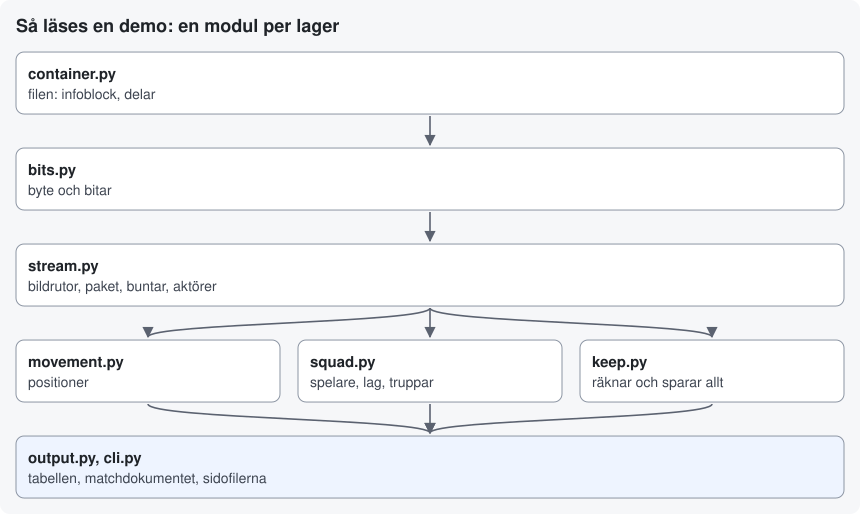

# Så läses en demo {#how-a-demo-is-read}

Med enkla ord: en Squad-server skickar varje spelares position till alla andra spelare. Demofilen är en inspelning av den trafiken. Verktyget spelar upp den igen och skriver ner vem som var var.



En Unreal-nätverksrepris är serverns egen replikeringstrafik, nedskriven av dess demodrivrutin. Att läsa den är att läsa trafiken så som en klient gör.

| Modul | Lager |
|---|---|
| `container.py` | Filströmmarens fil: ett infoblock (magiskt `0x1CA2E27F`), sedan delar. Delarnas typer är huvudet (`FNetworkDemoHeader`, magiskt `0x2CF5A13D`), replikeringsdata, kontrollpunkter och händelser. |
| `bits.py` | Bytearkiv för bildrutor och bitarkiv för paket. Paket läses med lägsta biten först. |
| `stream.py` | Bildrutor, paket, buntar (delvisa buntar sammanfogas), aktörskanaler, aktörsuppkomster och innehållsblock. Varje block innehåller replikerade egenskaper som handtag, antal bitar och bitar, sedan fjärranrop och anpassade deltafält som handtag i klassens grupp i `_ClassNetCache`. Objekt som exporterna inte namnger får sin klass när hela demon har lästs (se nedan). |
| `movement.py` | Motorns `FRepMovement`, och Squads helikopterrörelse. |
| `keep.py` | Varje post som mötts, räknats och sparats: sidofilernas rader och självkontrollen. |
| `squad.py` | Vilka Squad-klasser som bär vad. `SQPlayerState` innehåller namnet, lagläget, truppläget och nuvarande pjäs; `SQTeamState` lagnumret och fraktionen; `SQSquadState` truppnumret. En sätespjäs ägare är dess fordon. |
| `output.py`, `cli.py` | Tabellen och matchdokumentet. |

En repris anger själv sina fält. Den bär klassvägarna och egenskapsnamnen för varje handtag, och vägarna till de objekt den refererar. Så varje egenskap kan hittas med namn utan spelets kod. Bara egenskapernas bitar behöver en typ. För rörelse är det motorns egen typ; för Squads egenskaper är typerna enkla: strängar, heltal, objektreferenser och namn.

Vissa objekt namnges bara av sig själva: en nivås aktörer av deras instansnamn (`Team1SpawnPoint3`), komponenter av sina egna (`MovementComponent`, `wheel_L1`). Deras klass hittas i exporttabellerna, efter strömmen: demodrivrutinen exporterar en klass fält i bildrutan där det först skickas (sant för varje första sändning av ett namngivet objekt i testdemonerna), så klassen är den ena gruppen som exporterade precis de handtagen i de bildrutor där objektet först skickade dem; annars vilken grupp som helst som hade alla sina handtag då, när alla ger dem samma namn; annars klassen för ett objekt med samma namn, utan siffrorna, eller den enda gruppen vars namn innehåller objektets. Av handtagen hos objekt som namnges så, vars klass skickar dem med ett fast antal bitar, kom alla med det antalet (ingen med ett annat). Det som ingen av dessa avgör stannar i sidofilen för entiteter, helt.

## Avkoda egenskaper {#decoding-properties}

Varje replikerad egenskap avkodas så långt dess bitar säger vad den är: en bit en flagga, en referens till ett objekt (dess nätverks-GUID) där namnet slutar som en referens gör (`...State`, `...Seat`, `...Pawn`, `...Class`...), en längd och så många byte en sträng, ett namn, 8/16/32/64 bitar ett tal (ett flyttal där egenskapens namn säger det: hälsa, tid, hastighet, indata...), allt annat sina bitar i hex med de strängar som hittas inuti. Fjärranrop läses på samma sätt, efter de parameternamn som demon exporterar för varje funktion.

## Så läses händelserna {#how-the-events-are-read}

En soldats `Health` och `bWounded` kommer från servern: sårad när `bWounded` slås på, återupplivad när den slås av med hälsa över 0, död när hälsan sjunker under -100 (en spelare som ger upp eller blöder ut sätts till -300); en bot, som aldrig blir sårad, dör vid 0. Ett fordon eller en utplacerad sak blir `damaged` vid varje fall i dess `Health`, `destroyed` vid 0 eller lägre. Uppkomster och borttagningar är aktörskanalen som öppnas och stängs; en plats är spelarens tillståndsobjekts `CurrentSeat` (en referens till platskomponenten, som skickas på dess fordon). Synvinkelns lutning är soldatens `RemoteViewPitch`, en byte från rakt ner (0) till rakt upp (255). Ett skott är ett vapens `MulticastFireProjectile` (ursprung och riktning), eller dess `MulticastFireMultipleProjectileEffects` där inget sådant anrop kom med samma riktning; en träff är ett fordons `MulticastPlayDamageEffects` (nedslagsplats, skadetyp).

## Vad som kontrollerats, och hur {#what-was-verified-and-how}

Dessa kontrollerades mot två offentliga Squad v10.3.1-serverdemos (Unreal Engine 5.5.4, nätverksversion 36 i motorn), från squad-replay-projektets testfixturer:

- **Antal.** Antalen bildrutor, paket, aktöröppningar, exportgrupper och exporterade objektvägar stämmer exakt med det projektets oberoende läsare. Så gör antalet rörelseprov för soldater.
- **Rörelse mot hastighet.** Varje soldatprovs steg från det föregående, delat med tiden mellan dem, stämmer med hastigheten provet bär. Mediankvoten ligger mellan 0,8 och 1,2 för rörliga spelare.
- **Lag mot blueprints.** Varje rads lag är det lag vars fraktion soldatens blueprint tillhör. Detta höll även för en spelare som bytte sida under matchen.
- **Fel.** Ett strömfel per demo återstår: en bit som blivit över i slutet av den inledande buntens del för inspelarens egen åskådaraktör, som inte bär något som används här.
- **Dödsfall mot det projektets dödsfall.** Varje dödsfall det listar är ett sår eller ett dödsfall som läses här, vid samma tid och för samma spelare; dess fordonsdödsfall är fordon som läses här och når hälsa 0 eller lägre.
- **Utplacerade saker.** Aktörerna som läses här med ett byggtillstånd eller ett FOB-krav stämmer med det projektets utplacerade saker, inom ett.
- **Lutning.** Bytevärdet för synvinkelns lutning ligger runt 120 i vila och når 255 (rakt upp): läst som en byte över -90..+90. Läst som motorns vanliga byte för ett helt varv skulle det placera soldater upp till 128 grader under horisonten, vilket de inte kan titta.
- **Bots.** I en seeding-demo har varje bot (`SQSquidBot`) en egen spårlinje, och de bots som dör läses som dödsfall.
- **Helikopterrörelse** (`SQHelicopterMovementComponent.ReplicatedMovement`, Squads egna layout: inga flaggor, platsen i hundradelar, hastigheten och vinkelhastigheten, tre valfria 16-bitars vinklar, serverns klocka som ett flyttal). Varje helikoptersampel fyller sina bitar exakt. En parkerad helikopters plats och gir är dess spawns, till centimetern och vinkelenheten. I flygning är steget mellan prov delat med klockans steg hastigheten (mediankvot 0,997), och klockan stegar med demons tid (median 0,4 ms isär). Vinkelhastigheten följer girhastigheten (korrelation 0,91), men dess enhet är inte fastställd: den sparas, används inte.
- **Platser.** En spelarstates `CurrentSeat` är en referens (ett packat nätverks-GUID), inte ett tal som det lästes tidigare: läst så, vid varje byte är det den plats som soldatens egen `MulticastUpdateCurrentSeat` anger strax innan, och byten är squad-replays.
- **Skott och träffar.** Varje `ShootDir` är en enhetsvektor (längd 1 inom 0,00003); varje `MulticastFireMultipleProjectileEffects`-ursprung, delat med 10, är `OriginZeroBased` för motsvarande `MulticastFireProjectile` inom 1 mm; där skyttens eller det träffade fordonets position är känd ligger skottets ursprung eller nedslaget i median 0,45 m från den.
- **Fordonsindata.** Lästa som flyttal ligger de bandgående fordonens gas, broms och handbroms mellan 0 och 1, och deras styrning mellan -1 och 1, i varje uppdatering.
- **Stängningsorsaker.** Varje aktör vars kanal öppnades igen hade stängts med `Dormancy`; ingen stängd med `Destroyed` öppnades igen.

Tester på demos som testerna själva bygger täcker behållaren, arkiven, strömmen och hela vägen till tabellen, och att en demo som innehåller en av varje sorts post inte förlorar någon ([`tests/test_completeness.py`](https://github.com/Holdi601/3DHeat-Ext-Squad/blob/main/tests/test_completeness.py)):

```bash
python -m pip install -e .[test]
pytest                                   # syntetiska demos
HEAT3D_SQUAD_DEMOS=<folder> pytest       # plus riktiga demos i den mappen
```
