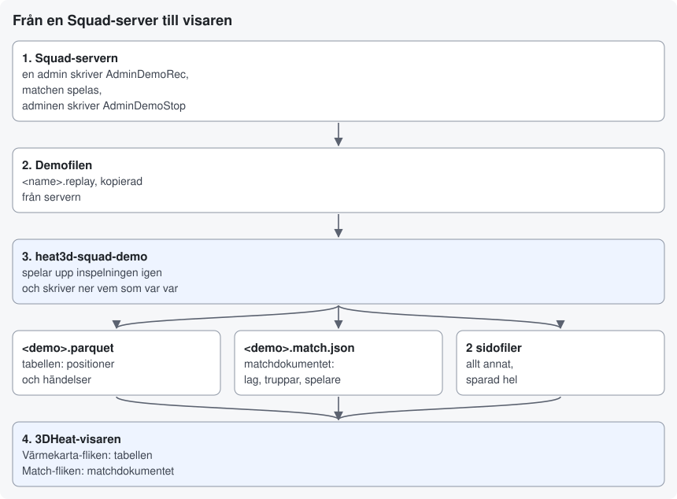

# 3DHeat Squad {#dheat-squad}

**Vad är det?** Ett litet program som gör om en inspelning av en Squad-match till
filer som [3DHeat](https://github.com/Holdi601/3DHeat)-visaren
([dokumentation](https://holdi601.github.io/3DHeat/)) kan rita: var varje
spelare var, sekund för sekund, och vad som hände var.

**Varför skulle jag använda det?** För att se en match uppifrån: var striderna
var, vilka vägar trupperna tog, var fordon förstördes.

**Exempel:** `match.replay` (en demo, inspelad på en Squad-server) ->
`match.parquet` (en rad per position eller händelse) + `match.match.json` (matchdokumentet: lag,
truppar, spelare). Utdatan är vanliga Parquet- och JSON-filer, så vad annat som helst kan läsa dem också.

Det här är användbart för:

- **Var en match utkämpades.** Varje spelares och bots position, till fots, i markfordon och i helikoptrar, ungefär åtta gånger per sekund, med lag, fraktion, trupp, hälsa och synvinkelns lutning.
- **Vad som hände var.** Sår, återupplivningar och dödsfall; varje skott och varje träff på ett fordon; varje fordon, utplacerad sak och bunker som uppkom, skadades, förstördes och togs bort.
- **Hela matchen i ett dokument.** Lag, truppar, spelläget, varje aktör, en rad per spelare och per bot, och en självkontroll som visar att inget som demon innehåller gick förlorat.



## Snabbstart {#quick-start}

Har du aldrig använt kommandoraden förut? Läs [Innan du börjar](before-you-start.md) först.

```bash
python -m pip install -e .              # installerar kommandot heat3d-squad-demo
heat3d-squad-demo match.replay -o out   # eller en mapp med .replay-filer
```

Du ser en rad per demo. Läs sedan in `out/<map>/<demo>.parquet` i visarens Värmekarta-flik
([Hämta data](https://holdi601.github.io/3DHeat/getting-data-in.html)).

## Sidor {#pages}

| Sida | Vad den täcker |
|---|---|
| [Innan du börjar](before-you-start.md) | Python, en terminal, en första körning |
| [Spela in en demo](recording.md) | att få en server att skriva en demo, och hitta den |
| [Konvertera demos](converting.md) | kommandot, varje alternativ, exempelutdata |
| [Tabellen](output-table.md) | varje kolumn och varje `event` |
| [Matchdokumentet och sidofilerna](output-match.md) | `.match.json`, de två sidofilerna, självkontrollen |
| [Så läses en demo](how-it-works.md) | läsarens lager, och vad som kontrollerats |
| [Begränsningar, uppdateringar och villkor](limits.md) | vad som inte läses, vad en Squad-uppdatering kan förstöra, personuppgifter, licens |
| [Kommandoreferens](../cli-reference.md) | varje alternativ och kolumn, genererat från koden |
| [Underhålla dokumentationen](maintaining.md) | checklistan för utgivning |

## Relaterat {#related}

- 3DHeat-visaren: [github.com/Holdi601/3DHeat](https://github.com/Holdi601/3DHeat),
  dokumentation på [holdi601.github.io/3DHeat](https://holdi601.github.io/3DHeat/).
- Filformaten visaren läser, inklusive behållaren som samlar en match i en fil:
  [En fil per match (.3dheat)](https://holdi601.github.io/3DHeat/container.html).
  Det här konverteringsverktyget skriver de lösa filerna: tabellen, matchdokumentet
  och dess sidofiler bredvid varandra.
- 3DHeat Watcher kör det här konverteringsverktyget på nya demos när det är installerat
  (adapter `squad-demos`): [3DHeat Watcher](https://holdi601.github.io/3DHeat-Watcher/).

## 3DHeat-verktygen {#the-3dheat-tools}

| Verktyg | Vad det gör | Kod | Dokumentation |
|---|---|---|---|
| 3DHeat-visaren | visar datan: värmekartor, Racinganalys, matchgenomgång | [3DHeat](https://github.com/Holdi601/3DHeat) | [dokumentation](https://holdi601.github.io/3DHeat/) |
| GameFiles | nivåer och banor från ett spels egna filer | [3DHeat-GameFiles](https://github.com/Holdi601/3DHeat-GameFiles) | [dokumentation](https://holdi601.github.io/3DHeat-GameFiles/) |
| GameCapture | varvtelemetri, och nivåer återskapade från spelvideo | [3DHeat-GameCapture](https://github.com/Holdi601/3DHeat-GameCapture) | [dokumentation](https://holdi601.github.io/3DHeat-GameCapture/) |
| Unreal Exporter | ett Unreal Editor-tillägg: en nivå som en `.glb`-fil | [3DHeat-UnrealExporter](https://github.com/Holdi601/3DHeat-UnrealExporter) | [dokumentation](https://holdi601.github.io/3DHeat-UnrealExporter/) |
| CS2 | Counter-Strike 2-demos och kartor | [3DHeat-CS2](https://github.com/Holdi601/3DHeat-CS2) | [dokumentation](https://holdi601.github.io/3DHeat-CS2/) |
| Watcher | spelar in det spel publicerar medan du spelar | [3DHeat-Watcher](https://github.com/Holdi601/3DHeat-Watcher) | [dokumentation](https://holdi601.github.io/3DHeat-Watcher/) |
| Ext-WarThunder | War Thunder-repriser | [3DHeat-Ext-WarThunder](https://github.com/Holdi601/3DHeat-Ext-WarThunder) | [dokumentation](https://holdi601.github.io/3DHeat-Ext-WarThunder/) |
| Ext-WoT | World of Tanks-repriser | [3DHeat-Ext-WoT](https://github.com/Holdi601/3DHeat-Ext-WoT) | [dokumentation](https://holdi601.github.io/3DHeat-Ext-WoT/) |
| Ext-WoWs | World of Warships-repriser | [3DHeat-Ext-WoWs](https://github.com/Holdi601/3DHeat-Ext-WoWs) | [dokumentation](https://holdi601.github.io/3DHeat-Ext-WoWs/) |
| Ext-Squad | Squad-serverdemos | [3DHeat-Ext-Squad](https://github.com/Holdi601/3DHeat-Ext-Squad) | [dokumentation](https://holdi601.github.io/3DHeat-Ext-Squad/) |
| Ext-DCS | DCS World-kartor som 3D-nivåer | [3DHeat-Ext-DCS](https://github.com/Holdi601/3DHeat-Ext-DCS) | [dokumentation](https://holdi601.github.io/3DHeat-Ext-DCS/) |
| Ext-IL2 | IL-2 Sturmovik-kartor som 3D-nivåer | [3DHeat-Ext-IL2](https://github.com/Holdi601/3DHeat-Ext-IL2) | [dokumentation](https://holdi601.github.io/3DHeat-Ext-IL2/) |
