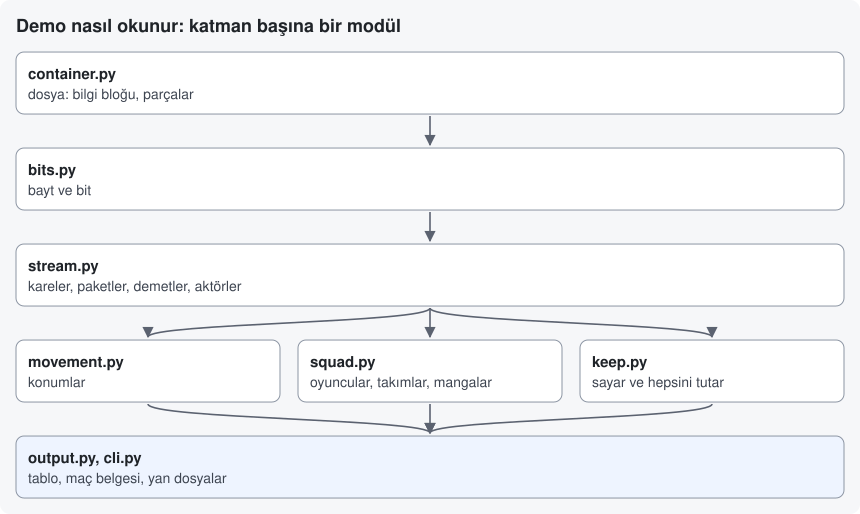

# Demo nasıl okunur {#how-a-demo-is-read}

Sade bir dille: bir Squad sunucusu her oyuncunun konumunu diğer her oyuncuya gönderir. Demo dosyası bu trafiğin bir kaydıdır. Bu araç onu baştan oynatır ve kimin nerede olduğunu yazar.



Bir Unreal ağ tekrarı, sunucunun kendi çoğaltma trafiğidir ve demo sürücüsü tarafından yazılır. Birini okumak, o trafiği bir istemcinin okuyacağı gibi okumaktır.

| Modül | Katman |
|---|---|
| `container.py` | Dosya kapsayıcısı: bir bilgi bloğu (sihirli sayı `0x1CA2E27F`), ardından parçalar. Parça türleri: başlık (`FNetworkDemoHeader`, sihirli sayı `0x2CF5A13D`), tekrar verisi, denetim noktaları ve olaylar. |
| `bits.py` | Kareler için bayt arşivleri, paketler için bit arşivleri. Paketler en düşük bitten başlanarak okunur. |
| `stream.py` | Kareler, paketler, bunch'lar (kısmi bunch'lar birleştirilmiş), aktör kanalları, aktör doğuşları ve içerik blokları. Her blok çoğaltılan özellikleri tutamaç, bit sayısı ve bitler olarak tutar; ardından uzak çağrılar ve özel delta alanları, sınıfın `_ClassNetCache` grubundaki tutamaçlar olarak gelir. Dışa aktarmaların adını vermediği nesnelere, tüm demo okunduktan sonra sınıfları verilir (aşağıya bakın). |
| `movement.py` | Motorun `FRepMovement` yapısı ve Squad'un helikopter hareketi. |
| `keep.py` | Karşılaşılan her öğe: sayılmış ve tutulmuş; yan dosyaların satırları ve öz denetim. |
| `squad.py` | Hangi Squad sınıfının neyi taşıdığı. `SQPlayerState` adı, takım durumunu, manga durumunu ve o anki pawn'ı tutar; `SQTeamState` takım numarasını ve fraksiyonu; `SQSquadState` manga numarasını. Bir koltuk pawn'ının sahibi, ait olduğu araçtır. |
| `output.py`, `cli.py` | Tablo ve maç belgesi. |

Bir tekrar kendi alanlarını adlandırır. Her tutamaç için sınıf yollarını ve özellik adlarını, ayrıca başvurduğu nesnelerin yollarını taşır. Böylece her özellik, oyunun koduna gerek kalmadan adıyla bulunabilir. Bir özelliğin yalnızca bitlerini çözmek için türü gerekir: hareket için bu motorun kendi türüdür; Squad'un özellikleri için türler basittir: metinler, tamsayılar, nesne başvuruları ve adlar.

Bazı nesneler yalnızca kendi adlarıyla anılır: bir seviyenin aktörleri örnek adlarıyla (`Team1SpawnPoint3`), bileşenler kendi adlarıyla (`MovementComponent`, `wheel_L1`). Sınıfları, akıştan sonra dışa aktarma tablolarından bulunur. Demo sürücüsü bir sınıfın alanını, ilk gönderildiği karede dışa aktarır (test demolarındaki adlandırılmış her nesnenin ilk gönderiminde doğru). Bu yüzden sınıf, nesnenin ilk gönderdiği karelerde tam olarak bu tutamaçları dışa aktaran tek gruptur; yoksa o zamana kadar tüm tutamaçlarını almış herhangi bir grup, hepsi aynı adları verdiğinde; yoksa sayılar dışarıda bırakılarak aynı adlı nesnenin sınıfı ya da nesnenin adını içeren tek grup. Bu şekilde adlandırılan nesnelerin, sınıfları sabit bir bit sayısıyla gönderen tutamaçlarının hepsi o sayıyla geldi (başka bir sayıyla hiçbiri gelmedi). Bunlardan hiçbiriyle çözülmeyenler, bütün olarak entities yan dosyasında kalır.

## Özellikleri çözme {#decoding-properties}

Her çoğaltılan özellik, bitlerinin ne olduğunu söylediği kadarıyla çözülür: bir bit bayrak; adı bir başvuruyla biten özellikte (`...State`, `...Seat`, `...Pawn`, `...Class`...) bir nesne başvurusu (net GUID'i); bir uzunluk ve o kadar bayt metin; bir ad; 8/16/32/64 bitlik bir sayı (özelliğin adının söylediği yerde kayan noktalı: can, zaman, oran, girdi...); geri kalanı ise içinde bulunan metinlerle birlikte onaltılık bitleri. Uzak çağrılar da aynı şekilde okunur: demonun her fonksiyon için dışa aktardığı parametre adlarıyla.

## Olaylar nasıl okunur {#how-the-events-are-read}

Bir askerin `Health` ve `bWounded` değerleri sunucudan gelir: `bWounded` açıldığında yaralı; canı 0'ın üzerindeyken kapandığında canlandırılmış; can -100'ün altına düştüğünde ölü (pes eden ya da kanayarak ölen bir oyuncu -300'e ayarlanır). Hiç yaralanmamış bir bot 0'da ölür. Bir araç ya da konuşlandırılabilir öğe, `Health` her düştüğünde `damaged` (hasarlı), 0 ya da altına indiğinde `destroyed` (yok edildi) olur. Doğuşlar ve kaldırmalar, aktör kanalının açılması ve kapanmasıdır; bir koltuk, oyuncu durumunun `CurrentSeat` değeridir (aracında gönderilen koltuk bileşenine bir başvuru). Bakış eğimi, askerin `RemoteViewPitch` değeridir: tam aşağıdan (0) tam yukarıya (255) bir bayt. Bir atış, bir silahın `MulticastFireProjectile` çağrısıdır (başlangıç ve yön); aynı yönle bu çağrı gelmediğinde `MulticastFireMultipleProjectileEffects`. Bir isabet, bir aracın `MulticastPlayDamageEffects` çağrısıdır (çarpma yeri, hasar türü).

## Neyin doğrulandığı ve nasıl {#what-was-verified-and-how}

Bunlar, squad-replay projesinin test verilerinden iki genel Squad v10.3.1 sunucu demosuna karşı denetlendi (Unreal Engine 5.5.4, motor ağ sürümü 36):

- **Sayılar.** Kare, paket, aktör açılışı, dışa aktarma grubu ve dışa aktarılan nesne yollarının sayıları, o projenin bağımsız ayrıştırıcısıyla tam olarak eşleşir. Asker hareket örneklerinin sayısı da öyle.
- **Hareket, hıza karşı.** Her asker örneğinin bir öncekine göre adımı, aralarındaki süreye bölündüğünde, örneğin taşıdığı hızla eşleşir. Hareket eden oyuncularda medyan oran 0,8 ile 1,2 arasındadır.
- **Takımlar, blueprint'lere karşı.** Her satırın takımı, askerin blueprint'inin ait olduğu fraksiyonun takımıdır. Bu, maç sırasında taraf değiştiren bir oyuncu için de geçerli oldu.
- **Hatalar.** Demo başına bir akış hatası kalır: kaydedicinin kendi izleyici aktörünün açılış bunch'ının sonundaki bir fazla bit. Burada kullanılan hiçbir şeyi taşımaz.
- **Ölümler, o projenin öldürmelerine karşı.** Projenin listelediği her öldürme, burada okunan bir yaralanma ya da ölümdür; aynı zamanda ve aynı oyuncuya ait. Araç öldürmeleri de burada okunan, canı 0'a ya da altına inen araçlardır.
- **Konuşlandırılabilir öğeler.** Burada bir inşa durumu ya da bir FOB gereksinimiyle okunan aktörler, o projenin konuşlandırılabilir öğeleriyle bir farka kadar eşleşir.
- **Eğim.** Bakış eğimi baytı durgunken yaklaşık 120 civarındadır ve 255'e (tam yukarı) çıkar: bayt -90..+90 aralığında okunur. Motorun olağan tam dönüş baytı olarak okunsaydı, askerleri ufkun 128 derece altına koyardı; onlar oraya bakamaz.
- **Botlar.** Bir ısınma demosunda her bot (`SQSquidBot`) kendi izine sahiptir; ölen botlar ölüm olarak okunur.
- **Helikopter hareketi** (`SQHelicopterMovementComponent.ReplicatedMovement`, Squad'un kendi düzeni: bayrak yok, konum yüzde birler cinsinden, hız ve açısal hız, üç isteğe bağlı 16 bitlik açı, sunucu saati bir kayan nokta olarak). Her helikopter örneği bitlerini tam olarak doldurur. Park halindeki bir helikopterin konumu ve yaw'u, doğduğu yerinkidir: santimetreye ve açı birimine kadar. Uçuşta, örnekler arası adımın saatin adımına bölümü hızdır (medyan oran 0,997); saat demonun zamanıyla birlikte ilerler (medyan 0,4 ms aralıkla). Açısal hız yaw oranını izler (korelasyon 0,91), ama birimi kesin belirlenmedi: tutulur, kullanılmaz.
- **Koltuklar.** Bir oyuncu durumunun `CurrentSeat`'i bir başvurudur (paketlenmiş bir net GUID), daha önce okunduğu gibi bir sayı değil. Böyle okunur: her değişimde, askerin kendi `MulticastUpdateCurrentSeat` çağrısının az önce adlandırdığı koltuktur ve değişimler squad-replay'in değişimleridir.
- **Atışlar ve isabetler.** Her `ShootDir` bir birim vektördür (uzunluk 1, 0,00003 içinde). Her `MulticastFireMultipleProjectileEffects` başlangıcı 10'a bölündüğünde, eşleşen `MulticastFireProjectile`'ın `OriginZeroBased` değerine 1 mm içinde eşittir. Nişancının ya da isabet alan aracın konumu biliniyorsa, atışın başlangıcı ya da çarpma yeri ondan medyan 0,45 m uzaklıktadır.
- **Araç girdileri.** Kayan noktalı sayılar olarak okunduğunda, paletli araçların gazı, freni ve el freni 0..1 aralığında, direksiyonları -1..1 aralığındadır; her güncellemede.
- **Kapanma nedenleri.** Kanalı yeniden açılan her aktör `Dormancy` ile kapatılmıştı; `Destroyed` ile kapatılıp yeniden açılan hiçbiri yoktu.

Testler, kendileri tarafından oluşturulan demolar üzerinde kapsayıcıyı, arşivleri, akışı ve tabloya giden tüm yolu kapsar; her türden birer öğe içeren bir demonun hiçbir şey kaybetmediğini de doğrular ([`tests/test_completeness.py`](https://github.com/Holdi601/3DHeat-Ext-Squad/blob/main/tests/test_completeness.py)):

```bash
python -m pip install -e .[test]
pytest                                   # sentetik demolar
HEAT3D_SQUAD_DEMOS=<folder> pytest       # ayrıca o klasördeki gerçek demolar
```
