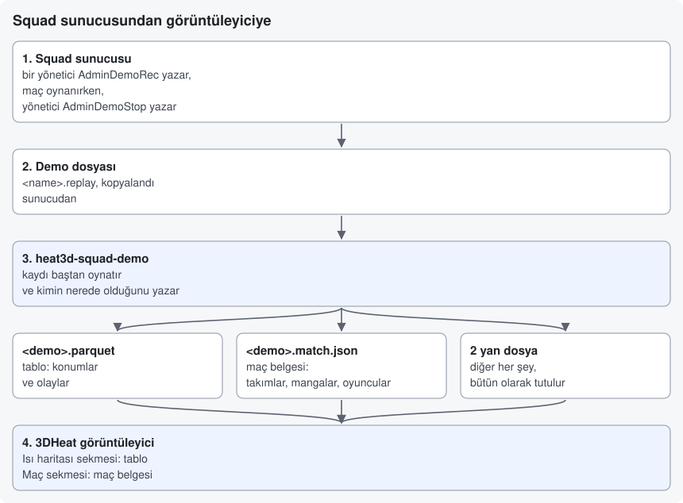

# 3DHeat Squad {#dheat-squad}

**Nedir?** Bir Squad maçının kaydını, [3DHeat](https://github.com/Holdi601/3DHeat) görüntüleyicisinin ([belgeler](https://holdi601.github.io/3DHeat/)) çizebileceği dosyalara dönüştüren küçük bir program: her oyuncunun her an nerede olduğu ve nerede neyin olduğu.

**Neden kullanmalıyım?** Maçı yukarıdan görmek için: çatışmanın nerede olduğunu, mangaların hangi rotaları izlediğini, araçların nerede yok olduğunu.

**Örnek:** `match.replay` (bir Squad sunucusunda kaydedilmiş bir demo) -> `match.parquet` (satır başına bir konum ya da olay) + `match.match.json` (maç belgesi: takımlar, mangalar, oyuncular). Çıktılar sıradan Parquet ve JSON dosyalarıdır; bu yüzden başka programlar da bunları okuyabilir.

Bu araç şunlar için işe yarar:

- **Maçın nerede oynandığı.** Her oyuncunun ve botun konumu; yaya, kara araçlarında ve helikopterlerde, saniyede yaklaşık sekiz kez; takım, fraksiyon, manga, sağlık ve bakış eğimiyle birlikte.
- **Nerede ne olduğu.** Yaralanmalar, canlandırmalar ve ölümler; her atış ve bir araca her isabet; doğan, hasar gören, yok edilen ve kaldırılan her araç, konuşlandırılabilir öğe ve mevzi.
- **Tüm maç tek bir belgede.** Takımlar, mangalar, oyun durumu, her aktör, her oyuncu ve bot için birer satır ve demonun tuttuğu hiçbir şeyin kaybolmadığını gösteren bir öz denetim.



## Hızlı başlangıç {#quick-start}

Komut satırında yeni misiniz? Önce [Başlamadan önce](before-you-start.md) sayfasını okuyun.

```bash
python -m pip install -e .              # installs the heat3d-squad-demo command
heat3d-squad-demo match.replay -o out   # or a folder of .replay files
```

Her demo için bir satır görmelisiniz. Sonra `out/<map>/<demo>.parquet` dosyasını görüntüleyicinin Isı haritası sekmesinde yükleyin ([Veri ekleme](https://holdi601.github.io/3DHeat/getting-data-in.html)).

## Sayfalar {#pages}

| Sayfa | Neyi anlatır |
|---|---|
| [Başlamadan önce](before-you-start.md) | Python, bir terminal, ilk çalıştırma |
| [Demo kaydetme](recording.md) | bir sunucunun demo yazmasını sağlamak ve onu bulmak |
| [Demoları dönüştürme](converting.md) | komut, her seçenek, örnek çıktı |
| [Tablo](output-table.md) | her sütun ve her `event` |
| [Maç belgesi ve yan dosyalar](output-match.md) | `.match.json`, iki yan dosya, öz denetim |
| [Demo nasıl okunur](how-it-works.md) | okuyucunun katmanları ve neyin doğrulandığı |
| [Sınırlar, güncellemeler ve koşullar](limits.md) | okunmayanlar, bir Squad güncellemesinin bozabilecekleri, kişisel veriler, lisans |
| [Komut başvurusu](../cli-reference.md) | her seçenek ve sütun, koddan üretilmiş |
| [Bu belgelerin bakımı](maintaining.md) | sürüm kontrol listesi |

## İlgili {#related}

- 3DHeat görüntüleyici: [github.com/Holdi601/3DHeat](https://github.com/Holdi601/3DHeat), belgeleri [holdi601.github.io/3DHeat](https://holdi601.github.io/3DHeat/) adresinde.
- Görüntüleyicinin okuduğu dosya biçimleri, maç başına tek dosyalık kapsayıcı dahil: [Maç başına tek dosya (.3dheat)](https://holdi601.github.io/3DHeat/container.html). Bu dönüştürücü, yan yana duran düz dosyaları yazar: tablo, maç belgesi ve yan dosyaları.
- 3DHeat Watcher kuruluysa yeni demolarda bu dönüştürücüyü çalıştırır (adaptör `squad-demos`): [3DHeat Watcher](https://holdi601.github.io/3DHeat-Watcher/).

## 3DHeat araçları {#the-3dheat-tools}

| Araç | Ne yapar | Kod | Belgeler |
|---|---|---|---|
| 3DHeat görüntüleyici | verileri gösterir: ısı haritaları, yarış analizi, maç incelemesi | [3DHeat](https://github.com/Holdi601/3DHeat) | [belgeler](https://holdi601.github.io/3DHeat/) |
| GameFiles | bir oyunun kendi dosyalarından seviyeler ve parkurlar | [3DHeat-GameFiles](https://github.com/Holdi601/3DHeat-GameFiles) | [belgeler](https://holdi601.github.io/3DHeat-GameFiles/) |
| GameCapture | tur telemetrisi ve oynanış videosundan yeniden kurulan seviyeler | [3DHeat-GameCapture](https://github.com/Holdi601/3DHeat-GameCapture) | [belgeler](https://holdi601.github.io/3DHeat-GameCapture/) |
| Unreal Exporter | bir Unreal Editor eklentisi: bir seviye tek bir `.glb` olarak | [3DHeat-UnrealExporter](https://github.com/Holdi601/3DHeat-UnrealExporter) | [belgeler](https://holdi601.github.io/3DHeat-UnrealExporter/) |
| CS2 | Counter-Strike 2 demoları ve haritaları | [3DHeat-CS2](https://github.com/Holdi601/3DHeat-CS2) | [belgeler](https://holdi601.github.io/3DHeat-CS2/) |
| Watcher | oynarken oyunların yayınladığını kaydeder | [3DHeat-Watcher](https://github.com/Holdi601/3DHeat-Watcher) | [belgeler](https://holdi601.github.io/3DHeat-Watcher/) |
| Ext-WarThunder | War Thunder tekrarları | [3DHeat-Ext-WarThunder](https://github.com/Holdi601/3DHeat-Ext-WarThunder) | [belgeler](https://holdi601.github.io/3DHeat-Ext-WarThunder/) |
| Ext-WoT | World of Tanks tekrarları | [3DHeat-Ext-WoT](https://github.com/Holdi601/3DHeat-Ext-WoT) | [belgeler](https://holdi601.github.io/3DHeat-Ext-WoT/) |
| Ext-WoWs | World of Warships tekrarları | [3DHeat-Ext-WoWs](https://github.com/Holdi601/3DHeat-Ext-WoWs) | [belgeler](https://holdi601.github.io/3DHeat-Ext-WoWs/) |
| Ext-Squad | Squad sunucu demoları | [3DHeat-Ext-Squad](https://github.com/Holdi601/3DHeat-Ext-Squad) | [belgeler](https://holdi601.github.io/3DHeat-Ext-Squad/) |
| Ext-DCS | DCS World haritaları 3B seviyeler olarak | [3DHeat-Ext-DCS](https://github.com/Holdi601/3DHeat-Ext-DCS) | [belgeler](https://holdi601.github.io/3DHeat-Ext-DCS/) |
| Ext-IL2 | IL-2 Sturmovik haritaları 3B seviyeler olarak | [3DHeat-Ext-IL2](https://github.com/Holdi601/3DHeat-Ext-IL2) | [belgeler](https://holdi601.github.io/3DHeat-Ext-IL2/) |
