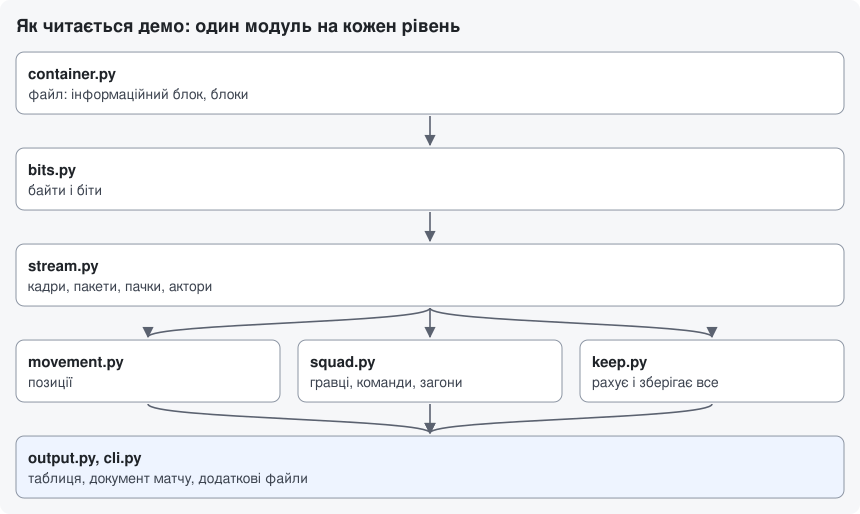

# Як читається демо {#how-a-demo-is-read}

Простими словами: сервер Squad надсилає позицію кожного гравця кожному іншому
гравцю. Файл демо — це запис цього трафіку. Цей інструмент відтворює його і
записує, хто де був.



Повтор мережі Unreal — це власний мережевий трафік сервера (реплікація), який
записав його demo-драйвер. Читати такий повтор означає читати цей трафік так,
як його читав би клієнт.

| Модуль | Рівень |
|---|---|
| `container.py` | файл потокового передавача локальних файлів: інформаційний блок (магія `0x1CA2E27F`), далі блоки. Типи блоків: заголовок (`FNetworkDemoHeader`, магія `0x2CF5A13D`), дані повтору, контрольні точки та події. |
| `bits.py` | байтові архіви для кадрів і бітові архіви для пакетів. Пакети читаються від молодшого біта. |
| `stream.py` | кадри, пакети, пачки (частини пачок з'єднуються), канали акторів, появи акторів і блоки вмісту. Кожен блок містить репліковані властивості як дескриптор, кількість бітів і самі біти, далі віддалені виклики та власні delta-поля як дескриптори в групі `_ClassNetCache` класу. Об'єкти, яких експорт не називає, отримують свій клас після читання всього демо (див. нижче). |
| `movement.py` | `FRepMovement` рушія і компонент руху гелікоптерів Squad. |
| `keep.py` | кожен прочитаний елемент, порахований і збережений: рядки супутніх файлів і самоперевірка. |
| `squad.py` | які класи Squad що несуть. `SQPlayerState` містить ім'я, стан команди, стан загону і поточну піхотну одиницю (pawn); `SQTeamState` — номер команди і фракцію; `SQSquadState` — номер загону. Власник пілотського місця — його техніка. |
| `output.py`, `cli.py` | таблиця і документ матчу. |

Повтор сам називає свої поля. Він містить назви класів і властивостей для
кожного дескриптора та шляхи до об'єктів, на які посилається. Тож кожну
властивість можна знайти за назвою без коду гри. Для бітів властивості потрібен
тип: для руху це тип самого рушія; для властивостей Squad типи прості: рядки,
цілі числа, посилання на об'єкти і назви.

Деякі об'єкти названі лише самими собою: актори рівня — своїм іменем екземпляра
(`Team1SpawnPoint3`), компоненти — власними (`MovementComponent`, `wheel_L1`).
Їхній клас знаходиться в таблицях експорту після читання потоку: демо-драйвер
експортує поле класу в кадрі, де воно вперше надіслано (це правда для кожного
першого надсилання названого об'єкта в тестових демо), тож клас — це та одна
група, яка експортувала саме ті дескриптори в тих кадрах, де об'єкт їх уперше
надіслав; інакше — будь-яка група, що до того часу мала всі свої дескриптори,
коли всі вони дають однакові імена; або клас об'єкта з тим самим іменем без
номерів, або одна група, назва якої містить назву об'єкта. З дескрипторів таких
об'єктів, чий клас надсилає їх з однією фіксованою кількістю бітів, усі
прийшли з цією кількістю (жодного з іншою). Те, що жодне з цього не визначає,
залишається в супутньому файлі сутностей, цілком.

## Декодування властивостей {#decoding-properties}

Кожна реплікована властивість декодується настільки, наскільки її біти кажуть,
що це таке: один біт — прапорець; посилання на об'єкт (його net GUID), якщо
назва закінчується як у посилань (`...State`, `...Seat`, `...Pawn`, `...Class`...);
довжина і стільки байтів — рядок; ім'я; 8/16/32/64 біти — число (число з
плаваючою комою, якщо так каже назва властивості: здоров'я, час, швидкість, ввід...);
усе інше — його біти в hex з рядками, знайденими всередині. Віддалені виклики
читаються так само, за іменами параметрів, які демо експортує для кожної функції.

## Як читаються події {#how-the-events-are-read}

`Health` і `bWounded` солдата надходять від сервера: поранений, коли `bWounded`
вмикається; оживлений, коли воно вимикається, а здоров'я більше 0; мертвий, коли
здоров'я падає нижче -100 (гравець, який здався або знекровився, отримує -300);
бот, якого ніколи не поранюють, гине при 0. Техніка або розгортання отримує
`damaged` при кожному падінні її `Health`, `destroyed` при 0 або нижче. Появи й
прибирання — це відкриття і закриття каналу актора; місце — це `CurrentSeat`
стану гравця (посилання на компонент місця, який надсилається разом із технікою).
Кут нахилу погляду — це `RemoteViewPitch` солдата, байт від прямо вниз (0) до
прямо вгору (255). Постріл — це `MulticastFireProjectile` зброї (початок і напрям)
або її `MulticastFireMultipleProjectileEffects`, якщо з тим самим напрямом не
приходив такий виклик; влучання — це `MulticastPlayDamageEffects` техніки (місце
удару, тип пошкодження).

## Що перевірено і як {#what-was-verified-and-how}

Це перевірялося на двох публічних демо серверів Squad v10.3.1 (Unreal Engine 5.5.4,
мережева версія рушія 36) з тестових фікстур проєкту squad-replay:

- **Кількості.** Кількості кадрів, пакетів, відкриттів акторів, груп експорту та
  експортованих шляхів об'єктів точно збігаються з незалежним парсером цього
  проєкту. Так само й кількість зразків руху солдатів.
- **Рух проти швидкості.** Крок кожного зразка солдата від попереднього, поділений
  на час між ними, збігається зі швидкістю, яку несе зразок. Медіанне відношення
  лежить у межах від 0,8 до 1,2 для гравців, що рухаються.
- **Команди проти блюпринтів.** Команда кожного рядка — це та команда, до фракції
  якої належить блюпринт солдата. Це підтвердилося і для гравця, який змінив
  сторону під час матчу.
- **Помилки.** Лишається одна помилка потоку на демо: зайвий біт наприкінці
  початкової пачки власного спостерігача запису, який не містить нічого, що тут
  використовується.
- **Загибелі порівняно з вбивствами цього проєкту.** Кожне вбивство, яке той
  проєкт перелічує, — це поранення або смерть, прочитані тут, в той самий час і
  того самого гравця; його вбивства техніки — це техніка, прочитана тут з
  здоров'ям 0 або нижче.
- **Розгортання.** Актори, прочитані тут із станом побудови або вимогою FOB,
  збігаються з розгортаннями того проєкту з точністю до одного.
- **Кут нахилу.** Байт кута нахилу погляду лежить близько 120 у спокої і досягає
  255 (прямо вгору): його прочитано як байт у діапазоні від -90 до +90. Якби його
  прочитали як звичайний байт рушія для повного оберту, солдати опинилися б до 128
  градусів під горизонтом, куди вони не можуть дивитися.
- **Боти.** На демо з набором гравців кожен бот (`SQSquidBot`) має свою траєкторію,
  а боти, які гинуть, прочитані як смерті.
- **Рух гелікоптерів** (`SQHelicopterMovementComponent.ReplicatedMovement`, власний
  формат Squad: без прапорців, положення в сотих, швидкість і кутова швидкість,
  три необов'язкові 16-бітні кути, годинник сервера як число з плаваючою комою).
  Кожен зразок гелікоптера заповнює свої біти точно. Положення і курс стоячого
  гелікоптера збігаються з його точкою появи, до сантиметра і одиниці кута. У
  польоті крок між зразками, поділений на крок годинника, є швидкістю (медіанне
  відношення 0,997), а годинник іде разом із часом демо (медіанний крок 0,4 мс).
  Кутова швидкість відповідає швидкості повороту (кореляція 0,91), але її одиниця
  не визначена: її зберігають, але не використовують.
- **Місця.** `CurrentSeat` стану гравця — це посилання (упакований net GUID), а не
  число, як читалося раніше: прочитане так, при кожній зміні це місце, яке
  власний `MulticastUpdateCurrentSeat` солдата називає трохи раніше, а зміни —
  ті самі, що в squad-replay.
- **Постріли і влучання.** Кожен `ShootDir` — це одиничний вектор (довжина 1 з
  точністю до 0,00003); кожне початкове значення `MulticastFireMultipleProjectileEffects`,
  поділене на 10, є `OriginZeroBased` відповідного `MulticastFireProjectile` з
  точністю до 1 мм; там, де відома позиція стрільця або техніки, що отримала
  влучання, початок пострілу або місце удару — в медіані за 0,45 м від неї.
- **Вхідні дані техніки.** Прочитані як числа з плаваючою комою, газ, гальмо та
  ручний гальмо гусеничних машин лежать у межах 0..1, а кермо — у межах -1..1, в
  кожному оновленні.
- **Причини закриття.** Кожен актор, чий канал відкрився знову, був закритий з
  `Dormancy`; жоден не закрився з `Destroyed` і не відкрився знову.

Тести на демо, які самі тести будують, покривають контейнер, архіви, потік і весь
шлях до таблиці, а також те, що демо з одним екземпляром кожного виду елементів
нічого не втрачає ([`tests/test_completeness.py`](https://github.com/Holdi601/3DHeat-Ext-Squad/blob/main/tests/test_completeness.py)):

```bash
python -m pip install -e .[test]
pytest                                   # синтетичні демо
HEAT3D_SQUAD_DEMOS=<folder> pytest       # плюс справжні демо в цій папці
```
