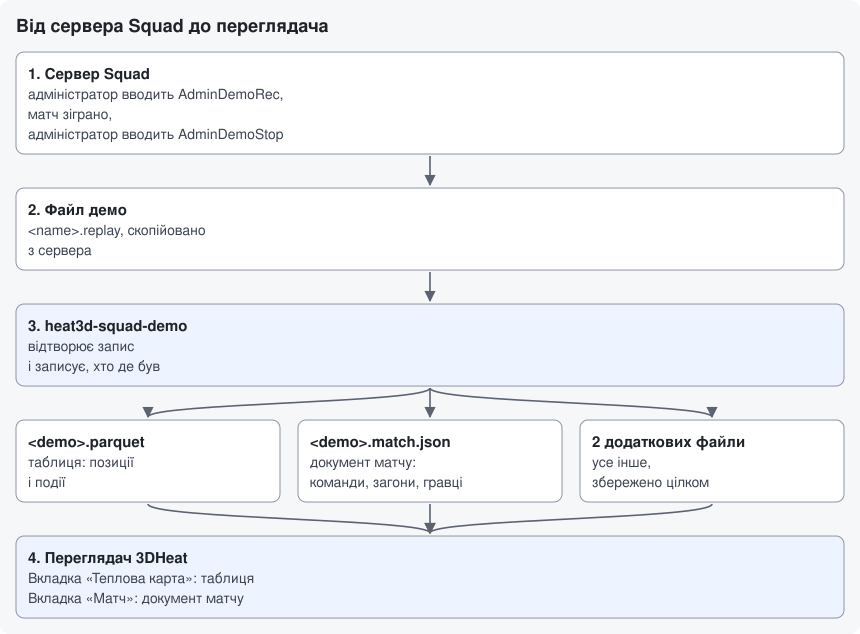

# 3DHeat Squad {#dheat-squad}

**Що це?** Невелика програма, яка перетворює запис матчу Squad на файли,
які переглядач [3DHeat](https://github.com/Holdi601/3DHeat)
([документація](https://holdi601.github.io/3DHeat/)) може намалювати: де був
кожен гравець, секунда за секундою, і що відбувалося в кожному місці.

**Навіщо це потрібно?** Щоб побачити матч згори: де йшов бій, якими маршрутами
рухались загони, де гинула техніка.

**Приклад:** `match.replay` (демо, записане на сервері Squad) ->
`match.parquet` (один рядок на кожну позицію або подію) + `match.match.json`
(документ матчу: команди, загони, гравці). Вихідні файли — звичайні файли
Parquet і JSON, тож їх можна прочитати й будь-якою іншою програмою.

Для чого це корисно:

- **Де велися бої.** Позиція кожного гравця і кожного бота: пішки, на наземній
  техніці та на гелікоптерах, близько восьми разів на секунду, з командою,
  фракцією, загоном, здоров'ям і кутом нахилу погляду.
- **Що відбувалося в якому місці.** Поранення, оживлення і смерті; кожен
  постріл і кожне влучення в техніку; кожна техніка, розгортання та укриття,
  що з'явилися, були пошкоджені, знищені або прибрані.
- **Увесь матч в одному документі.** Команди, загони, стан гри, кожен актор,
  рядок на кожного гравця і кожного бота, а також самоперевірка, яка показує,
  що з демо нічого не загубилося.



## Швидкий старт {#quick-start}

Ви лише починаєте працювати з командним рядком? Спершу прочитайте
[Перш ніж почати](before-you-start.md).

```bash
python -m pip install -e .              # встановлює команду heat3d-squad-demo
heat3d-squad-demo match.replay -o out   # або папку з файлами .replay
```

Ви маєте побачити один рядок на кожне демо. Потім завантажте `out/<map>/<demo>.parquet`
у вкладці «Теплова карта» переглядача
([Завантаження даних](https://holdi601.github.io/3DHeat/getting-data-in.html)).

## Сторінки {#pages}

| Сторінка | Що в ній |
|---|---|
| [Перш ніж почати](before-you-start.md) | Python, термінал, перший запуск |
| [Запис демо](recording.md) | як змусити сервер записати демо і де його знайти |
| [Перетворення демо](converting.md) | команда, кожен параметр, приклад результату |
| [Таблиця](output-table.md) | кожна колонка і кожна `event` |
| [Документ матчу і супутні файли](output-match.md) | `.match.json`, два супутні файли, самоперевірка |
| [Як читається демо](how-it-works.md) | рівні читача і що було перевірено |
| [Обмеження, оновлення та умови](limits.md) | що не читається, що може зламати оновлення Squad, персональні дані, ліцензія |
| [Довідка з команд](../cli-reference.md) | кожен параметр і колонка, створені з коду |
| [Підтримка цих документів](maintaining.md) | контрольний список для випуску |

## Пов'язане {#related}

- Переглядач 3DHeat: [github.com/Holdi601/3DHeat](https://github.com/Holdi601/3DHeat),
  документація на [holdi601.github.io/3DHeat](https://holdi601.github.io/3DHeat/).
- Формати файлів, які читає переглядач, зокрема контейнер один файл на матч:
  [Один файл на матч (.3dheat)](https://holdi601.github.io/3DHeat/container.html).
  Цей конвертер записує окремі файли: таблицю, документ матчу та його супутні
  файли поруч.
- 3DHeat Watcher запускає цей конвертер для нових демо, якщо його встановлено
  (адаптер `squad-demos`): [3DHeat Watcher](https://holdi601.github.io/3DHeat-Watcher/).

## Інструменти 3DHeat {#the-3dheat-tools}

| Інструмент | Що робить | Код | Документація |
|---|---|---|---|
| Переглядач 3DHeat | показує дані: теплові карти, аналіз заїздів, огляд матчів | [3DHeat](https://github.com/Holdi601/3DHeat) | [документація](https://holdi601.github.io/3DHeat/) |
| GameFiles | рівні й траси з власних файлів гри | [3DHeat-GameFiles](https://github.com/Holdi601/3DHeat-GameFiles) | [документація](https://holdi601.github.io/3DHeat-GameFiles/) |
| GameCapture | телеметрія кіл, а також рівні, відтворені з відео ігрового процесу | [3DHeat-GameCapture](https://github.com/Holdi601/3DHeat-GameCapture) | [документація](https://holdi601.github.io/3DHeat-GameCapture/) |
| Unreal Exporter | плагін для Unreal Editor: рівень як один `.glb` | [3DHeat-UnrealExporter](https://github.com/Holdi601/3DHeat-UnrealExporter) | [документація](https://holdi601.github.io/3DHeat-UnrealExporter/) |
| CS2 | демо та карти Counter-Strike 2 | [3DHeat-CS2](https://github.com/Holdi601/3DHeat-CS2) | [документація](https://holdi601.github.io/3DHeat-CS2/) |
| Watcher | записує те, що ігри публікують під час вашої гри | [3DHeat-Watcher](https://github.com/Holdi601/3DHeat-Watcher) | [документація](https://holdi601.github.io/3DHeat-Watcher/) |
| Ext-WarThunder | повтори War Thunder | [3DHeat-Ext-WarThunder](https://github.com/Holdi601/3DHeat-Ext-WarThunder) | [документація](https://holdi601.github.io/3DHeat-Ext-WarThunder/) |
| Ext-WoT | повтори World of Tanks | [3DHeat-Ext-WoT](https://github.com/Holdi601/3DHeat-Ext-WoT) | [документація](https://holdi601.github.io/3DHeat-Ext-WoT/) |
| Ext-WoWs | повтори World of Warships | [3DHeat-Ext-WoWs](https://github.com/Holdi601/3DHeat-Ext-WoWs) | [документація](https://holdi601.github.io/3DHeat-Ext-WoWs/) |
| Ext-Squad | демо серверів Squad | [3DHeat-Ext-Squad](https://github.com/Holdi601/3DHeat-Ext-Squad) | [документація](https://holdi601.github.io/3DHeat-Ext-Squad/) |
| Ext-DCS | карти DCS World як 3D-рівні | [3DHeat-Ext-DCS](https://github.com/Holdi601/3DHeat-Ext-DCS) | [документація](https://holdi601.github.io/3DHeat-Ext-DCS/) |
| Ext-IL2 | карти IL-2 Sturmovik як 3D-рівні | [3DHeat-Ext-IL2](https://github.com/Holdi601/3DHeat-Ext-IL2) | [документація](https://holdi601.github.io/3DHeat-Ext-IL2/) |
