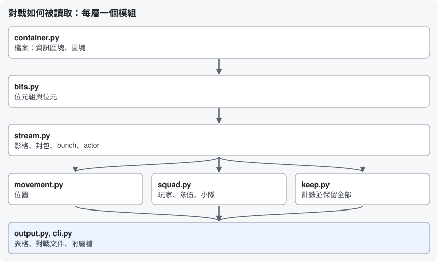

# 對戰如何被讀取 {#how-a-demo-is-read}

簡單來說：Squad 伺服器會把每位玩家的位置傳送給其他所有玩家。對戰檔案就是這些流量的錄製。本工具會把它重新播放，並記下每個人在哪裡。



Unreal 網路對戰檔案是伺服器自己的複製流量，由它的對戰驅動程式寫下來。讀取它，就是像客戶端一樣讀取這些流量。

| 模組 | 層 |
|---|---|
| `container.py` | 本機檔案串流器的檔案：一個資訊區塊（魔術碼 `0x1CA2E27F`），然後是區塊。區塊類型有標頭（`FNetworkDemoHeader`，魔術碼 `0x2CF5A13D`）、複製資料、檢查點與事件。 |
| `bits.py` | 用於影格的位元組陣列，以及用於封包的位元陣列。封包以最低位元優先讀取。 |
| `stream.py` | 影格、封包、bunch（部分 bunch 會被接合）、actor 通道、actor 生成，以及內容區塊。每個區塊包含複製屬性（以 handle、位元數與位元表示）、接著是遠端呼叫與自訂 delta 欄位，它們是指向該類別 `_ClassNetCache` 群組的 handle。匯出資料未指名的物件，會在整場對戰讀完之後才指定其類別（見下文）。 |
| `movement.py` | 引擎的 `FRepMovement`，以及 Squad 的直升機移動。 |
| `keep.py` | 遇到的每一項都會被計數並保留：附屬檔的資料列與自我檢查。 |
| `squad.py` | 哪些 Squad 類別帶有哪些資料。`SQPlayerState` 保存名稱、隊伍狀態、小隊狀態與目前的 pawn；`SQTeamState` 保存隊伍編號與陣營；`SQSquadState` 保存小隊編號。座位 pawn 的擁有者就是它的載具。 |
| `output.py`、`cli.py` | 表格與對戰文件。 |

對戰會自行命名它的欄位。它包含每個 handle 所指的類別路徑與屬性名稱，以及它所參照物件的路徑。因此，不需要遊戲的程式碼，就能依名稱找到每一個屬性。只有屬性的位元需要知道型別。對於移動，那是引擎自己的型別；對於 Squad 的屬性，型別很單純：字串、整數、物件參照與名稱。

有些物件只能靠自身來命名：關卡的 actor 以其實例名稱命名（`Team1SpawnPoint3`），元件則以自己的名稱命名（`MovementComponent`、`wheel_L1`）。它們的類別是在串流之後，從匯出表中找到的：對戰驅動程式會在某個類別的欄位第一次被送出的那個影格中匯出該欄位（在測試對戰中，每個具名物件的第一次送出都是如此），因此該類別就是那個群組：它在這些物件第一次送出它們的影格中，恰好匯出了這些 handle；否則就是任何在當時已擁有其所有 handle 的群組，前提是它們給出的名稱都相同；再不然，就是與該物件同名（去掉數字）的物件的類別，或名稱包含該物件名稱的那個群組。以這種方式命名的物件，其 handle 中，凡是該類別以固定位元數送出的，都是以該位元數送出的（沒有以其他位元數送出的）。以上都無法確定的內容，會完整保留在實體附屬檔中。

## 解碼屬性 {#decoding-properties}

每個複製屬性，都會被解碼到其位元所能說明的程度：一個位元是旗標；名稱以參照的方式結尾（`...State`、`...Seat`、`...Pawn`、`...Class`……）的，是一個物件參照（其網路 GUID）；長度加上對應位元組數的，是字串；名稱，以及 8/16/32/64 位元的數字（屬性名稱表示浮點數時為浮點數：生命值、時間、速率、輸入……）；其他的則以十六進位表示其位元，並附上其中找到的字串。遠端呼叫也以相同方式讀取，依據對戰為每個函式匯出的參數名稱。

## 事件如何被讀取 {#how-the-events-are-read}

士兵的 `Health` 與 `bWounded` 來自伺服器：`bWounded` 開啟時為受傷，關閉且生命值高於 0 時為復活，生命值降至 -100 以下時為死亡（主動放棄或流血至死的玩家會被設為 -300）；從不受傷的機器人則在 0 時死亡。載具或可部署物在其 `Health` 每次下降時為 `damaged`，降至 0 或以下時為 `destroyed`。生成與移除，是 actor 通道的開啟與關閉；座位則是玩家狀態的 `CurrentSeat`（指向座位元件的參照，該元件會隨其載具一起送出）。視角俯仰是士兵的 `RemoteViewPitch`，是一個位元組，從正下方（0）到正上方（255）。射擊是武器的 `MulticastFireProjectile`（起點與方向），若沒有方向相同的此類呼叫，則為其 `MulticastFireMultipleProjectileEffects`；命中則是載具的 `MulticastPlayDamageEffects`（撞擊位置、傷害類型）。

## 驗證了什麼，以及如何驗證 {#what-was-verified-and-how}

這些內容已以兩份公開的 Squad v10.3.1 伺服器對戰檢驗（Unreal Engine 5.5.4，引擎網路版本 36），來源是 squad-replay 專案的測試資料：

- **計數。** 影格、封包、actor 開啟、匯出群組與匯出物件路徑的數量，與該專案獨立的解析器完全一致。士兵移動取樣的數量也一致。
- **移動與速度相比。** 每個士兵取樣相對於前一個取樣的位移，除以兩者之間的時間，與該取樣所帶的速度相符。移動中玩家的中位比值落在 0.8 到 1.2 之間。
- **隊伍與藍圖相比。** 每一列的隊伍，都是該士兵藍圖所屬陣營的那一隊。即使玩家在比賽中換過邊，這點仍然成立。
- **錯誤。** 每場對戰仍有一個串流錯誤：錄製者自己的觀戰者 actor 的開頭 bunch 末尾有一個多出的位元，它所承載的內容在此都未被使用。
- **傷亡與該專案的擊殺相比。** 該專案列出的每一次擊殺，都對應到此處讀到的傷或死，時間相同、玩家相同；它列出的載具擊殺，則對應到此處讀到的、生命值降至 0 或以下的載具。
- **可部署物。** 此處讀到、且帶有建造狀態或 FOB 需求的 actor，與該專案的可部署物相符，誤差在一以內。
- **俯仰。** 視角俯仰位元組在靜止時約為 120，最高達 255（正上方）：以 -90 到 +90 的範圍將它當作位元組讀取。若依引擎通常對一整圈的位元組來讀，士兵會被算成看向地平線以下最多 128 度，而這是他們做不到的。
- **機器人。** 在一場集結對戰中，每個機器人（`SQSquidBot`）都有自己的軌跡，而死亡的機器人則被讀為死亡。
- **直升機移動**（`SQHelicopterMovementComponent.ReplicatedMovement`，Squad 自己的版面：沒有旗標，位置以百分之一為單位，接著是速度與角速度、三個選用的 16 位元角度，以及伺服器時鐘的浮點數）。每一筆直升機取樣都完整填滿其位元。停放中的直升機，其位置與偏航角等於它的生成點，精確到公分與角度單位。飛行中，取樣之間的位移除以時鐘的步進，即為速度（中位比值 0.997）；時鐘隨對戰的時間前進（中位間隔 0.4 毫秒）。角速度與偏航速率相關（相關係數 0.91），但其單位尚未確定：它被保留，但未被使用。
- **座位。** 玩家狀態的 `CurrentSeat` 是一個參照（打包的網路 GUID），而不是先前所讀取的數字：如此讀取時，每次變更都是士兵自己的 `MulticastUpdateCurrentSeat` 在稍早所指定的座位，而這些變更與 squad-replay 的一致。
- **射擊與命中。** 每個 `ShootDir` 都是單位向量（長度 1，誤差在 0.00003 以內）；每個 `MulticastFireMultipleProjectileEffects` 的起點除以 10，會在 1 毫米內等於對應 `MulticastFireProjectile` 的 `OriginZeroBased`；若已知射手或被命中載具的位置，則射擊起點或撞擊點與其位置的中位距離為 0.45 公尺。
- **載具輸入。** 以浮點數讀取時，履帶式載具的油門、煞車與手煞車位於 0..1，轉向位於 -1..1，且出現在每一次更新中。
- **關閉原因。** 每一個通道再次開啟的 actor，都曾以 `Dormancy` 關閉；沒有任何以 `Destroyed` 關閉的 actor 會再次開啟。

測試會以測試自己建立的對戰，涵蓋容器、位元陣列、串流，以及一路到表格的整個流程，並驗證一場包含每種項目各一的對戰不會遺失任何內容（[`tests/test_completeness.py`](https://github.com/Holdi601/3DHeat-Ext-Squad/blob/main/tests/test_completeness.py)）：

```bash
python -m pip install -e .[test]
pytest                                   # synthetic demos
HEAT3D_SQUAD_DEMOS=<folder> pytest       # plus real demos in that folder
```
