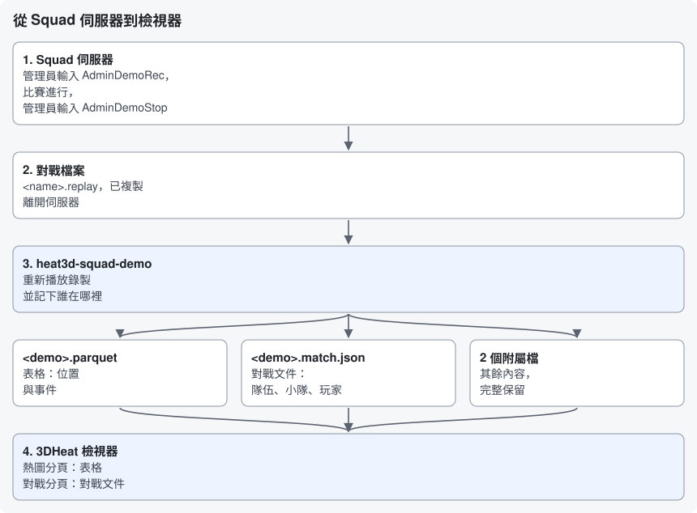

# 3DHeat Squad {#dheat-squad}

**這是什麼？** 一個小程式，能把 Squad 對戰的錄製檔，轉換成 [3DHeat](https://github.com/Holdi601/3DHeat) 檢視器可以繪製的檔案（[說明文件](https://holdi601.github.io/3DHeat/)）：每位玩家在哪裡、每一秒的位置，以及各處發生了什麼事。

**為什麼要用它？** 從上方看一場對戰：戰鬥發生在哪裡、各個小隊走過哪些路線、載具在哪裡被摧毀。

**範例：** `match.replay`（在 Squad 伺服器上錄製的對戰）->
`match.parquet`（每個位置或事件一列）+ `match.match.json`（對戰文件：隊伍、小隊、玩家）。輸出是一般的 Parquet 與 JSON 檔案，因此其他工具也能讀取。

它的用途包括：

- **對戰在哪裡進行。** 每位玩家與機器人的位置，無論是在步行、地面載具或直升機上，大約每秒八次，並附有隊伍、陣營、小隊、生命值與視角俯仰。
- **各處發生了什麼。** 受傷、復活與死亡；每一次射擊，以及每一次對載具的命中；每個載具、可部署物與砲台的生成、受損、摧毀與移除。
- **整場對戰都在一份文件裡。** 隊伍、小隊、遊戲狀態、每個 actor，每位玩家與每個機器人各一行，以及一項自我檢查，確認對戰中的任何內容都沒有遺失。



## 快速開始 {#quick-start}

第一次使用命令列？請先閱讀[開始之前](before-you-start.md)。

```bash
python -m pip install -e .              # installs the heat3d-squad-demo command
heat3d-squad-demo match.replay -o out   # or a folder of .replay files
```

你會看到每場對戰一行。接著在檢視器的熱圖分頁中載入 `out/<map>/<demo>.parquet`（[載入資料](https://holdi601.github.io/3DHeat/getting-data-in.html)）。

## 頁面 {#pages}

| 頁面 | 內容 |
|---|---|
| [開始之前](before-you-start.md) | Python、終端機、第一次執行 |
| [錄製對戰](recording.md) | 讓伺服器寫出對戰檔，並找到它 |
| [轉換對戰](converting.md) | 命令、每個選項、輸出範例 |
| [表格](output-table.md) | 每一欄與每一個 `event` |
| [對戰文件與附屬檔](output-match.md) | `.match.json`、兩個附屬檔、自我檢查 |
| [對戰如何被讀取](how-it-works.md) | 讀取器的各層，以及已驗證的內容 |
| [限制、更新與條款](limits.md) | 未被讀取的內容、Squad 更新可能造成的問題、個人資料、授權 |
| [命令參考](../cli-reference.md) | 每個選項與欄位，由程式碼產生 |
| [維護這些文件](maintaining.md) | 發行檢查清單 |

## 相關連結 {#related}

- 3DHeat 檢視器：[github.com/Holdi601/3DHeat](https://github.com/Holdi601/3DHeat)，
  說明文件位於 [holdi601.github.io/3DHeat](https://holdi601.github.io/3DHeat/)。
- 檢視器所讀取的檔案格式，包括每場對戰一個檔案的容器：[每場對戰一個檔案（.3dheat）](https://holdi601.github.io/3DHeat/container.html)。
  本轉換器寫出的是獨立檔案：表格、對戰文件與其附屬檔並排存放。
- 3DHeat Watcher 安裝後，會對新的對戰執行本轉換器（轉接器 `squad-demos`）：[3DHeat Watcher](https://holdi601.github.io/3DHeat-Watcher/)。

## 3DHeat 工具 {#the-3dheat-tools}

| 工具 | 功能 | 程式碼 | 文件 |
|---|---|---|---|
| 3DHeat 檢視器 | 顯示資料：熱圖、賽車分析、對戰回顧 | [3DHeat](https://github.com/Holdi601/3DHeat) | [文件](https://holdi601.github.io/3DHeat/) |
| GameFiles | 遊戲自身檔案中的關卡與賽道 | [3DHeat-GameFiles](https://github.com/Holdi601/3DHeat-GameFiles) | [文件](https://holdi601.github.io/3DHeat-GameFiles/) |
| GameCapture | 圈速遙測，以及從遊戲影片重建的關卡 | [3DHeat-GameCapture](https://github.com/Holdi601/3DHeat-GameCapture) | [文件](https://holdi601.github.io/3DHeat-GameCapture/) |
| Unreal Exporter | Unreal Editor 外掛：將關卡匯出為一個 `.glb` | [3DHeat-UnrealExporter](https://github.com/Holdi601/3DHeat-UnrealExporter) | [文件](https://holdi601.github.io/3DHeat-UnrealExporter/) |
| CS2 | Counter-Strike 2 的對戰與地圖 | [3DHeat-CS2](https://github.com/Holdi601/3DHeat-CS2) | [文件](https://holdi601.github.io/3DHeat-CS2/) |
| Watcher | 在你遊玩時，記錄遊戲所發布的內容 | [3DHeat-Watcher](https://github.com/Holdi601/3DHeat-Watcher) | [文件](https://holdi601.github.io/3DHeat-Watcher/) |
| Ext-WarThunder | War Thunder 錄影 | [3DHeat-Ext-WarThunder](https://github.com/Holdi601/3DHeat-Ext-WarThunder) | [文件](https://holdi601.github.io/3DHeat-Ext-WarThunder/) |
| Ext-WoT | World of Tanks 錄影 | [3DHeat-Ext-WoT](https://github.com/Holdi601/3DHeat-Ext-WoT) | [文件](https://holdi601.github.io/3DHeat-Ext-WoT/) |
| Ext-WoWs | World of Warships 錄影 | [3DHeat-Ext-WoWs](https://github.com/Holdi601/3DHeat-Ext-WoWs) | [文件](https://holdi601.github.io/3DHeat-Ext-WoWs/) |
| Ext-Squad | Squad 伺服器對戰 | [3DHeat-Ext-Squad](https://github.com/Holdi601/3DHeat-Ext-Squad) | [文件](https://holdi601.github.io/3DHeat-Ext-Squad/) |
| Ext-DCS | 以 3D 關卡呈現的 DCS World 地圖 | [3DHeat-Ext-DCS](https://github.com/Holdi601/3DHeat-Ext-DCS) | [文件](https://holdi601.github.io/3DHeat-Ext-DCS/) |
| Ext-IL2 | 以 3D 關卡呈現的 IL-2 Sturmovik 地圖 | [3DHeat-Ext-IL2](https://github.com/Holdi601/3DHeat-Ext-IL2) | [文件](https://holdi601.github.io/3DHeat-Ext-IL2/) |
