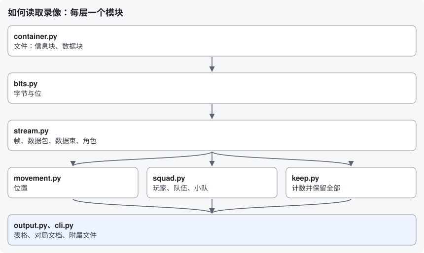

# 如何读取录像 {#how-a-demo-is-read}

简单来说：Squad 服务器会把每个玩家的位置发送给其他所有玩家。录像文件记录的就是这些网络流量。本工具把它重新播放，并记录下每个人所在的位置。



虚幻引擎的网络录像，是服务器自身的复制流量，由它的录像驱动程序写下来。读取它，就相当于像客户端那样读取这些流量。

| 模块 | 层次 |
|---|---|
| `container.py` | 本地文件流的文件：一个信息块（魔数 `0x1CA2E27F`），然后是数据块。数据块类型有：文件头（`FNetworkDemoHeader`，魔数 `0x2CF5A13D`）、回放数据、检查点和事件。 |
| `bits.py` | 用于帧的字节归档和用于数据包的位归档。数据包按最低位优先读取。 |
| `stream.py` | 帧、数据包、数据束（bunch，部分数据束会被拼接起来）、角色通道、角色生成和内容块。每个块包含复制的属性（句柄、位数和位），然后是远程调用和自定义增量字段，它们以句柄的形式指向该类的 `_ClassNetCache` 组。导出表没有命名的对象，会在整个录像读完之后再确定其类（见下文）。 |
| `movement.py` | 引擎的 `FRepMovement`，以及 Squad 的直升机移动数据。 |
| `keep.py` | 遇到的每一项都被计数并保留：附属文件的行和自我检查。 |
| `squad.py` | 哪些 Squad 类携带哪些数据。`SQPlayerState` 保存名称、队伍状态、小队状态和当前操控的角色；`SQTeamState` 保存队伍编号和阵营；`SQSquadState` 保存小队编号。座位上角色的所有者是它的载具。 |
| `output.py`、`cli.py` | 表格和对局文档。 |

录像会自行标注字段名。它为每个句柄提供类路径和属性名，以及它所引用对象的路径。因此，不需要游戏的代码，也能按名称找到每个属性。只有属性的位需要类型信息：对于移动数据，是引擎自己的类型；对于 Squad 的属性，类型都很简单：字符串、整数、对象引用和名称。

有些对象只能通过自身来识别：关卡中的角色通过实例名称（如 `Team1SpawnPoint3`）识别，组件则通过它们自己的名称（如 `MovementComponent`、`wheel_L1`）识别。它们的类是在读完数据流之后，从导出表中找出的：录像驱动程序会在对象的某个属性第一次被发送的那一帧中导出该类的这个属性，因此该类就是在对象首次发送这些句柄的帧中，恰好导出了这些句柄的那一个组（测试录像中，每个具名对象首次发送的情况都是如此）；否则，就是截至那时已经拥有其全部句柄、且所有句柄给出相同名称的任一组；再否则，就是与对象同名的对象的类（忽略数字），或者名称包含该对象名称的那一个组。对于以这种方式命名的对象，如果其类以固定位数发送某个句柄，那么所有这些句柄都带着该位数到达（没有一个带着其他位数）。以上都无法确定的内容，会完整保存在实体附属文件中。

## 解码属性 {#decoding-properties}

每个复制的属性，只要其位能说明它是什么，就会被解码：一位表示标志；当属性名以引用的形式结尾时（`...State`、`...Seat`、`...Pawn`、`...Class`……），就是指向某个对象的引用（其网络 GUID）；长度加上相应字节数表示字符串；名称表示名称；8/16/32/64 位表示数字（当属性名表明它是浮点数时，即生命值、时间、速率、输入等，按浮点数读取）；其他情况则以十六进制保存其位，并附上其中找到的字符串。远程调用也以同样的方式读取，参数名称来自录像为每个函数导出的信息。

## 事件如何被读取 {#how-the-events-are-read}

士兵的 `Health` 和 `bWounded` 来自服务器：当 `bWounded` 打开时为受伤；当它关闭且生命值高于 0 时为救治；当生命值降到 -100 以下时为死亡（一名放弃或流血致死的玩家被设为 -300）；从不受伤的机器人在生命值降到 0 时死亡。每当载具或可部署设备的 `Health` 下降时，记为 `damaged`（受损）；降到 0 或以下时，记为 `destroyed`（摧毁）。生成和移除就是角色通道的打开和关闭；座位则是玩家状态的 `CurrentSeat`（指向座位组件的引用，该组件随其载具发送）。视角俯仰角是士兵的 `RemoteViewPitch`，一个字节，从正下方（0）到正上方（255）。开火是武器的 `MulticastFireProjectile`（起点和方向），如果没有相同方向的此类调用，则使用其 `MulticastFireMultipleProjectileEffects`；击中是载具的 `MulticastPlayDamageEffects`（撞击位置、伤害类型）。

## 验证的内容及方法 {#what-was-verified-and-how}

以下内容已经用两个公开的 Squad v10.3.1 服务器录像（虚幻引擎 5.5.4，引擎网络版本 36）进行了核对，这两个录像来自 squad-replay 项目的测试数据：

- **计数。** 帧、数据包、角色打开次数、导出组数和导出对象路径的数量，与该项目独立的解析器完全一致。士兵移动采样数也一致。
- **移动与速度的对比。** 每个士兵采样相对于前一个采样的位移，除以两者之间的时间，与该采样携带的速度一致。在移动中的玩家身上，中位比值在 0.8 到 1.2 之间。
- **队伍与蓝图的对比。** 每一行的队伍，都是士兵蓝图所属阵营对应的那个队伍。在一名在对局中途换边的玩家身上，这一点同样成立。
- **错误。** 每个录像仍有一个流错误：录制者自身观战角色的开头数据束末尾有一个多余的位，它不携带这里使用的任何内容。
- **伤亡与该项目列出的击杀对比。** 它列出的每一次击杀，都是这里读到的一次受伤或死亡，时间相同，玩家也相同；它列出的载具击毁，都是这里读到的生命值降到 0 或以下的载具。
- **可部署设备。** 这里读到的、带有建造状态或 FOB 要求的角色，与该项目的可部署设备相符，误差在一个以内。
- **俯仰角。** 视角俯仰角字节在静止时约为 120，最高可达 255（正上方）：它按 -90 到 +90 的范围读取为字节。若按引擎通常的整圈字节来读，士兵会被算作能抬头到地平线以下 128 度，而这是他们做不到的。
- **机器人。** 在一个集结（seeding）录像中，每个机器人（`SQSquidBot`）都有自己的轨迹，死亡的机器人被读取为死亡。
- **直升机移动**（`SQHelicopterMovementComponent.ReplicatedMovement`，Squad 自己的布局：没有标志位，位置以百分之一厘米为单位，速度和角速度，三个可选的 16 位角度，以及服务器时钟的浮点数）。每个直升机采样都完整填满了它的位。停放中的直升机，其位置和偏航角与它的生成点一致，精确到厘米和角度单位。飞行中，采样之间的位移除以时钟的步长即为速度（中位比值 0.997），时钟随录像时间前进（中位间隔 0.4 毫秒）。角速度与偏航速率相关（相关系数 0.91），但其单位尚未确定：保留，但不使用。
- **座位。** 玩家状态的 `CurrentSeat` 是一个引用（打包的网络 GUID），而不是之前读取时的数字：按此读取后，每次变化时，它就是士兵自己的 `MulticastUpdateCurrentSeat` 在稍早时刻指明的座位，而这些变化与 squad-replay 的记录一致。
- **开火与击中。** 每个 `ShootDir` 都是单位向量（长度 1，误差在 0.00003 以内）；每个 `MulticastFireMultipleProjectileEffects` 的起点除以 10，与对应 `MulticastFireProjectile` 的 `OriginZeroBased` 相差在 1 毫米以内；在已知射手或被击中载具位置的情况下，射击起点或撞击点与其位置的中位距离为 0.45 米。
- **载具输入。** 按浮点数读取，履带式载具的油门、刹车和手刹在 0 到 1 之间，转向在 -1 到 1 之间，在每一次更新中都是如此。
- **关闭原因。** 每个重新打开的角色通道，都曾以 `Dormancy`（休眠）关闭；没有任何以 `Destroyed`（已销毁）关闭的通道被再次打开。

针对测试自己构建的录像进行的测试，覆盖了容器、字节归档、数据流以及直到表格的整个流程，并验证了包含每种项目各一个的录像不会丢失任何内容（[`tests/test_completeness.py`](https://github.com/Holdi601/3DHeat-Ext-Squad/blob/main/tests/test_completeness.py)）：

```bash
python -m pip install -e .[test]
pytest                                   # 合成录像
HEAT3D_SQUAD_DEMOS=<folder> pytest       # 外加该文件夹中的真实录像
```
