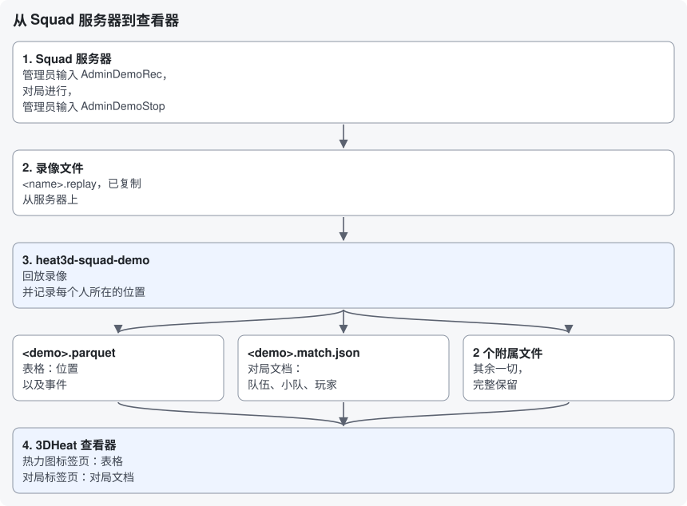

# 3DHeat Squad {#dheat-squad}

**这是什么？** 一个小程序，可以把 Squad 对局的录像转换成 [3DHeat](https://github.com/Holdi601/3DHeat) 查看器（[文档](https://holdi601.github.io/3DHeat/)）能够绘制的文件：每个玩家逐秒所在的位置，以及各处发生了什么。

**我为什么要用它？** 从上方俯瞰整场对局：哪里打得最激烈，各个小队走过哪些路线，载具在哪里被摧毁。

**示例：** `match.replay`（在 Squad 服务器上录制的录像）->
`match.parquet`（每行一个位置或一个事件）+ `match.match.json`（对局文档：队伍、小队、玩家）。输出的是普通的 Parquet 和 JSON 文件，其他程序也能读取。

它的用途包括：

- **对局在哪里交火。** 每个玩家和机器人的位置，包括步行、乘坐地面载具和直升机时的位置，大约每秒八次，并附有队伍、阵营、小队、生命值和视角俯仰角。
- **各处发生了什么。** 受伤、救治和死亡；每一次开火和每一次击中载具的命中；每一辆载具、可部署设备和炮位的生成、受损、摧毁和移除。
- **整场对局汇集在一个文档里。** 队伍、小队、游戏状态、每个角色、每个玩家和每个机器人各占一行，并有一项自我检查，确认录像中的内容没有丢失。



## 快速开始 {#quick-start}

第一次使用命令行？请先阅读 [开始之前](before-you-start.md)。

```bash
python -m pip install -e .              # 安装 heat3d-squad-demo 命令
heat3d-squad-demo match.replay -o out   # 或者指定一个包含 .replay 文件的文件夹
```

每个录像会输出一行信息。然后在查看器的热力图标签页中加载 `out/<map>/<demo>.parquet`（[数据导入](https://holdi601.github.io/3DHeat/getting-data-in.html)）。

## 页面 {#pages}

| 页面 | 内容 |
|---|---|
| [开始之前](before-you-start.md) | Python、终端和第一次运行 |
| [录制录像](recording.md) | 让服务器录制录像，以及找到它 |
| [转换录像](converting.md) | 命令、每个选项和示例输出 |
| [表格](output-table.md) | 每一列和每一种 `event` |
| [对局文档和附属文件](output-match.md) | `.match.json`、两个附属文件和自我检查 |
| [如何读取录像](how-it-works.md) | 读取器的各个层次，以及已验证的内容 |
| [限制、更新与条款](limits.md) | 没有读取的内容、Squad 更新可能带来的问题、个人数据、许可证 |
| [命令参考](../cli-reference.md) | 每个选项和每一列，由代码生成 |
| [维护这些文档](maintaining.md) | 发布检查清单 |

## 相关内容 {#related}

- 3DHeat 查看器：[github.com/Holdi601/3DHeat](https://github.com/Holdi601/3DHeat)，
  文档位于 [holdi601.github.io/3DHeat](https://holdi601.github.io/3DHeat/)。
- 查看器能读取的文件格式，包括一场对局一个文件的容器格式：[一场对局一个文件（.3dheat）](https://holdi601.github.io/3DHeat/container.html)。
  本转换器输出的是散开的文件：表格、对局文档及其附属文件并排存放。
- 安装后，3DHeat Watcher 会对新录像运行本转换器（适配器 `squad-demos`）：[3DHeat Watcher](https://holdi601.github.io/3DHeat-Watcher/)。
- 每个游戏读取器都是一个独立的小项目，有自己的许可证文件、发布版本和问题跟踪器，因此可以单独安装、更新、维护，也可以应权利人的要求单独撤下，而不影响查看器或其他工具。

## 3DHeat 工具 {#the-3dheat-tools}

| 工具 | 作用 | 代码 | 文档 |
|---|---|---|---|
| 3DHeat 查看器 | 显示数据：热力图、赛车分析、对局回顾 | [3DHeat](https://github.com/Holdi601/3DHeat) | [文档](https://holdi601.github.io/3DHeat/) |
| GameFiles | 从游戏自身文件中提取关卡和赛道 | [3DHeat-GameFiles](https://github.com/Holdi601/3DHeat-GameFiles) | [文档](https://holdi601.github.io/3DHeat-GameFiles/) |
| GameCapture | 圈速遥测，以及从游戏录像重建的关卡 | [3DHeat-GameCapture](https://github.com/Holdi601/3DHeat-GameCapture) | [文档](https://holdi601.github.io/3DHeat-GameCapture/) |
| Unreal Exporter | 虚幻编辑器插件：把一个关卡导出为一个 `.glb` | [3DHeat-UnrealExporter](https://github.com/Holdi601/3DHeat-UnrealExporter) | [文档](https://holdi601.github.io/3DHeat-UnrealExporter/) |
| CS2 | 反恐精英 2 的录像和地图 | [3DHeat-CS2](https://github.com/Holdi601/3DHeat-CS2) | [文档](https://holdi601.github.io/3DHeat-CS2/) |
| Watcher | 在你游玩时记录游戏公开的数据 | [3DHeat-Watcher](https://github.com/Holdi601/3DHeat-Watcher) | [文档](https://holdi601.github.io/3DHeat-Watcher/) |
| Ext-WarThunder | 战争雷霆的录像 | [3DHeat-Ext-WarThunder](https://github.com/Holdi601/3DHeat-Ext-WarThunder) | [文档](https://holdi601.github.io/3DHeat-Ext-WarThunder/) |
| Ext-WoT | 坦克世界的录像 | [3DHeat-Ext-WoT](https://github.com/Holdi601/3DHeat-Ext-WoT) | [文档](https://holdi601.github.io/3DHeat-Ext-WoT/) |
| Ext-WoWs | 战舰世界的录像 | [3DHeat-Ext-WoWs](https://github.com/Holdi601/3DHeat-Ext-WoWs) | [文档](https://holdi601.github.io/3DHeat-Ext-WoWs/) |
| Ext-Squad | Squad 服务器录像 | [3DHeat-Ext-Squad](https://github.com/Holdi601/3DHeat-Ext-Squad) | [文档](https://holdi601.github.io/3DHeat-Ext-Squad/) |
| Ext-DCS | DCS World 地图，作为 3D 关卡 | [3DHeat-Ext-DCS](https://github.com/Holdi601/3DHeat-Ext-DCS) | [文档](https://holdi601.github.io/3DHeat-Ext-DCS/) |
| Ext-IL2 | IL-2 Sturmovik 地图，作为 3D 关卡 | [3DHeat-Ext-IL2](https://github.com/Holdi601/3DHeat-Ext-IL2) | [文档](https://holdi601.github.io/3DHeat-Ext-IL2/) |
